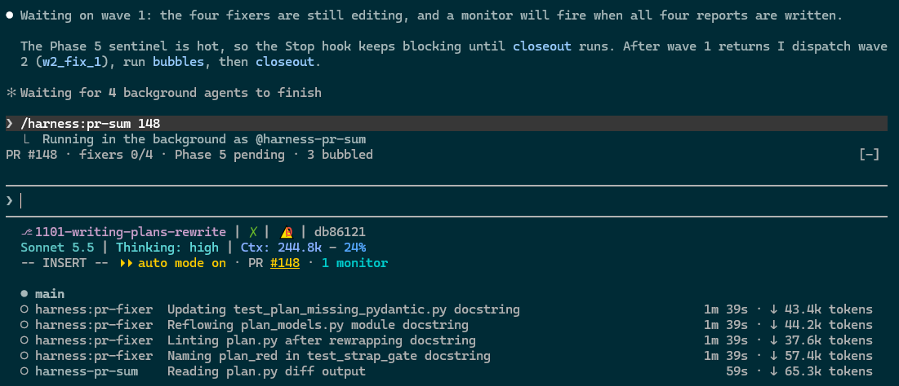

# `operator-straps`

[](https://github.com/t968rs/operator-straps/actions/workflows/ci.yml)
[](https://github.com/t968rs/operator-straps/actions/workflows/pylint.yml)
**Give Claude Code a repeatable process for reviewing PRs, applying fixes, and preparing changes for handoff.**

Install the workflows you need: review a PR with multiple agents, carry findings through fix waves and closeout,
draft commit messages and PR summaries from the diff, or start work in an isolated worktree. Add optional plugins
to track review progress, keep Git state visible, preserve context through compaction, and scope pytest runs.

[Choose a workflow](#what-you-can-do) · [Install](#install) · [Configure a project](#configure-a-project)

## What you can do



| Your goal                 | Use                                                 | What you get                                                                                                                                                                                                                      | Agent 'Ensurance'                                                                                                                                                                                                                                                                                                                                                                                                                                                                                                                               |
|---------------------------|-----------------------------------------------------|-----------------------------------------------------------------------------------------------------------------------------------------------------------------------------------------------------------------------------------|-------------------------------------------------------------------------------------------------------------------------------------------------------------------------------------------------------------------------------------------------------------------------------------------------------------------------------------------------------------------------------------------------------------------------------------------------------------------------------------------------------------------------------------------------|
| Review a PR               | `pr-review` or `pr-team`                            | Multiple reviewers, a consolidated review, branch checks before fixes, and fix waves with recorded resolutions.                                                                                                                   | • Configured agent-use Python runtime via `hpy`.<br>• Branch checks before fixes; schema validation on review writes.<br>• `Stop` hook blocks a stop attempt while the review session has an active Phase 5 sentinel.                                                                                                                                                                                                                                                                                                                           |
| Review a branch, no PR    | `review-local`                                      | The pr-review procedure over a committed `BASE..HEAD` range: reviewers, `LOCAL_<label>_<slug>.json` verdict, fix waves. `READY TO MERGE` reads "ready to open the PR".                                                            | • `capture --range` reads git, never gh.<br>• Phase 4 checks the captured branch, clean tree and ancestry from `plan.json`.<br>• Same Phase 5 sentinel and `Stop` hook as `pr-review`.                                                                                                                                                                                                                                                                                                                                                         |
| Commit message, single    | `c-msg`                                             | One message for everything that differs from HEAD (staged, unstaged, untracked), saved as `<branch>_pending.txt`. `/harness:c-msg <change>` rewrites the saved message.                                                           | • One capture call saves the skeleton and prints a size-budgeted diff, the agent's whole input.<br>• Build checks file coverage and message format before saving the draft.<br>• A matching carried draft or a canned message is kept unless a change is asked.                                                                                                                                                                                                                                                                                 |
| Commit message, range     | `branch-commit-msg`                                 | The branch broken into ordered commits (a block per module with its tests, then Docs, Planning and artifacts), saved as `<branch>.txt`. `--base REF` drafts against another base; `--merge-msg` adds the PR merge message.        | • The script buckets, pairs and orders the blocks; the agent reviews the plan and writes messages.<br>• Build rejects a dropped or duplicated path and format defects.<br>• An existing TXT carries forward; a replaced one is kept as `.txt.bak`.                                                                                                                                                                                                                                                                                              |
| Change message            | `amend-commit-msg`                                  | Amendment of message breakdown (rewritten messages, files moved between blocks).                                                                                                                                                  | • Configured Python runtime via `hpy`.<br>• Build checks file coverage and message format before saving the draft.                                                                                                                                                                                                                                                                                                                                                                                                                              |
| Merge message, PR         | `merge-commit-msg`                                  | A squash-merge subject and body for an open PR, saved as `PR<N>_merge.txt`, ready to paste into the merge UI or `gh pr merge`.                                                                                                    | • Capture prints the PR facts, size-capped diffs and a skeleton with subject, lineage and review lines filled; nothing is written before build.<br>• Build reads the title from `gh` again and rejects a changed subject, placeholders and filler.<br>• A guard hook denies hand edits of the saved TXT.                                                                                                                                                                                                                                        |
| Write PR Summary          | `pr-sum`                                            | A summary grounded in PR metadata and the diff. <br/>`--level 1\|2\|3` sets how much it draws (1 prose only, 2 flows and Changed Symbols, the default, 3 more diagram types)                                                      | • Script captures PR metadata, commits, file lists, and counts.<br>• Build requires a title, summary, and descriptions covering the listed non-artifact files.                                                                                                                                                                                                                                                                                                                                                                                  |
| Plan multi-step work      | `write-plan`                                        | An `ActionPlan` JSON whose claims about the code become script-enforced validation anchors, test files planned as real files, a PIP rendered from the JSON, and `parallel2` lanes for its open items.                             | • `check` opens every cited line range, reruns every search, and rejects hard-coded commit SHAs, pytest runs of directories and values that assume a rejected option.<br>• `red` runs the planned tests in a throwaway worktree; each must fail with its planned exception.<br>• `freeze` refuses open decisions, items nothing proves and red failures; later edits are detected.<br>• `record` runs the item's tests on a throwaway worktree at the commit or the index before marking it COMPLETE, and seals each status it writes; on a plan frozen with the record scheme, `check` refuses a status without a sealed record; a plan frozen before it still accepts the old `record --sha` shapes.<br>• `verify` reruns the COMPLETE items' tests at HEAD before the merge, writing nothing.<br>• `record` writes a sealed receipt beside the frozen plan, and the PIP is an HTML page with a derived `live.js` sidecar; the `.gitignore` the driver writes in each plan folder keeps the sidecar out of git. |
| New skill, proven test-first | `strap-skills`                                   | A project skill under `<skills_dir>/<name>/` (the default `strap.target`) or a harness plugin skill under `plugins/harness/skills/<name>/`, with its SKILL.md, models, api and a contract test scaffolded from templates, plus judgment behaviors drawn, run and graded through scenario agents before the spec freezes.       | • `freeze` refuses until each judgment behavior has a failing baseline, a passing green and a grade that quotes the reply.<br>• Drawn scenarios are locked: a behavior's scenarios, kind and type cannot change after its first draw.<br>• A SKILL.md fix needs a retest on its new content hash before the skill can freeze.<br>• Mechanical behaviors must fail as planned before freeze.<br>• A frozen spec takes part edits and green runs only; `freeze --refreeze` restamps the hash after every gate passes again. Behaviors, scenarios, draws and `retest` stay locked.                                                                                                                                                     |
| Docstrings by tier        | `writing-docstrings`                                | Python docstrings in one of three layouts (brief, compact, full), the tier stated per symbol before it is written, from the convention in the skill folder.                                                                     | • The session turns the request into arguments and dispatches `harness:docstring-writer`, which measures with the tier command (body lines, forks, suggested tier, current layout, format flags such as long lines against `docstrings.line_length`, single backticks, citations, label order, full-layout parameter items and underlines) and writes the docstrings.<br>• `--include-new` / `-in` adds docstrings to undocumented functions; without it they are listed, not written.<br>• `--parallel` / `-p` runs one agent per file after a tool probe.<br>• Docstrings already in layout stay. |
| Generate Issue Memo       | `bubble-memo`                                       | A memo, `PR_<N>_Bubbles.md`, with an index and one short entry per bubbled issue (description, recommendation, checked references), saved in your project's reviews folder.                                                       | • Driver proves every bubbled issue has an entry and checks each reference against the working tree.<br>• The memo is a snapshot; decisions are stamped in by `bubble-stamp`, never written by the skill.                                                                                                                                                                                                                                                                                                                                       |
| Isolated task's checkout  | `d-w`                                               | A detached-HEAD worktree cut from HEAD, an integration branch, or another ref.                                                                                                                                                    | • Script resolves the base ref to a commit and creates a detached worktree.<br>• Failed integration-branch fetches stop creation; directory collisions get a fresh path.<br>• Runs the project's configured `worktree_setup`, then `worktree_baseline`, in the new worktree; failures are reported, never fatal, and `--no-setup` skips both.<br>• Warns when run from a linked worktree.                                                                                                                                                       |
| Diagnose `harness`        | `doctor`                                            | A read-only report on the interpreter `hpy` picks, the three Python modules, `git`, `gh` and `.claude/harness.json`, each marked `ok`, `warn` or `fail`, with the fix beside every failure.                                       | • Standard library only, so it runs when `pydantic`, `jsonschema` or `referencing` are missing.<br>• Installs nothing and writes nothing; the install line is for you to run, naming the interpreter `hpy` uses.                                                                                                                                                                                                                                                                                                                                |
| (Re)Attach Worktree       | `a-w`                                               | The work from a `d-w` worktree lands on the branch you name, <br/>staged and uncommitted or as its own commits (`--committed`), and the worktree is removed.                                                                      | • Script requires the target branch checked out with no tracked changes.<br>• Staging merges three-way; `--committed` fast-forwards only. A refusal changes nothing; a three-way conflict keeps the worktree (files and index) and leaves markers in the target checkout, with the commands to finish or undo.                                                                                                                                                                                                                                  |
| Add a TODO note           | `add-todo`                                          | One ranked catalog item from a note typed after `--`, researched to the level `-r 0-3` asks; local-only, or backed by a new GitHub issue with `--issue`.                                                                          | • Active only when `.claude/harness.json` sets `todo.folder`.<br>• The main session only prints the dispatch row and adds the conversation's context; the `todo-editor` agent researches and drafts, and the script scores, ranks and (with `--issue`) files the issue after the spec validates.                                                                                                                                                                                                                                                  |
| Create TODO               | `sync-gh-todo`                                      | One drafted, ranked catalog item per open GitHub issue no catalog record mentions, then ranked among the existing items; no id changes.                                                                                           | • Active only when `.claude/harness.json` sets `todo.folder`.<br>• `gh` lists the issues; the script refuses an issue the catalog already records, scores and ranks the items, and `check` runs after the edit.                                                                                                                                                                                                                                                                                                                                 |
| ArcGIS toolbox help       | `arc-straps`                                        | `arc-meta` checks each tool's canonical help XML against its parameters, and the `.atbx` archive's hover text and "?" page against that XML; it applies the hover text, the page and the toolbox-level help, dry run first. `arc-help-pages` builds each tool's linked help page from a fragment and that XML, and checks the page and the tool's link targets. Paths come from `plugins.arc-straps` in `.claude/harness.json`. | • The checks and the apply writers share one generator, so a passing `check_applied` means the tool's hover text and "?" page hold what an apply writes; a reference to a key the rc lacks, or a literal description in `tool.content`, is left alone by the writer and keeps it failing.<br>• An apply writes a temp copy, validates it, then copies the original to `<archive>.bak` and swaps the copy in; a failed validation leaves the archive and any older `.bak` unchanged.<br>• Python runs through `harness-skill-api` (needs `harness` 0.56.0 or later); ArcGIS Pro is not needed. |
| Banner Config             | `banner-status`: `setup-statusline`, or `band-line` | Options: (1) ccstatusline as the project's status line (needs Node.js and npm; `setup-statusline` offers the install)<br/>(2) `band-line`: an `oStraps:` band above the prompt with the model and context window, no npm install. | • The skill writes `.claude/settings.json` `statusLine` and `.claude/ccstatusline.json` only after the user approves each edit.<br>• `band-line` reads the `git-status` snapshot; neither draws without `git-status`.                                                                                                                                                                                                                                                                                                                           |

## Bundled Mods and Dashboard Views
| Goal                    | Where             | Mods               | Description                                                                                                                                                                                          | Notes                                                                                                                                                                                                                                                                                                                                                     |
|-------------------------|-------------------|--------------------|------------------------------------------------------------------------------------------------------------------------------------------------------------------------------------------------------|-----------------------------------------------------------------------------------------------------------------------------------------------------------------------------------------------------------------------------------------------------------------------------------------------------------------------------------------------------------|
| Project TODO            | Banner-Visible    | `todo-watch`       | The next TODO items and a live sync status line in a band above the prompt (kept until dismissed), a `TODO_SYNC` drift line in prompt context, and `/todo` with the top items and every finding.     | • Active only when `.claude/harness.json` sets `todo.folder`.<br>• Watched-file edits re-run the harness `todo_sync` checks; every hook fails open.                                                                                                                                                                                                       |
| PR Review Status        | Banner-Visible    | `agent-watcher`  | A review progress band, pending-fix context, reviewer matrix rows and a per-agent usage log (every Agent dispatch, of this marketplace's agents, built-ins or other plugins' agents, and every forked (`context: fork`) skill run), and a Stop guard for unrecorded escalated issues. | • `Stop` guard checks that escalated issues are recorded in the review.<br>• Usage rows come from engine measurements and must pass schema validation before append.                                                                                                                                                                                      |
| Branch Info             | Banner-Visible    | `git-status`       | Git state checked on each prompt, changed state added as `GIT_STATE` context, and a fallback Git status line.                                                                                        | • Prompt hooks recheck Git state and inject changed state.<br>• Git context is reinjected after clear, resume, or main-conversation compaction.<br>• The fallback line gives way to ccstatusline or `band-line`.                                                                                                                                          |
| Enforce Python Test env | Automatic         | `pytest-scope`     | Rewrites bare `pytest` to your chosen interpreter and rejects runs with no explicit test file or node ID.                                                                                            | • Rewrites recognized pytest commands only when `python` is set.<br>• Rejects broad runs when `require_test_file=true`; `/pytest-broad-ok` allows one override.                                                                                                                                                                                           |
| Post-Compaction Context | Automatic         | `session-bookmark` | Git state, recent prompts and your session notes, kept through compaction.                                                                                                                           | • Hooks capture git state, the last three prompts, stored notes and `/compact` instructions.<br>• The bookmark is appended to the compacted transcript and kept in session state.<br>• The session writes each note, resolving a reference such as "the current status" into the facts it stands for; a script stores it (20 notes, 300 characters each). |
| Parallel Lane Status    | Banner-Visible    | `parallel2-lanes`  | A `parallel2` lane's `Agent` spawn starts with its brief in the prompt, the plan's model and its worktree as working directory; a band lists each run's lanes with their status and agent phase. | • Reads the run state `parallel2.py` writes; needs no config key.<br>• A call naming another model is rewritten to the plan's, with a toast; anything unreadable passes the spawn through unchanged.                                                                                                                                                                              |
| Bubble Memo Stamps      | Automatic + Toast | `bubble-stamp`     | Stamps each decision in the review JSON (`RESOLVED`, `CLOSED_NO_ACTION`) into the memo's index and entry; a toast names the ids.                                                                     | • Active only in projects with `.claude/harness.json`.<br>• Runs on session start, `pr_review.py` and `review_edit.py` calls, review JSON edits and turn end; a rerun changes nothing, and every hook fails open.                                                                                                                                         |

## Agent process standardization

`harness` packages the procedure as skills, scripts, agents and hooks. Set the test layout, guard suites, base
branch and output folders once in `.claude/harness.json`; every run then follows the same process.

For example, a PR review follows five phases:

```mermaid
flowchart LR
    accTitle: Agent process standardization for PR review
    accDescr: Project configuration supplies guards, branch rules, and output paths to a shared five-phase process. Capture and guards lead to reviewers, consolidated findings, branch verification, then fix waves and closeout. The review and resolutions are saved in the consuming project.
    config["Project configuration<br/>.claude/harness.json"]
    capture["1 · Capture<br/>PR facts + guards"]
    review["2 · Review<br/>Scoped reviewers"]
    findings["3 · Consolidate<br/>Findings + verdict"]
    safety["4 · Verify branch<br/>Before code changes"]
    fixes["5 · Fix + close out<br/>Waves + resolutions"]
    artifacts["Project artifacts<br/>Review + resolution record"]

    capture --> review --> findings --> safety --> fixes
    config -. "guard suites" .-> capture
    config -. "branch rules" .-> safety
    config -. "output paths" .-> artifacts
    findings --> artifacts
    fixes --> artifacts

    classDef settings fill:#eef2ff,stroke:#6366f1,color:#1e1b4b
    classDef process fill:#f0fdfa,stroke:#0f766e,color:#134e4a
    classDef gate fill:#fff7ed,stroke:#c2410c,color:#7c2d12
    classDef result fill:#eff6ff,stroke:#2563eb,color:#1e3a8a
    class config settings
    class capture,review,findings,fixes process
    class safety gate
    class artifacts result
```



Skills define the steps, scripts validate review artifacts, hooks check workflow conditions. Branch safety is
checked right before fixes, ambiguous issues go to you, and closeout records each finding's outcome. Review data
stays in your project; plugin code stays in its cache.

The companion plugins install separately and stand alone, except that `band-line` reads `git-status`'s snapshot
(it lists `git-status` as a dependency), and `arc-straps` needs `harness`: it runs its Python through
`harness-skill-api` (it lists `harness` 0.56.0 or later as a dependency). The ccstatusline line from
`banner-status` replaces `git-status`'s own line only when ccstatusline is installed, and installing
`banner-status` does not install it: run `/banner-status:setup-statusline`, which offers
`npm install -g ccstatusline@~2.2.32` (Node.js and npm required), or run that command first. Until then
`git-status` draws its fallback line.

- `agent-watcher` and `bubble-stamp` are active only in projects with `.claude/harness.json`.
- `parallel2-lanes` acts only on `Agent` calls that open with a `parallel2` dispatch row's `Brief:` line.
- `todo-watch` is active only when `.claude/harness.json` sets `todo.folder`.
- `pytest-scope` takes effect only when one of its options is set.

## Install

For the review, commit, summary, and worktree workflows, install `harness`:

```sh
claude plugin marketplace add t968rs/operator-straps
claude plugin install harness@operator-straps
```

Renamed from `pr-review-watch` (0.6.0): enable `agent-watcher@operator-straps` and drop the old key. The usage
log default is now `docs/_harness/agent_usage.jsonl` (`git mv` the old log, or set `agent_usage_path`).

Add any companion plugins you want:

```sh
claude plugin install agent-watcher@operator-straps
claude plugin install git-status@operator-straps
claude plugin install banner-status@operator-straps
claude plugin install band-line@operator-straps
claude plugin install session-bookmark@operator-straps
claude plugin install pytest-scope@operator-straps --config python=C:/path/to/env/python.exe --config require_test_file=true
claude plugin install todo-watch@operator-straps
claude plugin install bubble-stamp@operator-straps
claude plugin install parallel2-lanes@operator-straps
claude plugin install arc-straps@operator-straps
```

After configuring your project below, open Claude Code in that repository and invoke a workflow, for example:

```text
/harness:pr-review 123
/harness:c-msg
/harness:pr-sum 123
/harness:d-w HEAD
/harness:a-w my-branch --committed
/harness:a-w HEAD
/harness:add-bookmark keep the public API frozen until PR 60 merges
```

Replace `123` with your PR number. `pr-review` runs the full review-and-fix workflow. `c-msg` and `pr-sum` save
drafts in the configured artifact folders. `/harness:c-msg <change>` rewrites the saved pending message; a bare
`/harness:c-msg` rerun leaves a carried or canned message as it stands.

### add-bookmark

`/harness:add-bookmark` stores notes that survive compaction. The session-bookmark mod prints them above the
`/compact` instructions, so a constraint or reminder stays visible after the summary.

```text
/harness:add-bookmark keep the public API frozen until PR 60 merges
/harness:add-bookmark --list
/harness:add-bookmark --clear
```

| Form                                     | Effect                                      |
|------------------------------------------|---------------------------------------------|
| `/harness:add-bookmark [--] <note text>` | Store one note (a leading `--` is optional) |
| `/harness:add-bookmark --list`           | Print the stored notes, numbered            |
| `/harness:add-bookmark --clear`          | Drop every stored note                      |

- The session that runs the command writes the stored line, so a note that points at the conversation
  (`the current status of the banner options`, `what we built`) is stored as the branch, versions, ids and
  pending checks it refers to. Text that stands alone is stored as written, apart from quoting and length.
- At most 20 notes; `--clear` frees the slots. A note over 300 characters, or a blank one, is refused.
- Notes live in `session-bookmark/notes.json` under `state_dir` (default `.claude/state/harness`); gitignore that
  folder like the other runtime state.
- The file is versioned (`"version": 1`). A file that is not JSON or has another version is refused, not
  overwritten; `--clear` resets it.
- What the bookmark prints and how the mod reads the notes: `plugins/session-bookmark/README.md`.

### Guidance after `--`

Every user-invocable harness skill accepts free-text guidance after a standalone `--` token, next to its own
arguments:

```text
/harness:pr-review 106 --no-fetch -- look hard at the Windows path handling in lib/
/harness:d-w main -- the work is the open-args fix; touch only plugins/harness/skills/
```

- Split rule and limits: `plugins/harness/reference/skill_arguments.md`. Text before the token is the skill's own
  arguments, text after it is guidance. Guidance never reaches a command line and never waives a skill rule, a
  harness rule or the project's CLAUDE.md.
- Skills whose whole argument is free text (`c-msg`, `check-runlogs`, `add-bookmark`) take a leading `--` as
  optional. `fold-in-review` looks for the token on the last line only, since pasted output holds `--` lines.
- `pr-review` forwards guidance to every reviewer and fixer prompt, `pr-team` to each reviewer prompt file,
  `roast-my-code` to the roast agent; the other skills apply it in the main session or fork.
- `tests/skills/test_skill_guidance_tail_contract.py` pins the hint, the pointer to the reference and the absence
  of `$ARGUMENTS` from fenced commands for each skill, and fails on an unclassified new skill.

### c-msg

`/harness:c-msg` drafts one commit message for the pending change: everything that differs from HEAD, staged,
unstaged and untracked. It runs as a fork of the `harness:messenger` agent.

```text
/harness:c-msg
/harness:c-msg -- name the retry limit in the subject
```

- `branch_commit_msg.py capture --pending --save --diff` saves the skeleton and prints the block's diff in one
  call; that output is the agent's whole input. A path over its budget prints as a summary (a hunk outline, a
  head with the definitions past it, or JSON key tallies).
- `message <skeleton> --block 1 --build` sets the message from stdin and writes `<branch>_pending.txt` in the
  commit_messages directory, with `Merge base:` set to HEAD. The branch ledger `<branch>.txt` is never touched,
  and files under the commit_messages directory are not part of the pending change.
- A bare rerun keeps a carried draft that still matches the diff, and a canned message, as they stand. Text after
  the command (a leading `--` is optional) is a change to the saved message.

### branch-commit-msg

`/harness:branch-commit-msg` breaks everything on the branch into Conventional Commits. The plan assumes the
developer mixed-resets the branch to its merge base and re-commits it block by block, so every path lands in
exactly one block and every block is a bisect point.

```text
/harness:branch-commit-msg
/harness:branch-commit-msg --base 3b5d53a
/harness:branch-commit-msg --fresh -- keep the hook change apart from the driver
/harness:branch-commit-msg --merge-msg
```

| Arguments                  | Writes                  | Plan                                                                                  |
|----------------------------|-------------------------|---------------------------------------------------------------------------------------|
| none                       | `<branch>.txt`          | whole branch against `base_branch` (else `origin/HEAD`); the existing TXT carries forward |
| `--fresh`                  | `<branch>.txt`          | whole branch regrouped from the rules; carried messages dropped (canned ones refill)  |
| `--base REF` or bare `REF` | `<branch>_<sha7>.txt`   | paths that differ from REF; the branch TXT is never overwritten                       |
| `--merge-msg`              | also `PR<N>_merge.txt`  | after the build, runs `merge-commit-msg` for the branch's open PR                     |

- The script groups the plan: the test registry first, one block per source module with its tests, then one
  Docs block, one Planning block and the artifacts last. The agent changes it only for an ordering dependency or
  a RESTRUCTURE review verdict, and records the reason in the skeleton's `split`.
- `diff <skeleton> --block N ...` prints every block that needs a message in one call, within per-block line and
  character budgets; `message <skeleton> --all` sets them all from one stdin text.
- `build` rejects a dropped or duplicated path and the format defects named in
  `plugins/harness/reference/commit_format.md`; a replaced TXT is kept as `.txt.bak`. Change a drafted TXT with
  `amend-commit-msg` instead of a redraft. `--no-fetch` skips fetching the base branch.

### amend-commit-msg

`/harness:amend-commit-msg` amends the breakdown `branch-commit-msg` drafted instead of redrafting it. The session
that runs it knows what changed since the draft; the forked `branch-commit-msg` agent does not.

```text
/harness:amend-commit-msg -- the review fixes landed; restate blocks 2 and 3
/harness:amend-commit-msg --base 3b5d53a -- move tests/test_x.py into the runtime block
```

- Arguments before the first standalone `--` (at the start, or spaced on both sides) are the `branch-commit-msg`
  capture arguments (`REF`, `--base REF`, `--no-fetch`) and name the TXT to amend; text after it says what to
  change. `--fresh` and `--pending` are refused.
- A missing TXT is an error (`no TXT to amend: <path>`), never a silent redraft. A `--base` amendment needs the
  `<branch>_<sha7>.txt` of that base, and the ref must resolve now to the drafted base (the sha7 in the TXT name).
  Pass that SHA or a branch name; a relative ref such as `HEAD~3` moves as commits land.
- `branch_commit_msg.py move` shifts files between blocks and carries each file's `file: what changed` bullet. An
  amendment build rejects a bullet that names a file of another block.
- Messages are set with `branch_commit_msg.py message FILE --all` (one stdin text, a `##### block N #####` line
  before each message; `--block N` sets one), not with Edit. The run prints only the receipt. `diff FILE --all`
  reads every block in one call; repeated `--block N` reads the named blocks.
- The replaced TXT is kept as `<name>.txt.bak`, one generation.

### merge-commit-msg

`/harness:merge-commit-msg <PR>` drafts the merge subject and body for an open PR, ready to paste into the
merge UI or `gh pr merge`. Squash mode (`--squash`, `-s` or a bare `squash` after the PR number) drafts the
squash-merge commit instead.

```text
/harness:merge-commit-msg 123
/harness:merge-commit-msg 123 --squash
/harness:merge-commit-msg 123 --squash --auto-title
/harness:merge-commit-msg 123 -- lead with the hook change
```

- `capture <PR>` prints the PR's facts, changed files, size-capped diffs, commits and a message skeleton, and
  writes nothing. The subject (`Merge PR #N -- <title>`, or `<title> (#N)` in squash mode), `Branch lineage:`
  and, when a review JSON exists, the review-artifact and review-fix lines come filled. Squash mode needs a
  `Word(scope): summary` PR title (a word, an optional scope, a colon and a non-empty summary; the word is
  not checked against the commit types); any other title stops the run. With `--auto-title` it does not:
  the agent writes a compliant title and `retitle <PR> --title` sets it with `gh pr edit`. A usable title is
  never replaced. `pr-sum --auto-title` sets the summary's title at `build` whenever the PR title is not a
  `Word(scope): summary` subject, in either mode. `"auto_title": true` in `.claude/harness.json` turns
  `--auto-title` on for every capture of both skills; `--no-auto-title` turns it off for one run.
- The agent replaces the prose and bullet placeholders (format: `plugins/harness/skills/merge-commit-msg/message_format.md`)
  and passes the whole message to `build <PR>` on stdin.
- `build` reads the title from `gh` again and rejects a changed subject, a leftover placeholder, an indented line,
  filler words, commit SHAs and vendor names. Clean, it writes `PR<N>_merge.txt` and keeps a replaced copy as
  `.txt.bak`. A PR that is no longer open, or a `gh` failure, stops the run. Without `--squash`, `build`
  accepts either exact subject and applies that subject's mode, so a rebuild from a saved TXT needs no flag.
- To change a saved message, rerun `build` with `PR<N>_merge.txt`, changed as asked, on stdin. A rerun of
  `capture` would replace the prose.

### Canned commit messages

A change made only of generated files whose message never varies skips drafting: `capture` fills the block with a
canned message, and `build` still checks it.

```text
changed files ──► every file fits one entry's patterns? ──no──► drafted as usual
                              │yes
                              ▼
                  block message = that entry's canned message
```

| Entry (`lib/harness_lib/canned_messages.py`) | Patterns                                                                                     | Message                                                           |
|----------------------------------------------|----------------------------------------------------------------------------------------------|-------------------------------------------------------------------|
| TODO sync files                              | `_IMPL_TODO.md`, `RepoToDo.json`, `ResearchImplementationCatalog.json`, `TODO_Snapshot_*.md` | `Chore(todo): refresh TODO catalog, research stubs and snapshot`  |
| Review artifacts                             | `docs/PR_REVIEWS/*.json`, `docs/PR_SUMMARIES/*.md`, the two `pr_review_*.jsonl` run logs     | `Chore(reviews): record PR review, summary and run-log artifacts` |

- A change may use only some of an entry's files; a file outside the entry, or files from two entries, gives no
  canned message. A pattern with a `/` matches the whole path, any other the file name.
- `c-msg`, `branch-commit-msg` and `amend-commit-msg` keep a prefilled message as it stands, unless the developer
  asks for a change (`/harness:c-msg <change>`, `/harness:amend-commit-msg [--base <sha7>] -- <change>`, with the
  `--base` the draft used). `merge-commit-msg` capture applies the same lookup to the PR's changed files and
  prefills the prose; `merge-commit-msg` changes a saved message by `build` with `PR<N>_merge.txt`, changed as
  asked, on stdin.
- A saved message is final: the build receipt ends with a `Final as saved` line, and a PreToolUse hook
  (`guard_commit_txt.py`) denies Write and Edit on the saved `.txt` files, `PR<N>_merge.txt` included. Shell
  writes (redirects, heredocs, `sed -i`, `Set-Content`) are covered only by the standing rule.
- Entries use the plugin's default file names (and, for review artifacts, folders); a project that renames them
  drafts as usual.

### Working on this repository

This repository enables its own plugins in `.claude/settings.json` from the published marketplace
(`t968rs/operator-straps`), so sessions here run the cached copy of the pushed default branch, not the checkout.
Edits under `plugins/` take effect after merge, version bump and `claude plugin marketplace update
operator-straps`. To try them sooner, run `claude --plugin-dir plugins/<name>` or add the checkout as a local
marketplace (`claude plugin marketplace add ./`).

### Plugin options

The CLI install takes `--config KEY=VALUE`; installing from `/plugin` in a session opens a dialog for each unset
option. `pytest-scope` options (see `plugins/pytest-scope/README.md`):

| Option              | Default | Meaning                                                                      |
|---------------------|---------|------------------------------------------------------------------------------|
| `python`            | unset   | Absolute path of the interpreter bare `pytest` runs under. Unset: no rewrite |
| `require_test_file` | `false` | Deny pytest calls with no test path or a directory path                      |

`harness` options (`claude plugin configure harness`):

| Option            | Default | Meaning                                                                                                                                                |
|-------------------|---------|--------------------------------------------------------------------------------------------------------------------------------------------------------|
| `python`          | unset   | Interpreter for harness hooks only; skill commands do not receive it, so pin those with `HARNESS_PY`. Needs `jsonschema`, `referencing`, `pydantic>=2.1` |
| `bash_discipline` | `true`  | Deny Bash commands chained with `&&` or `;`                                                                                                            |
| `inject_rules`    | `true`  | Add `rules/HARNESS_RULES.md` to the session context at start                                                                                           |

### Python

Every hook and script runs through `plugins/harness/scripts/hpy`, which tries in order `HARNESS_PY` (project
settings `env`), then the `python` option (hooks only), then `python`, then `py -3`. An explicit candidate (the
first two) that exists and is executable wins unprobed, saving an interpreter start per hook; the others win when
they start. A present-but-broken `HARNESS_PY` (a venv whose base interpreter was removed, a stale shim) is
therefore not skipped: every hook fails, and `/harness:doctor` cannot run under it either, so unset it to
diagnose. It skips the Windows Store `python3` stub and does not probe for `jsonschema` / `referencing` / `pydantic`; the code
that needs them reports a missing module itself. The schema hook stands down with a one-line warning; `pr-review`
and `pr-team` check all three before any subcommand and exit 1 with a `problem:` line naming the first one
missing. Commit, summary and worktree tooling need only the standard library.

Pin an interpreter with `HARNESS_PY` under `env` in `.claude/settings.local.json` (one project, kept out of git) or
`~/.claude/settings.json` (every project). The `python` option lives in `~/.claude/settings.json` under
`pluginConfigs` > `harness@<marketplace>` > `options`; skill commands run in a shell that does not receive it, so
`hpy` falls through to `python` on PATH. Prefer `HARNESS_PY` when a skill fails on a missing module.

`/harness:doctor` checks all of this read-only: the interpreter `hpy` picked, a skipped override or an unreached
`python` option, the three modules (with a `pip install` line for that interpreter), `git`, `gh` and the project's
`.claude/harness.json`. Run it first in a repository new to the harness.

## Configure a project

Create `.claude/harness.json` in the consuming repository. Every key is optional; objects merge key by key over
`plugins/harness/config/defaults.json`, arrays and scalars replace. Schema: `plugins/harness/config/harness.schema.json`.

```json
{
  "base_branch": "dev",
  "integration_branches": ["dev", "main"],
  "exclusions": "reference/machine_generated_exclusions.json",
  "artifacts": {"reviews": "docs/PR_REVIEWS", "plans": "docs/PLANS", "summaries": "docs/PR_SUMMARIES"},
  "tests": {"roots": ["src/tests/"], "registry": "src/tests/registry.json", "registry_names": ["registry.json"]},
  "review": {
    "guard_suite": ["src/tests/guards/test_ci_workflows.py"],
    "structural_guard_prefixes": [".github/workflows/"],
    "domain_pointers": [{"prefix": "src/geo/", "pointer": "Geometry code never imports the GIS runtime at module level."}]
  },
  "commit_buckets": [
    {"bucket": "Runtime", "prefixes": ["src/pkg/"]},
    {"bucket": "Test", "prefixes": ["src/tests/"]}
  ],
  "auto_approve_python_c": true,
  "worktree_root": "~/worktrees/{repo}",
  "runlogs": {"dir": "logs/test_runs"},
  "todo": {"folder": "docs/RESEARCH/_TODO"}
}
```

TODO sync needs only `todo.folder`. Once set, the catalog is `<folder>/RepoToDo.json`, snapshots go to
`<folder>/Snapshots`, and `<folder>/RepoToDo.schema.json` and `<folder>/ResearchImplementationCatalog.json` are
used when present (a name set explicitly must exist); stubs are `_IMPL_TODO.md` files under `artifacts.research`.
Set a key below only to depart from that layout.

Item ids are stable: a random code such as `todo-k7qf` (lowercase `todo-` plus four characters, at least one digit
and one letter), drawn once and kept for the life of the item. Order lives only in `rank`, and no structural edit
changes any id.

`todo_sync.py retire ID [ID ...] [--dry-run]` removes finished items, rescores, recounts and records each removed id
in the catalog's `retired_ids` list, so the id is never drawn again. It then lists what it cannot record itself
(issues to add as close candidates, trackers to revisit, prose naming a retired or split id). That reference list
is for a person: the script never rewrites prose.
`todo_sync.py split ID --spec PATH` replaces one item with the parts in a spec file (field overrides over a copy
of the item). Every part gets a new id, the original joins `retired_ids`, and `split_ids` records the original
with its parts; `todo_sync.py refresh` rescores and re-sorts after hand edits and leaves every id as it is.
`/harness:todo-edit --retire todo-k7qf, m3x9 [--delete-retired] | --split todo-sp7t | --refresh` runs any of the
three through the `todo-editor` agent, which also writes the split parts, close-candidate evidence and the prose
that named a retired or split id. A retirement also updates implementation status in the affected stubs and
research entries; the reply names each stub's new state, the research entries now fully resolved and the issues
that can close. With `--delete-retired`, the agent also sets an entry to `FULLY_IMPLEMENTED` and deletes its stub,
but only after checking every deliverable in it; a stub with an unproven deliverable is kept and listed.

`todo_sync.py migrate-ids [--dry-run] [--exclude PATH ...]` is the one-time switch of an old catalog from rank-tied
`TODO-NNN` ids to stable ones. A `--dry-run` goes first and lists the files it would rewrite along with the plan.
The run rewrites every live file that names an old id: the research catalog, the stubs, and each tracked or
untracked text file `git grep` finds, source code and tests included. It skips the catalog and its schema, the
history folders, and each `--exclude` path; `--exclude` is repeatable and skips a path by path component. The run
keeps the old-to-new map in `legacy_ids` and leaves history as written: plans, reviews, snapshots, commit messages,
PR summaries, the scratch folder and each `artifacts.planning_prefixes` entry keep the old ids. A rerun finishes a
partial switch through the stored map. Before migrating, update the project's own `RepoToDo.schema.json` (or the file
`todo.catalog_schema` names) from the harness `catalogs/TodoCatalog.schema.json`, and update every install that
runs `todo_sync` on the project to this release: an older harness turns stable ids back into rank-tied `TODO-NNN`
ids on its next add or refresh. Until the catalog is migrated, `retire`, `split`, `refresh`, `add` and `untracked`
refuse (so `/harness:add-todo` and `/harness:sync-gh-todo` stop before any dispatch), and `check` reports one T6
finding that names `migrate-ids`, plus any duplicate-id findings.

`todo_sync.py init` creates a project's first catalog: with `todo.folder` set, it makes the folder, an empty
schema-valid catalog at `todo.catalog` (default `RepoToDo.json`; default ranking tables, no items, current commit
recorded) and the first snapshot. It refuses to overwrite a catalog, needs a git commit and does not edit
`harness.json`.

`todo_sync.py untracked` lists the open GitHub issues no record covers (an item's `gh_issues` or `gh_issue`
source, a tracker or tracker child, a close candidate or a research entry; an issue an item only lists in
`related_gh_issues` still counts as untracked) and writes each one's text, comments and linked PR review text to
`<state_dir>/todo-sync/untracked.json`. `todo_sync.py add --spec PATH [--dry-run] [--file-issue]` inserts one
item per spec entry with a new stable id, scores it, ranks it, recounts, and refuses an issue the catalog already
records. An entry that names no issue becomes a local-only item with a `note` source (its `ref` the date added);
`--file-issue` instead files a GitHub issue for it once the whole spec validates, and records that issue.
`/harness:sync-gh-todo` runs `untracked` (running `init` first when `untracked` reports `todo.catalog` as `file not
found`, then `untracked` again) and hands the issues to the `todo-editor` agent. The agent drafts each item from
`untracked.json` (a best guess for a thin issue, flagged as needing a decision when it turns on a choice), runs
`add`, then `render` and `check`. A `gh_issue` source needs no `_IMPL_TODO.md` stub.

```text
/harness:sync-gh-todo

[main session]  todo_sync.py untracked        list open issues no record mentions, write untracked.json
[main session]  todo_sync.py init             only when untracked reports the catalog file not found,
                                              then untracked again
[todo-editor]   draft one item per issue      from the issue text and the text of any linked PR review
[todo-editor]   todo_sync.py add --spec PATH  insert, score, rank, recount; refuses a recorded issue
[todo-editor]   todo_sync.py render, check    new snapshot, then the drift checks
```

`/harness:add-todo [--issue] [-r|--research 0-3] -- <note>` turns a note typed in the prompt into one catalog
item. The main session runs `add_todo.py row`, which picks the agent's model from the research level, and
dispatches the `todo-editor` agent with the note verbatim and a `Context:` line of what the conversation already
established (files, ids, findings), so the note can stay short. The level sets how far the agent reads before it
drafts: 0 (the default) writes a reminder from the note, 1 reads the files named, 2 also traces callers, related
items and open issues, 3 also reads history and linked reviews and cites `path:line` for every claim. Without
`--issue` the item stays local (a `note` source); with it, `add --file-issue` files the issue.

```text
/harness:add-todo -r 2 -- <note>

[main session]  add_todo.py row -r 2          the dispatch row: agent, model, Issue, Research, Project root
[main session]  + Note:, Context:             the note verbatim, the conversation's context
[todo-editor]   research at the given level   read, trace, cite
[todo-editor]   todo_sync.py add --spec PATH  insert as a note (or --file-issue), score, rank, recount
[todo-editor]   todo_sync.py render, check    new snapshot, then the drift checks
```

| Key                            | Default                                                                                         | Used by                                                                                                                                                                                                                                                                                                                                                                                                                                                                                                                                                            |
|--------------------------------|-------------------------------------------------------------------------------------------------|--------------------------------------------------------------------------------------------------------------------------------------------------------------------------------------------------------------------------------------------------------------------------------------------------------------------------------------------------------------------------------------------------------------------------------------------------------------------------------------------------------------------------------------------------------------------|
| `base_branch`                  | `origin/HEAD`, else `main`                                                                      | merge bases, `d-w`, `agent-watcher`                                                                                                                                                                                                                                                                                                                                                                                                                                                                                                                              |
| `integration_branches`         | base branch + `main`                                                                            | `d-w` (fetch-and-cut targets)                                                                                                                                                                                                                                                                                                                                                                                                                                                                                                                                      |
| `state_dir`                    | `.claude/state/harness`                                                                         | Phase 5 sentinels, `pr-team` runtime, `session-bookmark/notes.json`, `parallel2/` runs (gitignore it)                                                                                                                                                                                                                                                                                                                                                                                                                                                              |
| `agent_usage_path`             | `docs/_harness/agent_usage.jsonl`                                                               | `agent-watcher`: one usage row per Agent dispatch of any type or forked skill (model, tokens, runtime, fixer counts)                                                                                                                                                                                                                                                                                                                                                                                                                                                             |
| `artifacts.*`                  | `docs/PR_REVIEWS`, `docs/PLANS`, ...                                                            | review, plan, summary and commit-message output                                                                                                                                                                                                                                                                                                                                                                                                                                                                                                                    |
| `tests.*`                      | `tests/`, common test-file pattern                                                              | review bucketing, commit grouping                                                                                                                                                                                                                                                                                                                                                                                                                                                                                                                                  |
| `tests.timings`                | `null`                                                                                          | fixer briefs: a JSON report whose `tests` rows carry `file` (spelled exactly as the registry entry's `file`) and `duration` (seconds), summed per file; missing or unreadable means no runtime deferral. Stock pytest JSON reports do not match                                                                                                                                                                                                                                                                                                                    |
| `tests.fixer_test_seconds`     | `null` (no runtime rule)                                                                        | fixer briefs: a registered test over this many summed seconds in `tests.timings` is deferred (listed, not run; `closeout` prints it). Without usable `tests.timings` the ceiling is off and `waves` prints a `deferral:` notice                                                                                                                                                                                                                                                                                                                                    |
| `tests.defer_flags`            | `[]`                                                                                            | fixer briefs: dotted registry-entry paths (e.g. `properties.super_slow`); `true` at one defers the test                                                                                                                                                                                                                                                                                                                                                                                                                                                            |
| `tests.serial_flags`           | `[]`                                                                                            | `waves`: dotted registry-entry paths (e.g. `properties.licensed`); tests `true` at one never run in two fixers of a wave, so fixers reaching tests that share a flag go to different waves (or one fixer). A deferred test holds no lock                                                                                                                                                                                                                                                                                                                           |
| `review.*`                     | empty                                                                                           | Phase 1 guard suites, lens catalog, reviewer-brief rule pointers                                                                                                                                                                                                                                                                                                                                                                                                                                                                                                   |
| `review.tracking_paths`        | `[]`                                                                                            | `waves`: `fnmatch` globs over repo-relative POSIX paths of tracking documents (plans, trackers); `*` crosses `/`. No fixer owns them: an issue whose files are all tracking prints as a `tracking:` row for the main session (edit, then `closeout --resolved`), and a tracking path a `fix` option names never widens a fixer's file set                                                                                                                                                                                                                          |
| `commit_buckets`               | generic `src/`, `tests/`, `docs/` rules                                                         | `c-msg`, `branch-commit-msg`, `amend-commit-msg` grouping                                                                                                                                                                                                                                                                                                                                                                                                                                                                                                          |
| `exclusions`                   | `.claude/review_exclusions.json`                                                                | pr-review clean-tree checks and review capture skip machine-generated files. The default path is seeded on first use (see below). Name another file to keep your own list (it must exist), or `null` to filter nothing                                                                                                                                                                                                                                                                                                                                             |
| `auto_approve_python_c`        | `false`                                                                                         | `approve_python_c` hook                                                                                                                                                                                                                                                                                                                                                                                                                                                                                                                                            |
| `auto_title`                   | `false`                                                                                         | `merge-commit-msg` and `pr-sum` `capture`: `true` acts as `--auto-title` on every run (the developer's standing consent to rename a PR whose title fails the `Word(scope): summary` check); `--no-auto-title` turns it off for one run                                                                                                                                                                                                                                                                                                                             |
| `worktree_root`                | `~/.config/harness/worktrees/{repo}`                                                            | `d-w`, `parallel2`                                                                                                                                                                                                                                                                                                                                                                                                                                                                                                                                                 |
| `worktree_setup`               | `[]`                                                                                            | `d-w`: argv arrays run in order in each new worktree, without a shell (e.g. `[["uv", "sync"]]` builds a worktree-local `.venv`; an editable install into a shared interpreter repoints its package at the worktree). A bare program is looked up on PATH (`.cmd` shims such as `npm` included on Windows), a relative path resolves against the worktree; stdin is closed; each step is killed with its process tree after 600 s; the first failure stops the list; failures are reported, never fatal; `--no-setup` skips them; `parallel2 setup` runs them only with `--with-setup` |
| `worktree_baseline`            | `[]`                                                                                            | `d-w`, `parallel2 setup --with-setup`: argv arrays run after a successful `worktree_setup` to record the test state before any change; name test files, never a directory; lookup, closed stdin and the 600 s kill match `worktree_setup`; the first failure stops the list and each later command is reported `baseline [skipped]`; failures are reported, never fatal; `--no-setup` skips them                                                                                                                                                                                                   |
| `runlogs.dir`                  | `null` (the skill then needs `--dir`)                                                           | `check-runlogs` (newest run log; subfolders at any depth, dated archives included, are searched)                                                                                                                                                                                                                                                                                                                                                                                                                                                                   |
| `runlogs.name_pattern`         | a name ending in `<YYYY-MM-DD>[_<HHMMSS>].txt` or `.log`                                        | `check-runlogs` (named groups `date`, optional `time`)                                                                                                                                                                                                                                                                                                                                                                                                                                                                                                             |
| `skills_dir`                   | `.claude/skills/`                                                                               | pr-team's per-skill-package shell trigger (pr-review's trigger finds any `skills/<name>/` folder holding a `SKILL.md`); `strap-skills` project profile: the folder holding `<name>/SKILL.md`                                                                                                                                                                                                                                                                                                                                                                        |
| `agents_dir`                   | `.claude/agents/`                                                                               | `strap-skills` project profile: where this project keeps its own agents, beside `skills_dir`                                                                                                                                                                                                                                                                                                                                                                                                                                                                       |
| `strap.target`                 | `project`                                                                                       | `strap-skills`: `project` writes this project's skills, `harness` writes the harness plugin's skills                                                                                                                                                                                                                                                                                                                                                                                                                                                               |
| `plugins`                      | `{}`                                                                                            | Settings owned by other plugins of this marketplace, one object per plugin name; harness stores each section and the owning plugin validates it (`arc-straps`: see its README)                                                                                                                                                                                                                                                                                                                                                                                     |
| `docstrings.line_length`       | `110`                                                                                           | `writing-docstrings` tier command: a docstring line longer than this, indentation included, gets the `long-lines` flag                                                                                                                                                                                                                                                                                                                                                                                                                                             |
| `todo.folder`                  | `null` (feature off)                                                                            | the one key that turns TODO sync on: the project-relative folder holding the catalog and its companions. Every `todo` path below is relative to it (`..` allowed; climbing above the project root fails config load)                                                                                                                                                                                                                                                                                                                                               |
| `todo.catalog`                 | `RepoToDo.json`                                                                                 | `todo_sync.py`, its SessionStart hook, `todo-watch` (ranked TODO catalog JSON)                                                                                                                                                                                                                                                                                                                                                                                                                                                                                     |
| `todo.catalog_schema`          | `RepoToDo.schema.json` (used when present, else the harness `catalogs/TodoCatalog.schema.json`) | rule T1 (validated under the schema's own draft); `null` always uses the harness copy; a name the project sets must exist (config load fails)                                                                                                                                                                                                                                                                                                                                                                                                                      |
| `todo.stub_name`               | `_IMPL_TODO.md` (`null`: S1-S4 off)                                                             | stub file name under the research root (`artifacts.research`)                                                                                                                                                                                                                                                                                                                                                                                                                                                                                                      |
| `todo.top_n`                   | `10`                                                                                            | `todo-watch` `/todo` table, `todo_sync.py render`                                                                                                                                                                                                                                                                                                                                                                                                                                                                                                                  |
| `todo.snapshots.dir`           | `Snapshots` (`null`: T2 and `render` off)                                                       | rule T2, `todo_sync.py render` (creates the folder)                                                                                                                                                                                                                                                                                                                                                                                                                                                                                                                |
| `todo.snapshots.name_pattern`  | `TODO_Snapshot_<YYYY_MMDD>.md`                                                                  | rule T2 (named group `date`; newest by date, else mtime)                                                                                                                                                                                                                                                                                                                                                                                                                                                                                                           |
| `todo.research.catalog`        | `ResearchImplementationCatalog.json` (used when present; absent or `null`: S rules, T3-T5 off)  | research catalog JSON; a name the project sets must exist (config load fails)                                                                                                                                                                                                                                                                                                                                                                                                                                                                                      |
| `todo.research.anchor_pattern` | `catalog_entry: <path>#<id>`                                                                    | rules S1, S4 (named group `id`)                                                                                                                                                                                                                                                                                                                                                                                                                                                                                                                                    |
| `todo.research.ignore_folders` | `[]`                                                                                            | rule S6 (the folders holding the catalog and the snapshots are excluded automatically)                                                                                                                                                                                                                                                                                                                                                                                                                                                                             |
| `todo.plans.pairs`             | `true`                                                                                          | rules P1-P4 over `artifacts.plans`                                                                                                                                                                                                                                                                                                                                                                                                                                                                                                                                 |
| `todo.gh.repo`                 | `null` (the repository `gh` resolves for the checkout)                                          | `todo_sync.py untracked`, `todo_sync.py add --file-issue` (`add-todo --issue`)                                                                                                                                                                                                                                                                                                                                                                                                                                                                                     |
| `todo.gh.max_age_hours`        | `24`                                                                                            | `todo-watch` `/todo` summary age suffix (no sync rule reads it yet)                                                                                                                                                                                                                                                                                                                                                                                                                                                                                                |
| `todo.rules.disabled`          | `[]`                                                                                            | `todo_sync.py check` skips these rule ids                                                                                                                                                                                                                                                                                                                                                                                                                                                                                                                          |
| `todo.rules.warn_counts`       | `false`                                                                                         | warn findings count toward the drift number                                                                                                                                                                                                                                                                                                                                                                                                                                                                                                                        |
| `todo.inject_context`          | `true`                                                                                          | `todo-watch` per-prompt `TODO_SYNC` line                                                                                                                                                                                                                                                                                                                                                                                                                                                                                                                           |
| `todo.notice.style`            | `banner`                                                                                        | how `todo-watch` shows its session-start notice (top items, then sync status): `banner` (a band above the prompt, kept until Dismiss, status line live) or `toast` (one toast, leaves on a timer)                                                                                                                                                                                                                                                                                                                                                                  |
| `todo.notice.toast_seconds`    | `60` (the engine's ceiling)                                                                     | how long a `todo-watch` toast stays, above 0 and at most 60; unused with `banner`                                                                                                                                                                                                                                                                                                                                                                                                                                                                                  |
| `todo.notice.items`            | `3`                                                                                             | how many top items the `todo-watch` notice lists, by rank, 1 to 10                                                                                                                                                                                                                                                                                                                                                                                                                                                                                                 |

`exclusions` seeding:

- `pr_review.py capture`, `pr_review.py config` (when it prints `exclusions`), `phase4_branch_safety.py` and
  `git_status_filter_excluded.py` run without a path argument seed the file with patterns for `artifacts.reviews`,
  `artifacts.summaries`, `artifacts.scratch`, `artifacts.commit_messages`, `state_dir` and the files `matrix_path`
  and `agent_usage_path`.
- An existing file is never overwritten; the folders the harness writes stay exempt in memory even when the file
  (seeded by an earlier version, or your own list) lacks their rows. A run with `--exclusions-fixture` takes its
  list as given.
- Folder rows cover the whole subtree (`fnmatch` `*` crosses `/`), so point `artifacts.scratch`, `artifacts.reviews`
  and `artifacts.summaries` at dedicated folders: a broad value such as `docs` hides every docs change from the
  clean-tree check and review capture.
- When `.claude/` is not writable (a read-only checkout, or a file named `.claude`) the seed is skipped and the
  first use fails with `Exclusions file not found`: create the file by hand or set `exclusions` to `null`.
- The clean-tree check runs `git status --porcelain --untracked-files=all`, so a seeded file in an untracked
  `.claude/` matches its own pattern.

`schemas_dir` (default `.claude/agent-schemas`) pins project copies of the review schemas; anything missing
there falls back to the plugin's `schemas/`.

Two layout rules hold everywhere:

- **Data goes to the project, code stays in the plugin.** No hook or script writes under the plugin directory
  (it is a versioned cache once installed); `tests/contract/test_root_separation.py` enforces it.
- **Phase 5 sentinels are per repository.** They live under the main checkout's `state_dir`, so a fixer arming
  one from a linked worktree gates the session in the main checkout, and the reverse.

## Develop

```
python -m pip install -r requirements-dev.txt
python -m pytest tests/<area>/test_<name>.py -q
python -m ruff check plugins tests
claude plugin validate plugins/<name>
claude plugin test plugins/<name>
```

To run a working copy instead of the installed release, point `CLAUDE_CODE_PLUGIN_DIRS` (user settings `env`)
at the plugin folders of a checkout.

| Path                                                | Holds                                                                                                                            |
|-----------------------------------------------------|----------------------------------------------------------------------------------------------------------------------------------|
| `plugins/harness/lib/harness_lib/`                  | importable library: config, project roots, review/commit/summary engines, validation                                             |
| `plugins/harness/{scripts,hooks}/`                  | entry points; each puts `../lib` on `sys.path`                                                                                   |
| `plugins/harness/bin/`                              | shims on the Bash PATH while the plugin is enabled (`harness-skill-api`); LF endings, mode 100755                                |
| `plugins/harness/skills/`, `agents/`                | skill and agent markdown; agents dispatch as `harness:<name>`                                                                    |
| `plugins/harness/{config,schemas,rules,reference}/` | defaults + config schema, review schemas, session rules, commit format                                                           |
| `plugins/arc-straps/`                               | ArcGIS Pro toolbox skills (`arc-meta`, `arc-help-pages`) and the `plugins.arc-straps` defaults and schema; Python runs through `harness-skill-api` |
| `plugins/<mod>/hooks/`                              | TypeScript mods, each with its own `*.test.ts`                                                                                   |
| `plugins/<name>/.claude-plugin/`                    | `plugin.json` manifest and `icon.png` (square 1024x1024 PNG); every local plugin in `.claude-plugin/marketplace.json` ships both |
| `tests/`                                            | pytest suite; `make_project` builds throwaway consuming projects                                                                 |
| `docs/PROVENANCE.md`                                | where every file came from                                                                                                       |

`tests/contract/` holds the guards that keep the plugins generic: no consumer literals, no writes under the
plugin root, every `hooks.json` command resolvable.
