# `operator-straps`

[](https://github.com/t968rs/operator-straps/actions/workflows/ci.yml)

**Give Claude Code a repeatable process for reviewing PRs, applying fixes, and preparing changes for handoff.**

Install the workflows you need: review a PR with multiple agents, carry findings through fix waves and closeout,
draft commit messages and PR summaries from the diff, or start work in an isolated worktree. Add optional plugins
to track review progress, keep Git state visible, preserve context through compaction, and scope pytest runs.

[Choose a workflow](#what-you-can-do) · [Install](#install) · [Configure a project](#configure-a-project)

## What you can do

| Your goal | Use | What you get | Agent 'Ensurance' |
|---|---|---|---|
| Review a PR and work through its findings | `harness`: `pr-review` or `pr-team` | Multiple reviewers, a consolidated review, branch checks before fixes, and fix waves with recorded resolutions. `pr-team` keeps finding details out of the main session's context. | • Configured agent-use Python runtime via `hpy`.<br>• Branch checks before fixes; schema validation on review writes.<br>• `Stop` hook blocks a stop attempt while the review session has an active Phase 5 sentinel. |
| Draft a commit message or organize a branch's changes | `harness`: `c-msg`, `branch-commit-msg`, `amend-commit-msg` | A message for the pending change, a proposed breakdown into commits, or an amendment of that breakdown (rewritten messages, files moved between blocks), saved in your project's artifact folders. | • Configured Python runtime via `hpy`.<br>• Build checks file coverage and message format before saving the draft. |
| Explain a PR to the next reviewer | `harness`: `pr-sum` | A summary grounded in PR metadata and the diff. `--level 1\|2\|3` sets how much it draws (1 prose only, 2 flows and Changed Symbols, the default, 3 more diagram types); `--min-viz` at level 3 holds the session until the summary holds the diagram blocks. While the PR branch is checked out the summary includes its unpushed commits and uncommitted changes; `--local` covers any other branch checkout (commits since the PR base plus staged and unstaged changes, no untracked files), `--committed-only` leaves uncommitted changes out, and `--remote-head` reads only what `gh` reports. | • Script captures PR metadata, commits, file lists, and counts.<br>• Build requires a title, summary, and descriptions covering the listed non-artifact files. |
| Plan multi-step work from a spec | `harness`: `write-plan` | An ActionPlan JSON whose claims about the code are anchors and searches the script reruns, test files planned as real files, a PIP rendered from the JSON, and `parallel2` lanes for its open items. An item with tests is marked COMPLETE only when they pass at a commit that changed its files; a command-only item is recorded on the commit alone, and a closed one on its rationale. | • `check` opens every cited line range, reruns every search, and rejects hard-coded commit SHAs, pytest runs of directories and values that assume a rejected option.<br>• `red` runs the planned tests in a throwaway worktree; each must fail with its planned exception.<br>• `freeze` refuses open decisions, items nothing proves and red failures; later edits are detected.<br>• `record` reruns the item's tests on a throwaway worktree at the commit before marking it COMPLETE; `check` reports a COMPLETE item without that record. |
| Decide a review's bubbled issues from one readable memo | `harness`: `bubble-memo` | A memo, `PR_<N>_Bubbles.md`, with an index and one short entry per bubbled issue (description, recommendation, checked references), saved in your project's reviews folder. | • Driver proves every bubbled issue has an entry and checks each reference against the working tree.<br>• The memo is a snapshot; decisions are stamped in by `bubble-stamp`, never written by the skill. |
| Start a task in an isolated checkout | `harness`: `d-w` | A detached-HEAD worktree cut from HEAD, an integration branch, or another ref. | • Script resolves the base ref to a commit and creates a detached worktree.<br>• Failed integration-branch fetches stop creation; directory collisions get a fresh path. |
| Find out why the harness will not start in a repository | `harness`: `doctor` | A read-only report: the interpreter `hpy` picked, the three required Python modules, `git` and `gh`, and `.claude/harness.json`, each marked `ok`, `warn` or `fail`, with the fix beside every failure. | • Standard library only, so it runs when `pydantic`, `jsonschema` or `referencing` are missing.<br>• Installs nothing and writes nothing; the install line is for you to run, naming the interpreter `hpy` uses. |
| Bring a worktree's work back to a branch | `harness`: `a-w` | The work from a `d-w` worktree lands on the branch you name, staged and uncommitted or as its own commits (`--committed`), and the worktree is removed. | • Script requires the target branch checked out with no tracked changes.<br>• Staging merges three-way; `--committed` fast-forwards only. A refusal changes nothing; a three-way conflict keeps the worktree (files and index) and leaves markers in the target checkout, with the commands to finish or undo. |
| See where an agent-driven review stands | `pr-review-watch` | A review progress band, pending-fix context, reviewer matrix rows and a per-agent usage log (every dispatch of an agent this marketplace defines), and a Stop guard for unrecorded escalated issues. | • `Stop` guard checks that escalated issues are recorded in the review.<br>• Usage rows come from engine measurements and must pass schema validation before append. |
| Keep the current branch and working tree in view | `git-status` | Git state checked on each prompt, changed state added as `GIT_STATE` context, and a fallback Git status line. | • Prompt hooks recheck Git state and inject changed state.<br>• Git context is reinjected after clear, resume, or main-conversation compaction.<br>• The fallback line gives way to ccstatusline or `band-line`. |
| Choose how the Git banner looks | `banner-status`: `setup-statusline`, or `band-line` | ccstatusline as the project's status line (git branch and uncommitted changes, then model, thinking effort and context window; no prefix), or an `oStraps:` band above the prompt with the model and context window. ccstatusline is an optional dependency: it needs Node.js and npm, and `setup-statusline` offers to run `npm install -g ccstatusline@~2.2.32` for you. `band-line` needs no install. | • The skill writes `.claude/settings.json` `statusLine` and `.claude/ccstatusline.json` only after the user approves each edit.<br>• `band-line` reads the `git-status` snapshot; neither draws without `git-status`. |
| Carry working context through compaction | `session-bookmark`, with `harness`: `add-bookmark` | Git state, recent prompts, your session notes (`/harness:add-bookmark <note>`, `--list`, `--clear`) and your `/compact` instructions added to the compacted conversation. | • Compaction hooks capture Git state, the last three prompts, the stored notes, and `/compact` instructions.<br>• Bookmark is appended to the compacted transcript and retained in session state.<br>• The session itself writes each note, so a reference such as "the current status" becomes the facts it stands for; a script stores it (at most 20 notes, 300 characters each). |
| Keep a project's TODO catalog and its sync checks in view | `todo-watch` | The next TODO items and a live sync status line in a band above the prompt (kept until dismissed), a `TODO_SYNC` drift line in prompt context, and `/todo` with the top items and every finding. | • Active only when `.claude/harness.json` sets `todo.folder`.<br>• Watched-file edits re-run the harness `todo_sync` checks; every hook fails open. |
| Keep the bubble memo's decisions current | `bubble-stamp` | Each decision recorded in the review JSON (`RESOLVED`, `CLOSED_NO_ACTION`) stamped into the memo's index and entry, with a toast naming the ids stamped. | • Active only in projects with `.claude/harness.json`.<br>• Checks run on session start, `pr_review.py` and `review_edit.py` calls, review JSON edits and turn end; a second run changes nothing, and every hook fails open. |
| Add the open GitHub issues a TODO catalog misses | `harness`: `sync-gh-todo` | One drafted, ranked catalog item per open issue no record mentions, written from the issue text and from the text of any PR review it links, then the catalog renumbered. The edits are saved for you to review and commit. | • Active only when `.claude/harness.json` sets `todo.folder`.<br>• `gh` lists the issues; the script refuses an issue the catalog already records, scores and renumbers the items, and `check` runs after the edit. |
| Run targeted tests with the intended Python | `pytest-scope` | Optional rewriting of bare `pytest` to your chosen interpreter and rejection of runs without an explicit test file or node ID. | • When configured, Bash hooks rewrite recognized pytest commands to the selected Python.<br>• Scope hooks reject broad runs when `require_test_file=true`; `/pytest-broad-ok` allows one override. |

## Agent process standardization

The `harness` plugin packages the procedure as skills, scripts, agents, and hooks. You configure the project's
test layout, guard suites, base branch, and output folders once in `.claude/harness.json`; subsequent runs
use the same process with those project settings.

For example, a PR review follows five phases:

```mermaid
flowchart LR
    accTitle: Agent process standardization for PR review
    accDescr: Project configuration supplies guards, branch rules, and output paths to a shared five-phase process. Capture and guards lead to reviewers, consolidated findings, branch verification, then fix waves and closeout. The review and resolutions are saved in the consuming project.
    config["Project configuration<br/>.claude/harness.json"]
    capture["1 · Capture<br/>PR facts + guards"]
    review["2 · Review<br/>Scoped reviewers"]
    findings["3 · Consolidate<br/>Findings + verdict"]
    safety["4 · Verify branch<br/>Before code changes"]
    fixes["5 · Fix + close out<br/>Waves + resolutions"]
    artifacts["Project artifacts<br/>Review + resolution record"]

    capture --> review --> findings --> safety --> fixes
    config -. "guard suites" .-> capture
    config -. "branch rules" .-> safety
    config -. "output paths" .-> artifacts
    findings --> artifacts
    fixes --> artifacts

    classDef settings fill:#eef2ff,stroke:#6366f1,color:#1e1b4b
    classDef process fill:#f0fdfa,stroke:#0f766e,color:#134e4a
    classDef gate fill:#fff7ed,stroke:#c2410c,color:#7c2d12
    classDef result fill:#eff6ff,stroke:#2563eb,color:#1e3a8a
    class config settings
    class capture,review,findings,fixes process
    class safety gate
    class artifacts result
```



Skills define the steps, scripts validate structured review artifacts, and hooks check workflow conditions.
Branch safety is checked immediately before fixes. Ambiguous issues are escalated for your decision, and
closeout records how findings were handled. Review data stays in your project; plugin code stays in its cache.

The companion plugins are installed separately and are independent of one another, except that `band-line`
reads `git-status`'s snapshot (it lists `git-status` as a dependency) and the ccstatusline line from
`banner-status` replaces `git-status`'s own line only when ccstatusline is installed. Installing
`banner-status` does not install ccstatusline: run `/banner-status:setup-statusline`, which offers
`npm install -g ccstatusline@~2.2.32` (Node.js and npm required), or run that command yourself first.
Until then `git-status` keeps drawing its fallback line.
`pr-review-watch` is active only in projects with `.claude/harness.json`.
`pytest-scope` takes effect only when one of its options is set.
`todo-watch` is active only when `.claude/harness.json` sets `todo.folder`.
`bubble-stamp` is active only in projects with `.claude/harness.json`.

## Install

For the review, commit, summary, and worktree workflows, install `harness`:

```sh
claude plugin marketplace add t968rs/operator-straps
claude plugin install harness@operator-straps
```

Add any companion plugins you want:

```sh
claude plugin install pr-review-watch@operator-straps
claude plugin install git-status@operator-straps
claude plugin install banner-status@operator-straps
claude plugin install band-line@operator-straps
claude plugin install session-bookmark@operator-straps
claude plugin install pytest-scope@operator-straps --config python=C:/path/to/env/python.exe --config require_test_file=true
claude plugin install todo-watch@operator-straps
claude plugin install bubble-stamp@operator-straps
```

After configuring your project below, open Claude Code in that repository and invoke a workflow, for example:

```text
/harness:pr-review 123
/harness:c-msg
/harness:pr-sum 123
/harness:d-w HEAD
/harness:a-w my-branch --committed
/harness:a-w HEAD
/harness:add-bookmark keep the public API frozen until PR 60 merges
```

Replace `123` with your PR number. `pr-review` carries findings into fixes and closeout, so use it when you
want the full review-and-fix workflow. `c-msg` and `pr-sum` save drafts in the configured artifact folders.
`/harness:c-msg <change>` rewrites the saved pending message to make that change; a bare `/harness:c-msg` rerun
keeps a carried or canned message as it stands.

### add-bookmark

`/harness:add-bookmark` stores session notes that survive compaction. The session-bookmark mod prints them in its
compaction bookmark, above the `/compact` instructions, so a constraint or reminder stays visible after the summary.

```text
/harness:add-bookmark keep the public API frozen until PR 60 merges
/harness:add-bookmark --list
/harness:add-bookmark --clear
```

| Form | Effect |
|---|---|
| `/harness:add-bookmark [--] <note text>` | Store one note (a leading `--` is optional) |
| `/harness:add-bookmark --list` | Print the stored notes, numbered |
| `/harness:add-bookmark --clear` | Drop every stored note |

- The session that runs the command writes the stored line, not a separate agent, so a note that points at the
  conversation (`the current status of the banner options`, `what we built`) is stored as the branch, versions,
  ids and pending checks it refers to, in the same turn. Text that already stands alone is stored as written,
  apart from quoting and length.
- A project holds at most 20 notes; `--clear` frees the slots. A note longer than 300 characters or a blank note is refused.
- Notes are stored per project in `session-bookmark/notes.json` under `state_dir` (default `.claude/state/harness`).
  Add that folder to `.gitignore`, as with the other runtime state.
- The notes file is versioned (`"version": 1`). A file that is not JSON or has another version is refused rather than
  overwritten; run `--clear` to reset it.
- For what the compaction bookmark prints and how the mod reads the notes, see `plugins/session-bookmark/README.md`.

### Guidance after `--`

Every user-invocable harness skill accepts free-text guidance for the run after a standalone `--` token, next to
its own arguments:

```text
/harness:pr-review 106 --no-fetch -- look hard at the Windows path handling in lib/
/harness:d-w main -- the work is the open-args fix; touch only plugins/harness/skills/
```

- The split rule and the limits live in `plugins/harness/reference/skill_arguments.md`: text before the token is
  the skill's own arguments, text after it is guidance. Guidance never reaches a command line and never waives a
  skill rule, a harness rule or the project's CLAUDE.md.
- Skills whose whole argument is free text (`c-msg`, `check-runlogs`, `add-bookmark`) accept a leading `--` as
  optional. `fold-in-review` looks for the token on the last line only, since pasted output holds `--` lines.
- `pr-review` forwards the guidance to every reviewer and fixer prompt, `pr-team` to each reviewer prompt file,
  `roast-my-code` to the roast agent; the other skills apply it in the main session or fork.
- `tests/skills/test_skill_guidance_tail_contract.py` pins the hint, the pointer to the reference and the absence
  of `$ARGUMENTS` from fenced commands for each skill, and fails when a new skill is not classified.

### amend-commit-msg

`/harness:amend-commit-msg` amends the commit breakdown that `branch-commit-msg` drafted, instead of redrafting it.
The session that runs it knows what changed since the draft, which the forked `branch-commit-msg` agent does not.

```text
/harness:amend-commit-msg -- the review fixes landed; restate blocks 2 and 3
/harness:amend-commit-msg --base 3b5d53a -- move tests/test_x.py into the runtime block
```

- Arguments before the first standalone `--` token (at the start, or with spaces on both sides) are the `branch-commit-msg` capture arguments (`REF`, `--base REF`, `--no-fetch`) and
  name the TXT to amend. Text after it says what to change. `--fresh` and `--pending` are refused.
- A missing TXT is an error (`no TXT to amend: <path>`), never a silent redraft. A `--base` amendment needs the
  `<branch>_<sha7>.txt` of that base, and the ref must resolve now to the drafted base: the sha7 in the TXT
  name. Pass that SHA or a branch name; a relative ref such as `HEAD~3` moves once more commits land.
- Files move between blocks with `branch_commit_msg.py move`, which carries each file's `file: what changed`
  bullet with it. An amendment build rejects any bullet that names a file of another block.
- Messages are set with `branch_commit_msg.py message FILE --all` (one stdin text, a `##### block N #####` line
  before each message; `--block N` sets one), not with Edit, and the run prints nothing but the receipt: no edit
  diffs, no step-by-step narration. `diff FILE --all` reads every block in one call; repeated `--block N` reads the named blocks in one call.
- The replaced TXT is kept as `<name>.txt.bak`, one generation.

### Canned commit messages

A change made only of generated files whose message never varies skips drafting: `capture` fills the block with a
canned message, and `build` still checks it like any other.

```text
changed files ──► every file fits one entry's patterns? ──no──► drafted as usual
                              │yes
                              ▼
                  block message = that entry's canned message
```

| Entry (`lib/harness_lib/canned_messages.py`) | Patterns                                                                           | Message                                                   |
|----------------------------------------------|------------------------------------------------------------------------------------|-----------------------------------------------------------|
| TODO sync files                              | `_IMPL_TODO.md`, `RepoToDo.json`, `ResearchImplementationCatalog.json`, `TODO_Snapshot_*.md` | `Chore(todo): refresh TODO catalog, research stubs and snapshot` |
| Review artifacts                             | `docs/PR_REVIEWS/*.json`, `docs/PR_SUMMARIES/*.md`, the two `pr_review_*.jsonl` run logs      | `Chore(reviews): record PR review, summary and run-log artifacts` |

- A change may use only some of an entry's files; one file outside the entry, or files from two entries, gives no
  canned message. A pattern with a `/` matches the whole path, any other the file name.
- `c-msg`, `branch-commit-msg` and `amend-commit-msg` keep a prefilled message as it stands, unless the
  developer asks for a change (`/harness:c-msg <change>`, `/harness:amend-commit-msg [--base <sha7>] -- <change>`,
  with the `--base` the draft used).
  `merge-commit-msg` capture applies the same lookup to the PR's changed files and prefills the prose.
- A saved message is final: the build receipt ends with a `Final as saved` line, and a PreToolUse hook
  (`guard_commit_txt.py`) denies Write and Edit tool calls on the saved `.txt` files, `PR<NNN>_merge.txt`
  included (its working document, `PR<NNN>_merge.md`, stays editable). Shell writes (redirects, heredocs, `sed -i`, `Set-Content`) are covered only by the standing rule.
- The entries use the plugin's default file names (and, for review artifacts, folders); a project that renames them drafts as usual.

### Working on this repository

This repository enables its own plugins in `.claude/settings.json` from the published marketplace (the same
`t968rs/operator-straps` GitHub source as above), so sessions here run the cached copy from the pushed default
branch, not the checkout. Edits under `plugins/` take effect only after merge, version bump and
`claude plugin marketplace update operator-straps`; to exercise them before that, run
`claude --plugin-dir plugins/<name>` or add the checkout as a local marketplace (`claude plugin marketplace add ./`).

### Plugin options

Installing from `/plugin` inside a session opens a dialog for each unset option instead; the CLI install takes
`--config KEY=VALUE`. `pytest-scope` options (see `plugins/pytest-scope/README.md`):

| Option | Default | Meaning |
|---|---|---|
| `python` | unset | Absolute path of the interpreter bare `pytest` runs under. Unset: no rewrite |
| `require_test_file` | `false` | Deny pytest calls with no test path or a directory path |

`harness` options (`claude plugin configure harness`):

| Option | Default | Meaning |
|---|---|---|
| `python` | unset | Interpreter for harness scripts and hooks. Needs `jsonschema`, `referencing`, `pydantic>=2` |
| `bash_discipline` | `true` | Deny Bash commands chained with `&&` or `;` |
| `inject_rules` | `true` | Add `rules/HARNESS_RULES.md` to the session context at start |

### Python

Every hook and script runs through `plugins/harness/scripts/hpy`, which picks the first interpreter that starts:
`HARNESS_PY` (project settings `env`), then the `python` option, then `python`, then `py -3`. It skips the Windows
Store `python3` stub. It does not probe for `jsonschema` / `referencing` / `pydantic`; the code that needs them
reports a missing module itself: the schema hook stands down with a one-line warning, and `pr-review` /
`pr-team` (whose driver models reviews in pydantic and validates them with jsonschema / referencing) check all
three before any subcommand runs and exit 1 with one `problem:` line naming the first one missing. Commit, summary and
worktree tooling need only the standard library.

Pin an interpreter with `HARNESS_PY` under `env` in `.claude/settings.local.json` (one project, kept out of git) or
`~/.claude/settings.json` (every project). The `python` option lives in `~/.claude/settings.json` under
`pluginConfigs` > `harness@<marketplace>` > `options`; the shell that skill commands run in does not receive it, so
`hpy` falls through to `python` on PATH. Prefer `HARNESS_PY` when a skill fails on a missing module.

`/harness:doctor` checks all of this in one read-only pass: which interpreter `hpy` picked, whether an override
was skipped or the `python` option never reached the shell, the three modules (with a `pip install` line for that interpreter), `git` and `gh`, and the project's
`.claude/harness.json`. Run it first in a repository new to the harness.

## Configure a project

Create `.claude/harness.json` in the consuming repository. Every key is optional; objects merge key by key over
`plugins/harness/config/defaults.json`, arrays and scalars replace. The schema is
`plugins/harness/config/harness.schema.json`.

```json
{
  "base_branch": "dev",
  "integration_branches": ["dev", "main"],
  "exclusions": "reference/machine_generated_exclusions.json",
  "artifacts": {"reviews": "docs/PR_REVIEWS", "plans": "docs/PLANS", "summaries": "docs/PR_SUMMARIES"},
  "tests": {"roots": ["src/tests/"], "registry": "src/tests/registry.json", "registry_names": ["registry.json"]},
  "review": {
    "guard_suite": ["src/tests/guards/test_ci_workflows.py"],
    "structural_guard_prefixes": [".github/workflows/"],
    "domain_pointers": [{"prefix": "src/geo/", "pointer": "Geometry code never imports the GIS runtime at module level."}]
  },
  "commit_buckets": [
    {"bucket": "Runtime", "prefixes": ["src/pkg/"]},
    {"bucket": "Test", "prefixes": ["src/tests/"]}
  ],
  "auto_approve_python_c": true,
  "worktree_root": "~/worktrees/{repo}",
  "runlogs": {"dir": "logs/test_runs"},
  "todo": {"folder": "docs/RESEARCH/_TODO"}
}
```

TODO sync needs only `todo.folder`. With it set, the catalog is `<folder>/RepoToDo.json`, snapshots go to
`<folder>/Snapshots`, and `<folder>/RepoToDo.schema.json` and `<folder>/ResearchImplementationCatalog.json` are
used when they exist (a name set explicitly must exist); stubs are `_IMPL_TODO.md` files under `artifacts.research`. Set a key below only to depart
from that layout.

Finished items leave the catalog through `todo_sync.py retire ID [ID ...] [--dry-run]`: ids follow rank (rule T6),
so it renumbers the rest, rescores, recounts and rewrites moved ids in the research catalog and stubs, then lists
what the catalog cannot record by itself (issues to add as close candidates, trackers to revisit, and other files
naming a TODO id). `todo_sync.py split ID --spec PATH` replaces one item with the parts in a spec file (field
overrides laid over a copy of the item) and `todo_sync.py refresh` rescores and re-sorts after hand edits; both
renumber and rewrite ids the same way. `/harness:todo-edit --retire 1, 3 [--delete-retired] | --split 001 |
--refresh` runs any of the three through the `todo-editor` agent, which also writes the split parts,
close-candidate evidence and the prose that named a moved id. A retirement also updates the implementation
status in the affected stubs and research entries, and the reply names each stub's new state, the research
entries now fully resolved and the issues that can close. With `--delete-retired`, the agent also sets an entry
to `FULLY_IMPLEMENTED` and deletes its stub, but only after it ran a check for every deliverable in the stub;
a stub with any unproven deliverable is kept and listed.

A project's first catalog comes from `todo_sync.py init`: with `todo.folder` set, it creates the folder, an empty
schema-valid catalog at `todo.catalog` (default `RepoToDo.json`; the default ranking tables, no items, the
current commit recorded) and the first snapshot, and refuses to overwrite an existing catalog. It needs a git commit and does not edit `harness.json`.

Open GitHub issues enter the catalog through `todo_sync.py untracked`, which lists the open issues that no record
covers (an item's `gh_issues` or `gh_issue` source, a tracker or tracker child, a close candidate or a research
entry; an issue an item only lists in `related_gh_issues` still counts as untracked) and writes each one's text, comments
and the text of any PR review it links to `<state_dir>/todo-sync/untracked.json`. `todo_sync.py add --spec PATH
[--dry-run]` inserts one item per issue from a spec file, scores it, renumbers the rest and recounts, and refuses an
issue the catalog already records. `/harness:sync-gh-todo` runs `untracked` itself (and, when `untracked`
reports the configured catalog, `todo.catalog` with default `RepoToDo.json`, as `file not found`, runs `init` and
then `untracked` again), then hands the listed issues to the `todo-editor` agent, which drafts each item from the
`untracked.json` that run wrote (a best guess for a thin issue, flagged as needing a decision when it turns on a
choice), runs `add`, and then runs `render` and `check`. A `gh_issue` source needs no `_IMPL_TODO.md` stub.

```text
/harness:sync-gh-todo

[main session]  todo_sync.py untracked        list open issues no record mentions, write untracked.json
[main session]  todo_sync.py init             only when untracked reports the catalog file not found,
                                              then untracked again
[todo-editor]   draft one item per issue      from the issue text and the text of any linked PR review
[todo-editor]   todo_sync.py add --spec PATH  insert, score, renumber, recount; refuses a recorded issue
[todo-editor]   todo_sync.py render, check    new snapshot, then the drift checks
```

| Key | Default | Used by |
|---|---|---|
| `base_branch` | `origin/HEAD`, else `main` | merge bases, `d-w`, `pr-review-watch` |
| `integration_branches` | base branch + `main` | `d-w` (fetch-and-cut targets) |
| `state_dir` | `.claude/state/harness` | Phase 5 sentinels, pr-team runtime, session-bookmark notes (`session-bookmark/notes.json`), parallel2 runs (`parallel2/`) (gitignore it) |
| `agent_usage_path` | `docs/_harness/pr_review_agent_usage.jsonl` | `pr-review-watch` (one usage row per defined-agent dispatch: model, tokens, runtime, fixer counts) |
| `artifacts.*` | `docs/PR_REVIEWS`, `docs/PLANS`, ... | review, plan, summary and commit-message output |
| `tests.*` | `tests/`, common test-file pattern | review bucketing, commit grouping |
| `tests.timings` | `null` | pr-review fixer briefs: a JSON report whose `tests` rows carry `file` (repo-relative POSIX, spelled exactly as the registry entry's `file`) and `duration` (seconds), summed per file; missing or unreadable means no runtime deferral. Stock pytest JSON reports key rows by nodeid with per-phase durations and do not match |
| `tests.fixer_test_seconds` | `null` (no runtime rule) | pr-review fixer briefs: a registered test summing over this many seconds in `tests.timings` is deferred (listed, not run; `closeout` prints it). With `tests.timings` missing or unusable, the ceiling is inactive and `waves` prints a `deferral:` notice |
| `tests.defer_flags` | `[]` | pr-review fixer briefs: dotted registry-entry paths (e.g. `properties.super_slow`); `true` at any of them defers the test |
| `tests.serial_flags` | `[]` | pr-review `waves`: dotted registry-entry paths (e.g. `properties.licensed`, for tests that hold a shared license or port); a test that is `true` at one is never run by two fixers of a wave, so fixers whose file sets reach tests sharing a flag are planned into different waves (or into one fixer). A deferred test holds no lock |
| `review.*` | empty | Phase 1 guard suites, lens catalog, reviewer-brief rule pointers |
| `review.tracking_paths` | `[]` | pr-review `waves`: `fnmatch` globs over repo-relative POSIX paths of tracking documents (plans, trackers); `fnmatch` `*` crosses `/`, so `docs/*.md` also matches nested files. No fixer owns them: an issue whose files are all tracking is printed as a `tracking:` row for the main session (edit during or after the waves, then `closeout --resolved`), and a tracking path a `fix` option names never widens a fixer's file set |
| `commit_buckets` | generic `src/`, `tests/`, `docs/` rules | `c-msg`, `branch-commit-msg`, `amend-commit-msg` grouping |
| `exclusions` | `.claude/review_exclusions.json` | pr-review clean-tree checks and review capture ignore machine-generated files. At the default path the file is written on first use (`pr_review.py capture`, `pr_review.py config` when it prints `exclusions`, `phase4_branch_safety.py`, and `git_status_filter_excluded.py` run without a path argument) with patterns for `artifacts.reviews`, `artifacts.summaries`, `artifacts.scratch`, `artifacts.commit_messages`, `state_dir` and the files `matrix_path` and `agent_usage_path`; an existing file is never overwritten, and the folders the harness writes stay exempt in memory even when the file (seeded by an earlier version, or your own list) lacks their rows; a run with `--exclusions-fixture` takes its list as given. The folder rows cover the whole subtree (`fnmatch` `*` crosses `/`), so point `artifacts.scratch`, `artifacts.reviews` and `artifacts.summaries` at dedicated folders: a broad value such as `docs` hides every docs change from the clean-tree check and review capture. When `.claude/` is not writable (a read-only checkout, or a file named `.claude`) the seed is skipped and the first use fails with `Exclusions file not found`; create the file by hand or set `exclusions` to `null`. The clean-tree check runs `git status --porcelain --untracked-files=all`, so a seeded file in an untracked `.claude/` matches its own pattern. Name another file to keep your own list (it must exist), or set `null` to filter nothing |
| `auto_approve_python_c` | `false` | `approve_python_c` hook |
| `worktree_root` | `~/.config/harness/worktrees/{repo}` | `d-w`, `parallel2` |
| `runlogs.dir` | `null` (the skill then needs `--dir`) | `check-runlogs` (newest run log; every subfolder at any depth, dated archives included, is searched too) |
| `runlogs.name_pattern` | a name ending in `<YYYY-MM-DD>[_<HHMMSS>].txt` or `.log` | `check-runlogs` (named groups `date`, optional `time`) |
| `todo.folder` | `null` (feature off) | the one key a project sets to turn TODO sync on: the project-relative folder holding the TODO catalog and its companions. Every `todo` path below is relative to it (`..` allowed; a path that climbs above the project root fails config load) |
| `todo.catalog` | `RepoToDo.json` | `todo_sync.py`, its SessionStart hook, `todo-watch` (ranked TODO catalog JSON) |
| `todo.catalog_schema` | `RepoToDo.schema.json` (used when present, else the harness `catalogs/TodoCatalog.schema.json`) | rule T1 (validated under the schema's own draft); `null` always uses the harness copy; a name the project sets must exist (config load fails) |
| `todo.stub_name` | `_IMPL_TODO.md` (`null`: S1-S4 off) | stub file name under the research root (`artifacts.research`) |
| `todo.top_n` | `10` | `todo-watch` `/todo` table, `todo_sync.py render` |
| `todo.snapshots.dir` | `Snapshots` (`null`: T2 and `render` off) | rule T2, `todo_sync.py render` (creates the folder) |
| `todo.snapshots.name_pattern` | `TODO_Snapshot_<YYYY_MMDD>.md` | rule T2 (named group `date`; newest by date, else mtime) |
| `todo.research.catalog` | `ResearchImplementationCatalog.json` (used when present; absent or `null`: S rules, T3-T5 off) | research catalog JSON; a name the project sets must exist (config load fails) |
| `todo.research.anchor_pattern` | `catalog_entry: <path>#<id>` | rules S1, S4 (named group `id`) |
| `todo.research.ignore_folders` | `[]` | rule S6 (the folders holding the catalog and the snapshots are excluded automatically) |
| `todo.plans.pairs` | `true` | rules P1-P4 over `artifacts.plans` |
| `todo.gh.repo` | `null` (the repository `gh` resolves for the checkout) | `todo_sync.py untracked` |
| `todo.gh.max_age_hours` | `24` | `todo-watch` `/todo` summary age suffix (no sync rule reads it yet) |
| `todo.rules.disabled` | `[]` | `todo_sync.py check` skips these rule ids |
| `todo.rules.warn_counts` | `false` | warn findings count toward the drift number |
| `todo.inject_context` | `true` | `todo-watch` per-prompt `TODO_SYNC` line |
| `todo.notice.style` | `banner` | how `todo-watch` shows its session-start notice (the top items, then the sync status): `banner` (a band above the prompt, kept until Dismiss, its status line live) or `toast` (one toast at start, leaves on a timer) |
| `todo.notice.toast_seconds` | `60` (the engine's ceiling) | how long a `todo-watch` toast stays, above 0 and at most 60; unused with `banner` |
| `todo.notice.items` | `3` | how many top items the `todo-watch` notice lists, by rank, 1 to 10 |

`schemas_dir` (default `.claude/agent-schemas`) pins project copies of the review schemas; anything missing
there falls back to the plugin's `schemas/`.

Two layout rules hold everywhere:

- **Data goes to the project, code stays in the plugin.** No hook or script writes under the plugin directory
  (it is a versioned cache once installed); `tests/contract/test_root_separation.py` enforces it.
- **Phase 5 sentinels are per repository.** They live under the main checkout's `state_dir`, so a fixer arming
  one from a linked worktree gates the session in the main checkout, and the reverse.

## Develop

```
python -m pip install -r requirements-dev.txt
python -m pytest tests/<area>/test_<name>.py -q
python -m ruff check plugins tests
claude plugin validate plugins/<name>
claude plugin test plugins/<name>
```

To run a working copy instead of the installed release, point `CLAUDE_CODE_PLUGIN_DIRS` (user settings `env`)
at the plugin folders of a checkout.

| Path | Holds |
|---|---|
| `plugins/harness/lib/harness_lib/` | importable library: config, project roots, review/commit/summary engines, validation |
| `plugins/harness/{scripts,hooks}/` | entry points; each puts `../lib` on `sys.path` |
| `plugins/harness/skills/`, `agents/` | skill and agent markdown; agents dispatch as `harness:<name>` |
| `plugins/harness/{config,schemas,rules,reference}/` | defaults + config schema, review schemas, session rules, commit format |
| `plugins/<mod>/hooks/` | TypeScript mods, each with its own `*.test.ts` |
| `tests/` | pytest suite; `make_project` builds throwaway consuming projects |
| `docs/PROVENANCE.md` | where every file came from |

`tests/contract/` holds the guards that keep the plugins generic: no consumer literals, no writes under the
plugin root, every `hooks.json` command resolvable.
