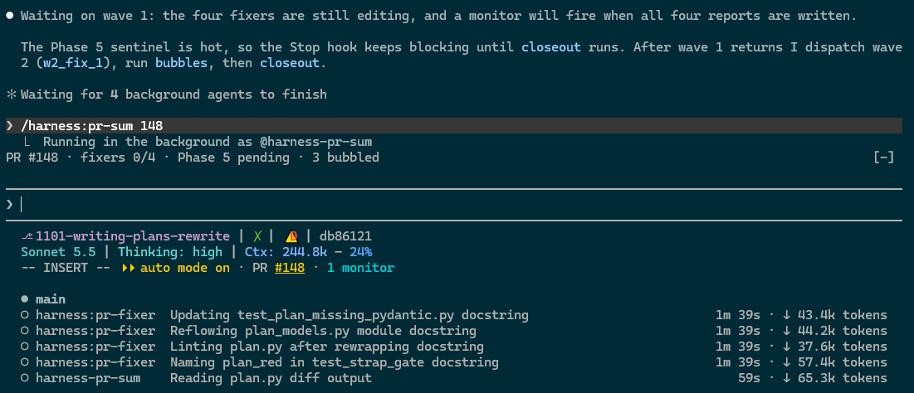

# `operator-straps`

[](https://github.com/t968rs/operator-straps/actions/workflows/ci.yml)

**Give Claude Code a repeatable process for reviewing PRs, applying fixes, and preparing changes for handoff.**

Install the workflows you need: review a PR with multiple agents, carry findings through fix waves and closeout,
draft commit messages and PR summaries from the diff, or start work in an isolated worktree. Add optional plugins
to track review progress, keep Git state visible, preserve context through compaction, and scope pytest runs.

[Choose a workflow](#what-you-can-do) · [Install](#install) · [Configure a project](#configure-a-project)

## What you can do



| Your goal                 | Use                                                 | What you get                                                                                                                                                                                                                      | Agent 'Ensurance'                                                                                                                                                                                                                                                                                                                                                                                                                                                                                                                               |
|---------------------------|-----------------------------------------------------|-----------------------------------------------------------------------------------------------------------------------------------------------------------------------------------------------------------------------------------|-------------------------------------------------------------------------------------------------------------------------------------------------------------------------------------------------------------------------------------------------------------------------------------------------------------------------------------------------------------------------------------------------------------------------------------------------------------------------------------------------------------------------------------------------|
| Review a PR               | `pr-review` or `pr-team`                            | Multiple reviewers, a consolidated review, branch checks before fixes, and fix waves with recorded resolutions.                                                                                                                   | • Configured agent-use Python runtime via `hpy`.<br>• Branch checks before fixes; schema validation on review writes.<br>• `Stop` hook blocks a stop attempt while the review session has an active Phase 5 sentinel.                                                                                                                                                                                                                                                                                                                           |
| Commit message, single    | `c-msg`                                             | A message for the pending change, saved in your project artifact folders.                                                                                                                                                         | • Configured Python runtime via `hpy`.<br>• Build checks file coverage and message format before saving the draft.                                                                                                                                                                                                                                                                                                                                                                                                                              |
| Commit message, range     | `branch-commit-msg`                                 | A proposed breakdown into commits.                                                                                                                                                                                                | • Configured Python runtime via `hpy`.<br>• Build checks file coverage and message format before saving the draft.                                                                                                                                                                                                                                                                                                                                                                                                                              |
| Change message            | `amend-commit-msg`                                  | Amendment of message breakdown (rewritten messages, files moved between blocks).                                                                                                                                                  | • Configured Python runtime via `hpy`.<br>• Build checks file coverage and message format before saving the draft.                                                                                                                                                                                                                                                                                                                                                                                                                              |
| Write PR Summary          | `pr-sum`                                            | A summary grounded in PR metadata and the diff. <br/>`--level 1\|2\|3` sets how much it draws (1 prose only, 2 flows and Changed Symbols, the default, 3 more diagram types)                                                      | • Script captures PR metadata, commits, file lists, and counts.<br>• Build requires a title, summary, and descriptions covering the listed non-artifact files.                                                                                                                                                                                                                                                                                                                                                                                  |
| Plan multi-step work      | `write-plan`                                        | An `ActionPlan` JSON whose claims about the code become script-enforced validation anchors, test files planned as real files, a PIP rendered from the JSON, and `parallel2` lanes for its open items.                             | • `check` opens every cited line range, reruns every search, and rejects hard-coded commit SHAs, pytest runs of directories and values that assume a rejected option.<br>• `red` runs the planned tests in a throwaway worktree; each must fail with its planned exception.<br>• `freeze` refuses open decisions, items nothing proves and red failures; later edits are detected.<br>• `record` reruns the item's tests on a throwaway worktree at the commit before marking it COMPLETE; `check` reports a COMPLETE item without that record. |
| New `harness`-style skill | `strap-skills`                                      | A skill under `plugins/harness/skills/<name>/` with its SKILL.md, models, api and a contract test scaffolded from templates, plus judgment behaviors drawn, run and graded through scenario agents before the spec freezes.       | • `freeze` refuses until each judgment behavior has a failing baseline, a passing green and a grade that quotes the reply.<br>• Drawn scenarios are locked: a behavior's scenarios, kind and type cannot change after its first draw.<br>• A SKILL.md fix needs a retest on its new content hash before the skill can freeze.<br>• Mechanical behaviors must fail as planned before freeze.                                                                                                                                                     |
| Generate Issue Memo       | `bubble-memo`                                       | A memo, `PR_<N>_Bubbles.md`, with an index and one short entry per bubbled issue (description, recommendation, checked references), saved in your project's reviews folder.                                                       | • Driver proves every bubbled issue has an entry and checks each reference against the working tree.<br>• The memo is a snapshot; decisions are stamped in by `bubble-stamp`, never written by the skill.                                                                                                                                                                                                                                                                                                                                       |
| Isolated task's checkout  | `d-w`                                               | A detached-HEAD worktree cut from HEAD, an integration branch, or another ref.                                                                                                                                                    | • Script resolves the base ref to a commit and creates a detached worktree.<br>• Failed integration-branch fetches stop creation; directory collisions get a fresh path.<br>• Runs the project's configured `worktree_setup`, then `worktree_baseline`, in the new worktree; failures are reported, never fatal, and `--no-setup` skips both.<br>• Warns when run from a linked worktree.                                                                                                                                                       |
| Diagnose `harness`        | `doctor`                                            | A read-only report on the interpreter `hpy` picks, the three Python modules, `git`, `gh` and `.claude/harness.json`, each marked `ok`, `warn` or `fail`, with the fix beside every failure.                                       | • Standard library only, so it runs when `pydantic`, `jsonschema` or `referencing` are missing.<br>• Installs nothing and writes nothing; the install line is for you to run, naming the interpreter `hpy` uses.                                                                                                                                                                                                                                                                                                                                |
| (Re)Attach Worktree       | `a-w`                                               | The work from a `d-w` worktree lands on the branch you name, <br/>staged and uncommitted or as its own commits (`--committed`), and the worktree is removed.                                                                      | • Script requires the target branch checked out with no tracked changes.<br>• Staging merges three-way; `--committed` fast-forwards only. A refusal changes nothing; a three-way conflict keeps the worktree (files and index) and leaves markers in the target checkout, with the commands to finish or undo.                                                                                                                                                                                                                                  |
| Create TODO               | `sync-gh-todo`                                      | One drafted, ranked catalog item per open GitHub issue no catalog record mentions, then the catalog renumbered.                                                                                                                   | • Active only when `.claude/harness.json` sets `todo.folder`.<br>• `gh` lists the issues; the script refuses an issue the catalog already records, scores and renumbers the items, and `check` runs after the edit.                                                                                                                                                                                                                                                                                                                             |
| Banner Config             | `banner-status`: `setup-statusline`, or `band-line` | Options: (1) ccstatusline as the project's status line (needs Node.js and npm; `setup-statusline` offers the install)<br/>(2) `band-line`: an `oStraps:` band above the prompt with the model and context window, no npm install. | • The skill writes `.claude/settings.json` `statusLine` and `.claude/ccstatusline.json` only after the user approves each edit.<br>• `band-line` reads the `git-status` snapshot; neither draws without `git-status`.                                                                                                                                                                                                                                                                                                                           |

## Bundled Mods and Dashboard Views
| Goal                    | Where             | Mods               | Description                                                                                                                                                                                          | Notes                                                                                                                                                                                                                                                                                                                                                     |
|-------------------------|-------------------|--------------------|------------------------------------------------------------------------------------------------------------------------------------------------------------------------------------------------------|-----------------------------------------------------------------------------------------------------------------------------------------------------------------------------------------------------------------------------------------------------------------------------------------------------------------------------------------------------------|
| Project TODO            | Banner-Visible    | `todo-watch`       | The next TODO items and a live sync status line in a band above the prompt (kept until dismissed), a `TODO_SYNC` drift line in prompt context, and `/todo` with the top items and every finding.     | • Active only when `.claude/harness.json` sets `todo.folder`.<br>• Watched-file edits re-run the harness `todo_sync` checks; every hook fails open.                                                                                                                                                                                                       |
| PR Review Status        | Banner-Visible    | `pr-review-watch`  | A review progress band, pending-fix context, reviewer matrix rows and a per-agent usage log (every dispatch of an agent this marketplace defines), and a Stop guard for unrecorded escalated issues. | • `Stop` guard checks that escalated issues are recorded in the review.<br>• Usage rows come from engine measurements and must pass schema validation before append.                                                                                                                                                                                      |
| Branch Info             | Banner-Visible    | `git-status`       | Git state checked on each prompt, changed state added as `GIT_STATE` context, and a fallback Git status line.                                                                                        | • Prompt hooks recheck Git state and inject changed state.<br>• Git context is reinjected after clear, resume, or main-conversation compaction.<br>• The fallback line gives way to ccstatusline or `band-line`.                                                                                                                                          |
| Enforce Python Test env | Automatic         | `pytest-scope`     | Rewrites bare `pytest` to your chosen interpreter and rejects runs with no explicit test file or node ID.                                                                                            | • Rewrites recognized pytest commands only when `python` is set.<br>• Rejects broad runs when `require_test_file=true`; `/pytest-broad-ok` allows one override.                                                                                                                                                                                           |
| Post-Compaction Context | Automatic         | `session-bookmark` | Git state, recent prompts and your session notes, kept through compaction.                                                                                                                           | • Hooks capture git state, the last three prompts, stored notes and `/compact` instructions.<br>• The bookmark is appended to the compacted transcript and kept in session state.<br>• The session writes each note, resolving a reference such as "the current status" into the facts it stands for; a script stores it (20 notes, 300 characters each). |
| Bubble Memo Stamps      | Automatic + Toast | `bubble-stamp`     | Stamps each decision in the review JSON (`RESOLVED`, `CLOSED_NO_ACTION`) into the memo's index and entry; a toast names the ids.                                                                     | • Active only in projects with `.claude/harness.json`.<br>• Runs on session start, `pr_review.py` and `review_edit.py` calls, review JSON edits and turn end; a rerun changes nothing, and every hook fails open.                                                                                                                                         |

## Agent process standardization

`harness` packages the procedure as skills, scripts, agents and hooks. Set the test layout, guard suites, base
branch and output folders once in `.claude/harness.json`; every run then follows the same process.

For example, a PR review follows five phases:

```mermaid
flowchart LR
    accTitle: Agent process standardization for PR review
    accDescr: Project configuration supplies guards, branch rules, and output paths to a shared five-phase process. Capture and guards lead to reviewers, consolidated findings, branch verification, then fix waves and closeout. The review and resolutions are saved in the consuming project.
    config["Project configuration<br/>.claude/harness.json"]
    capture["1 · Capture<br/>PR facts + guards"]
    review["2 · Review<br/>Scoped reviewers"]
    findings["3 · Consolidate<br/>Findings + verdict"]
    safety["4 · Verify branch<br/>Before code changes"]
    fixes["5 · Fix + close out<br/>Waves + resolutions"]
    artifacts["Project artifacts<br/>Review + resolution record"]

    capture --> review --> findings --> safety --> fixes
    config -. "guard suites" .-> capture
    config -. "branch rules" .-> safety
    config -. "output paths" .-> artifacts
    findings --> artifacts
    fixes --> artifacts

    classDef settings fill:#eef2ff,stroke:#6366f1,color:#1e1b4b
    classDef process fill:#f0fdfa,stroke:#0f766e,color:#134e4a
    classDef gate fill:#fff7ed,stroke:#c2410c,color:#7c2d12
    classDef result fill:#eff6ff,stroke:#2563eb,color:#1e3a8a
    class config settings
    class capture,review,findings,fixes process
    class safety gate
    class artifacts result
```



Skills define the steps, scripts validate review artifacts, hooks check workflow conditions. Branch safety is
checked right before fixes, ambiguous issues go to you, and closeout records each finding's outcome. Review data
stays in your project; plugin code stays in its cache.

The companion plugins install separately and stand alone, except that `band-line` reads `git-status`'s snapshot
(it lists `git-status` as a dependency). The ccstatusline line from `banner-status` replaces `git-status`'s own
line only when ccstatusline is installed, and installing `banner-status` does not install it: run
`/banner-status:setup-statusline`, which offers `npm install -g ccstatusline@~2.2.32` (Node.js and npm required),
or run that command first. Until then `git-status` draws its fallback line.

- `pr-review-watch` and `bubble-stamp` are active only in projects with `.claude/harness.json`.
- `todo-watch` is active only when `.claude/harness.json` sets `todo.folder`.
- `pytest-scope` takes effect only when one of its options is set.

## Install

For the review, commit, summary, and worktree workflows, install `harness`:

```sh
claude plugin marketplace add t968rs/operator-straps
claude plugin install harness@operator-straps
```

Add any companion plugins you want:

```sh
claude plugin install pr-review-watch@operator-straps
claude plugin install git-status@operator-straps
claude plugin install banner-status@operator-straps
claude plugin install band-line@operator-straps
claude plugin install session-bookmark@operator-straps
claude plugin install pytest-scope@operator-straps --config python=C:/path/to/env/python.exe --config require_test_file=true
claude plugin install todo-watch@operator-straps
claude plugin install bubble-stamp@operator-straps
```

After configuring your project below, open Claude Code in that repository and invoke a workflow, for example:

```text
/harness:pr-review 123
/harness:c-msg
/harness:pr-sum 123
/harness:d-w HEAD
/harness:a-w my-branch --committed
/harness:a-w HEAD
/harness:add-bookmark keep the public API frozen until PR 60 merges
```

Replace `123` with your PR number. `pr-review` runs the full review-and-fix workflow. `c-msg` and `pr-sum` save
drafts in the configured artifact folders. `/harness:c-msg <change>` rewrites the saved pending message; a bare
`/harness:c-msg` rerun leaves a carried or canned message as it stands.

### add-bookmark

`/harness:add-bookmark` stores notes that survive compaction. The session-bookmark mod prints them above the
`/compact` instructions, so a constraint or reminder stays visible after the summary.

```text
/harness:add-bookmark keep the public API frozen until PR 60 merges
/harness:add-bookmark --list
/harness:add-bookmark --clear
```

| Form                                     | Effect                                      |
|------------------------------------------|---------------------------------------------|
| `/harness:add-bookmark [--] <note text>` | Store one note (a leading `--` is optional) |
| `/harness:add-bookmark --list`           | Print the stored notes, numbered            |
| `/harness:add-bookmark --clear`          | Drop every stored note                      |

- The session that runs the command writes the stored line, so a note that points at the conversation
  (`the current status of the banner options`, `what we built`) is stored as the branch, versions, ids and
  pending checks it refers to. Text that stands alone is stored as written, apart from quoting and length.
- At most 20 notes; `--clear` frees the slots. A note over 300 characters, or a blank one, is refused.
- Notes live in `session-bookmark/notes.json` under `state_dir` (default `.claude/state/harness`); gitignore that
  folder like the other runtime state.
- The file is versioned (`"version": 1`). A file that is not JSON or has another version is refused, not
  overwritten; `--clear` resets it.
- What the bookmark prints and how the mod reads the notes: `plugins/session-bookmark/README.md`.

### Guidance after `--`

Every user-invocable harness skill accepts free-text guidance after a standalone `--` token, next to its own
arguments:

```text
/harness:pr-review 106 --no-fetch -- look hard at the Windows path handling in lib/
/harness:d-w main -- the work is the open-args fix; touch only plugins/harness/skills/
```

- Split rule and limits: `plugins/harness/reference/skill_arguments.md`. Text before the token is the skill's own
  arguments, text after it is guidance. Guidance never reaches a command line and never waives a skill rule, a
  harness rule or the project's CLAUDE.md.
- Skills whose whole argument is free text (`c-msg`, `check-runlogs`, `add-bookmark`) take a leading `--` as
  optional. `fold-in-review` looks for the token on the last line only, since pasted output holds `--` lines.
- `pr-review` forwards guidance to every reviewer and fixer prompt, `pr-team` to each reviewer prompt file,
  `roast-my-code` to the roast agent; the other skills apply it in the main session or fork.
- `tests/skills/test_skill_guidance_tail_contract.py` pins the hint, the pointer to the reference and the absence
  of `$ARGUMENTS` from fenced commands for each skill, and fails on an unclassified new skill.

### amend-commit-msg

`/harness:amend-commit-msg` amends the breakdown `branch-commit-msg` drafted instead of redrafting it. The session
that runs it knows what changed since the draft; the forked `branch-commit-msg` agent does not.

```text
/harness:amend-commit-msg -- the review fixes landed; restate blocks 2 and 3
/harness:amend-commit-msg --base 3b5d53a -- move tests/test_x.py into the runtime block
```

- Arguments before the first standalone `--` (at the start, or spaced on both sides) are the `branch-commit-msg`
  capture arguments (`REF`, `--base REF`, `--no-fetch`) and name the TXT to amend; text after it says what to
  change. `--fresh` and `--pending` are refused.
- A missing TXT is an error (`no TXT to amend: <path>`), never a silent redraft. A `--base` amendment needs the
  `<branch>_<sha7>.txt` of that base, and the ref must resolve now to the drafted base (the sha7 in the TXT name).
  Pass that SHA or a branch name; a relative ref such as `HEAD~3` moves as commits land.
- `branch_commit_msg.py move` shifts files between blocks and carries each file's `file: what changed` bullet. An
  amendment build rejects a bullet that names a file of another block.
- Messages are set with `branch_commit_msg.py message FILE --all` (one stdin text, a `##### block N #####` line
  before each message; `--block N` sets one), not with Edit. The run prints only the receipt. `diff FILE --all`
  reads every block in one call; repeated `--block N` reads the named blocks.
- The replaced TXT is kept as `<name>.txt.bak`, one generation.

### Canned commit messages

A change made only of generated files whose message never varies skips drafting: `capture` fills the block with a
canned message, and `build` still checks it.

```text
changed files ──► every file fits one entry's patterns? ──no──► drafted as usual
                              │yes
                              ▼
                  block message = that entry's canned message
```

| Entry (`lib/harness_lib/canned_messages.py`) | Patterns                                                                                     | Message                                                           |
|----------------------------------------------|----------------------------------------------------------------------------------------------|-------------------------------------------------------------------|
| TODO sync files                              | `_IMPL_TODO.md`, `RepoToDo.json`, `ResearchImplementationCatalog.json`, `TODO_Snapshot_*.md` | `Chore(todo): refresh TODO catalog, research stubs and snapshot`  |
| Review artifacts                             | `docs/PR_REVIEWS/*.json`, `docs/PR_SUMMARIES/*.md`, the two `pr_review_*.jsonl` run logs     | `Chore(reviews): record PR review, summary and run-log artifacts` |

- A change may use only some of an entry's files; a file outside the entry, or files from two entries, gives no
  canned message. A pattern with a `/` matches the whole path, any other the file name.
- `c-msg`, `branch-commit-msg` and `amend-commit-msg` keep a prefilled message as it stands, unless the developer
  asks for a change (`/harness:c-msg <change>`, `/harness:amend-commit-msg [--base <sha7>] -- <change>`, with the
  `--base` the draft used). `merge-commit-msg` capture applies the same lookup to the PR's changed files and
  prefills the prose.
- A saved message is final: the build receipt ends with a `Final as saved` line, and a PreToolUse hook
  (`guard_commit_txt.py`) denies Write and Edit on the saved `.txt` files, `PR<NNN>_merge.txt` included (its working
  document, `PR<NNN>_merge.md`, stays editable). Shell writes (redirects, heredocs, `sed -i`, `Set-Content`) are
  covered only by the standing rule.
- Entries use the plugin's default file names (and, for review artifacts, folders); a project that renames them
  drafts as usual.

### Working on this repository

This repository enables its own plugins in `.claude/settings.json` from the published marketplace
(`t968rs/operator-straps`), so sessions here run the cached copy of the pushed default branch, not the checkout.
Edits under `plugins/` take effect after merge, version bump and `claude plugin marketplace update
operator-straps`. To try them sooner, run `claude --plugin-dir plugins/<name>` or add the checkout as a local
marketplace (`claude plugin marketplace add ./`).

### Plugin options

The CLI install takes `--config KEY=VALUE`; installing from `/plugin` in a session opens a dialog for each unset
option. `pytest-scope` options (see `plugins/pytest-scope/README.md`):

| Option              | Default | Meaning                                                                      |
|---------------------|---------|------------------------------------------------------------------------------|
| `python`            | unset   | Absolute path of the interpreter bare `pytest` runs under. Unset: no rewrite |
| `require_test_file` | `false` | Deny pytest calls with no test path or a directory path                      |

`harness` options (`claude plugin configure harness`):

| Option            | Default | Meaning                                                                                                                                                |
|-------------------|---------|--------------------------------------------------------------------------------------------------------------------------------------------------------|
| `python`          | unset   | Interpreter for harness hooks only; skill commands do not receive it, so pin those with `HARNESS_PY`. Needs `jsonschema`, `referencing`, `pydantic>=2` |
| `bash_discipline` | `true`  | Deny Bash commands chained with `&&` or `;`                                                                                                            |
| `inject_rules`    | `true`  | Add `rules/HARNESS_RULES.md` to the session context at start                                                                                           |

### Python

Every hook and script runs through `plugins/harness/scripts/hpy`, which picks the first interpreter that starts:
`HARNESS_PY` (project settings `env`), then the `python` option (hooks only), then `python`, then `py -3`. It
skips the Windows Store `python3` stub and does not probe for `jsonschema` / `referencing` / `pydantic`; the code
that needs them reports a missing module itself. The schema hook stands down with a one-line warning; `pr-review`
and `pr-team` check all three before any subcommand and exit 1 with a `problem:` line naming the first one
missing. Commit, summary and worktree tooling need only the standard library.

Pin an interpreter with `HARNESS_PY` under `env` in `.claude/settings.local.json` (one project, kept out of git) or
`~/.claude/settings.json` (every project). The `python` option lives in `~/.claude/settings.json` under
`pluginConfigs` > `harness@<marketplace>` > `options`; skill commands run in a shell that does not receive it, so
`hpy` falls through to `python` on PATH. Prefer `HARNESS_PY` when a skill fails on a missing module.

`/harness:doctor` checks all of this read-only: the interpreter `hpy` picked, a skipped override or an unreached
`python` option, the three modules (with a `pip install` line for that interpreter), `git`, `gh` and the project's
`.claude/harness.json`. Run it first in a repository new to the harness.

## Configure a project

Create `.claude/harness.json` in the consuming repository. Every key is optional; objects merge key by key over
`plugins/harness/config/defaults.json`, arrays and scalars replace. Schema: `plugins/harness/config/harness.schema.json`.

```json
{
  "base_branch": "dev",
  "integration_branches": ["dev", "main"],
  "exclusions": "reference/machine_generated_exclusions.json",
  "artifacts": {"reviews": "docs/PR_REVIEWS", "plans": "docs/PLANS", "summaries": "docs/PR_SUMMARIES"},
  "tests": {"roots": ["src/tests/"], "registry": "src/tests/registry.json", "registry_names": ["registry.json"]},
  "review": {
    "guard_suite": ["src/tests/guards/test_ci_workflows.py"],
    "structural_guard_prefixes": [".github/workflows/"],
    "domain_pointers": [{"prefix": "src/geo/", "pointer": "Geometry code never imports the GIS runtime at module level."}]
  },
  "commit_buckets": [
    {"bucket": "Runtime", "prefixes": ["src/pkg/"]},
    {"bucket": "Test", "prefixes": ["src/tests/"]}
  ],
  "auto_approve_python_c": true,
  "worktree_root": "~/worktrees/{repo}",
  "runlogs": {"dir": "logs/test_runs"},
  "todo": {"folder": "docs/RESEARCH/_TODO"}
}
```

TODO sync needs only `todo.folder`. Once set, the catalog is `<folder>/RepoToDo.json`, snapshots go to
`<folder>/Snapshots`, and `<folder>/RepoToDo.schema.json` and `<folder>/ResearchImplementationCatalog.json` are
used when present (a name set explicitly must exist); stubs are `_IMPL_TODO.md` files under `artifacts.research`.
Set a key below only to depart from that layout.

`todo_sync.py retire ID [ID ...] [--dry-run]` removes finished items: ids follow rank (rule T6), so it renumbers
the rest, rescores, recounts and rewrites moved ids in the research catalog and stubs, then lists what it cannot
record itself (issues to add as close candidates, trackers to revisit, other files naming a TODO id).
`todo_sync.py split ID --spec PATH` replaces one item with the parts in a spec file (field overrides over a copy
of the item); `todo_sync.py refresh` rescores and re-sorts after hand edits. Both renumber and rewrite ids the same
way. `/harness:todo-edit --retire 1, 3 [--delete-retired] | --split 001 | --refresh` runs any of the three through
the `todo-editor` agent, which also writes the split parts, close-candidate evidence and the prose that named a
moved id. A retirement also updates implementation status in the affected stubs and research entries; the reply
names each stub's new state, the research entries now fully resolved and the issues that can close. With
`--delete-retired`, the agent also sets an entry to `FULLY_IMPLEMENTED` and deletes its stub, but only after
checking every deliverable in it; a stub with an unproven deliverable is kept and listed.

`todo_sync.py init` creates a project's first catalog: with `todo.folder` set, it makes the folder, an empty
schema-valid catalog at `todo.catalog` (default `RepoToDo.json`; default ranking tables, no items, current commit
recorded) and the first snapshot. It refuses to overwrite a catalog, needs a git commit and does not edit
`harness.json`.

`todo_sync.py untracked` lists the open GitHub issues no record covers (an item's `gh_issues` or `gh_issue`
source, a tracker or tracker child, a close candidate or a research entry; an issue an item only lists in
`related_gh_issues` still counts as untracked) and writes each one's text, comments and linked PR review text to
`<state_dir>/todo-sync/untracked.json`. `todo_sync.py add --spec PATH [--dry-run]` inserts one item per issue from
a spec file, scores it, renumbers the rest, recounts, and refuses an issue the catalog already records.
`/harness:sync-gh-todo` runs `untracked` (running `init` first when `untracked` reports `todo.catalog` as `file not
found`, then `untracked` again) and hands the issues to the `todo-editor` agent. The agent drafts each item from
`untracked.json` (a best guess for a thin issue, flagged as needing a decision when it turns on a choice), runs
`add`, then `render` and `check`. A `gh_issue` source needs no `_IMPL_TODO.md` stub.

```text
/harness:sync-gh-todo

[main session]  todo_sync.py untracked        list open issues no record mentions, write untracked.json
[main session]  todo_sync.py init             only when untracked reports the catalog file not found,
                                              then untracked again
[todo-editor]   draft one item per issue      from the issue text and the text of any linked PR review
[todo-editor]   todo_sync.py add --spec PATH  insert, score, renumber, recount; refuses a recorded issue
[todo-editor]   todo_sync.py render, check    new snapshot, then the drift checks
```

| Key                            | Default                                                                                         | Used by                                                                                                                                                                                                                                                                                                                                                                                                                                                                                                                                                            |
|--------------------------------|-------------------------------------------------------------------------------------------------|--------------------------------------------------------------------------------------------------------------------------------------------------------------------------------------------------------------------------------------------------------------------------------------------------------------------------------------------------------------------------------------------------------------------------------------------------------------------------------------------------------------------------------------------------------------------|
| `base_branch`                  | `origin/HEAD`, else `main`                                                                      | merge bases, `d-w`, `pr-review-watch`                                                                                                                                                                                                                                                                                                                                                                                                                                                                                                                              |
| `integration_branches`         | base branch + `main`                                                                            | `d-w` (fetch-and-cut targets)                                                                                                                                                                                                                                                                                                                                                                                                                                                                                                                                      |
| `state_dir`                    | `.claude/state/harness`                                                                         | Phase 5 sentinels, `pr-team` runtime, `session-bookmark/notes.json`, `parallel2/` runs (gitignore it)                                                                                                                                                                                                                                                                                                                                                                                                                                                              |
| `agent_usage_path`             | `docs/_harness/pr_review_agent_usage.jsonl`                                                     | `pr-review-watch`: one usage row per defined-agent dispatch (model, tokens, runtime, fixer counts)                                                                                                                                                                                                                                                                                                                                                                                                                                                                 |
| `artifacts.*`                  | `docs/PR_REVIEWS`, `docs/PLANS`, ...                                                            | review, plan, summary and commit-message output                                                                                                                                                                                                                                                                                                                                                                                                                                                                                                                    |
| `tests.*`                      | `tests/`, common test-file pattern                                                              | review bucketing, commit grouping                                                                                                                                                                                                                                                                                                                                                                                                                                                                                                                                  |
| `tests.timings`                | `null`                                                                                          | fixer briefs: a JSON report whose `tests` rows carry `file` (spelled exactly as the registry entry's `file`) and `duration` (seconds), summed per file; missing or unreadable means no runtime deferral. Stock pytest JSON reports do not match                                                                                                                                                                                                                                                                                                                    |
| `tests.fixer_test_seconds`     | `null` (no runtime rule)                                                                        | fixer briefs: a registered test over this many summed seconds in `tests.timings` is deferred (listed, not run; `closeout` prints it). Without usable `tests.timings` the ceiling is off and `waves` prints a `deferral:` notice                                                                                                                                                                                                                                                                                                                                    |
| `tests.defer_flags`            | `[]`                                                                                            | fixer briefs: dotted registry-entry paths (e.g. `properties.super_slow`); `true` at one defers the test                                                                                                                                                                                                                                                                                                                                                                                                                                                            |
| `tests.serial_flags`           | `[]`                                                                                            | `waves`: dotted registry-entry paths (e.g. `properties.licensed`); tests `true` at one never run in two fixers of a wave, so fixers reaching tests that share a flag go to different waves (or one fixer). A deferred test holds no lock                                                                                                                                                                                                                                                                                                                           |
| `review.*`                     | empty                                                                                           | Phase 1 guard suites, lens catalog, reviewer-brief rule pointers                                                                                                                                                                                                                                                                                                                                                                                                                                                                                                   |
| `review.tracking_paths`        | `[]`                                                                                            | `waves`: `fnmatch` globs over repo-relative POSIX paths of tracking documents (plans, trackers); `*` crosses `/`. No fixer owns them: an issue whose files are all tracking prints as a `tracking:` row for the main session (edit, then `closeout --resolved`), and a tracking path a `fix` option names never widens a fixer's file set                                                                                                                                                                                                                          |
| `commit_buckets`               | generic `src/`, `tests/`, `docs/` rules                                                         | `c-msg`, `branch-commit-msg`, `amend-commit-msg` grouping                                                                                                                                                                                                                                                                                                                                                                                                                                                                                                          |
| `exclusions`                   | `.claude/review_exclusions.json`                                                                | pr-review clean-tree checks and review capture skip machine-generated files. The default path is seeded on first use (see below). Name another file to keep your own list (it must exist), or `null` to filter nothing                                                                                                                                                                                                                                                                                                                                             |
| `auto_approve_python_c`        | `false`                                                                                         | `approve_python_c` hook                                                                                                                                                                                                                                                                                                                                                                                                                                                                                                                                            |
| `worktree_root`                | `~/.config/harness/worktrees/{repo}`                                                            | `d-w`, `parallel2`                                                                                                                                                                                                                                                                                                                                                                                                                                                                                                                                                 |
| `worktree_setup`               | `[]`                                                                                            | `d-w`: argv arrays run in order in each new worktree, without a shell (e.g. `[["uv", "sync"]]` builds a worktree-local `.venv`; an editable install into a shared interpreter repoints its package at the worktree). A bare program is looked up on PATH (`.cmd` shims such as `npm` included on Windows), a relative path resolves against the worktree; stdin is closed; each step is killed with its process tree after 600 s; the first failure stops the list; failures are reported, never fatal; `--no-setup` skips them; `parallel2` lanes do not run them |
| `worktree_baseline`            | `[]`                                                                                            | `d-w`: argv arrays run after a successful `worktree_setup` to record the test state before any change; name test files, never a directory; lookup, closed stdin and the 600 s kill match `worktree_setup`; the first failure stops the list and each later command is reported `baseline [skipped]`; failures are reported, never fatal; `--no-setup` skips them                                                                                                                                                                                                   |
| `runlogs.dir`                  | `null` (the skill then needs `--dir`)                                                           | `check-runlogs` (newest run log; subfolders at any depth, dated archives included, are searched)                                                                                                                                                                                                                                                                                                                                                                                                                                                                   |
| `runlogs.name_pattern`         | a name ending in `<YYYY-MM-DD>[_<HHMMSS>].txt` or `.log`                                        | `check-runlogs` (named groups `date`, optional `time`)                                                                                                                                                                                                                                                                                                                                                                                                                                                                                                             |
| `todo.folder`                  | `null` (feature off)                                                                            | the one key that turns TODO sync on: the project-relative folder holding the catalog and its companions. Every `todo` path below is relative to it (`..` allowed; climbing above the project root fails config load)                                                                                                                                                                                                                                                                                                                                               |
| `todo.catalog`                 | `RepoToDo.json`                                                                                 | `todo_sync.py`, its SessionStart hook, `todo-watch` (ranked TODO catalog JSON)                                                                                                                                                                                                                                                                                                                                                                                                                                                                                     |
| `todo.catalog_schema`          | `RepoToDo.schema.json` (used when present, else the harness `catalogs/TodoCatalog.schema.json`) | rule T1 (validated under the schema's own draft); `null` always uses the harness copy; a name the project sets must exist (config load fails)                                                                                                                                                                                                                                                                                                                                                                                                                      |
| `todo.stub_name`               | `_IMPL_TODO.md` (`null`: S1-S4 off)                                                             | stub file name under the research root (`artifacts.research`)                                                                                                                                                                                                                                                                                                                                                                                                                                                                                                      |
| `todo.top_n`                   | `10`                                                                                            | `todo-watch` `/todo` table, `todo_sync.py render`                                                                                                                                                                                                                                                                                                                                                                                                                                                                                                                  |
| `todo.snapshots.dir`           | `Snapshots` (`null`: T2 and `render` off)                                                       | rule T2, `todo_sync.py render` (creates the folder)                                                                                                                                                                                                                                                                                                                                                                                                                                                                                                                |
| `todo.snapshots.name_pattern`  | `TODO_Snapshot_<YYYY_MMDD>.md`                                                                  | rule T2 (named group `date`; newest by date, else mtime)                                                                                                                                                                                                                                                                                                                                                                                                                                                                                                           |
| `todo.research.catalog`        | `ResearchImplementationCatalog.json` (used when present; absent or `null`: S rules, T3-T5 off)  | research catalog JSON; a name the project sets must exist (config load fails)                                                                                                                                                                                                                                                                                                                                                                                                                                                                                      |
| `todo.research.anchor_pattern` | `catalog_entry: <path>#<id>`                                                                    | rules S1, S4 (named group `id`)                                                                                                                                                                                                                                                                                                                                                                                                                                                                                                                                    |
| `todo.research.ignore_folders` | `[]`                                                                                            | rule S6 (the folders holding the catalog and the snapshots are excluded automatically)                                                                                                                                                                                                                                                                                                                                                                                                                                                                             |
| `todo.plans.pairs`             | `true`                                                                                          | rules P1-P4 over `artifacts.plans`                                                                                                                                                                                                                                                                                                                                                                                                                                                                                                                                 |
| `todo.gh.repo`                 | `null` (the repository `gh` resolves for the checkout)                                          | `todo_sync.py untracked`                                                                                                                                                                                                                                                                                                                                                                                                                                                                                                                                           |
| `todo.gh.max_age_hours`        | `24`                                                                                            | `todo-watch` `/todo` summary age suffix (no sync rule reads it yet)                                                                                                                                                                                                                                                                                                                                                                                                                                                                                                |
| `todo.rules.disabled`          | `[]`                                                                                            | `todo_sync.py check` skips these rule ids                                                                                                                                                                                                                                                                                                                                                                                                                                                                                                                          |
| `todo.rules.warn_counts`       | `false`                                                                                         | warn findings count toward the drift number                                                                                                                                                                                                                                                                                                                                                                                                                                                                                                                        |
| `todo.inject_context`          | `true`                                                                                          | `todo-watch` per-prompt `TODO_SYNC` line                                                                                                                                                                                                                                                                                                                                                                                                                                                                                                                           |
| `todo.notice.style`            | `banner`                                                                                        | how `todo-watch` shows its session-start notice (top items, then sync status): `banner` (a band above the prompt, kept until Dismiss, status line live) or `toast` (one toast, leaves on a timer)                                                                                                                                                                                                                                                                                                                                                                  |
| `todo.notice.toast_seconds`    | `60` (the engine's ceiling)                                                                     | how long a `todo-watch` toast stays, above 0 and at most 60; unused with `banner`                                                                                                                                                                                                                                                                                                                                                                                                                                                                                  |
| `todo.notice.items`            | `3`                                                                                             | how many top items the `todo-watch` notice lists, by rank, 1 to 10                                                                                                                                                                                                                                                                                                                                                                                                                                                                                                 |

`exclusions` seeding:

- `pr_review.py capture`, `pr_review.py config` (when it prints `exclusions`), `phase4_branch_safety.py` and
  `git_status_filter_excluded.py` run without a path argument seed the file with patterns for `artifacts.reviews`,
  `artifacts.summaries`, `artifacts.scratch`, `artifacts.commit_messages`, `state_dir` and the files `matrix_path`
  and `agent_usage_path`.
- An existing file is never overwritten; the folders the harness writes stay exempt in memory even when the file
  (seeded by an earlier version, or your own list) lacks their rows. A run with `--exclusions-fixture` takes its
  list as given.
- Folder rows cover the whole subtree (`fnmatch` `*` crosses `/`), so point `artifacts.scratch`, `artifacts.reviews`
  and `artifacts.summaries` at dedicated folders: a broad value such as `docs` hides every docs change from the
  clean-tree check and review capture.
- When `.claude/` is not writable (a read-only checkout, or a file named `.claude`) the seed is skipped and the
  first use fails with `Exclusions file not found`: create the file by hand or set `exclusions` to `null`.
- The clean-tree check runs `git status --porcelain --untracked-files=all`, so a seeded file in an untracked
  `.claude/` matches its own pattern.

`schemas_dir` (default `.claude/agent-schemas`) pins project copies of the review schemas; anything missing
there falls back to the plugin's `schemas/`.

Two layout rules hold everywhere:

- **Data goes to the project, code stays in the plugin.** No hook or script writes under the plugin directory
  (it is a versioned cache once installed); `tests/contract/test_root_separation.py` enforces it.
- **Phase 5 sentinels are per repository.** They live under the main checkout's `state_dir`, so a fixer arming
  one from a linked worktree gates the session in the main checkout, and the reverse.

## Develop

```
python -m pip install -r requirements-dev.txt
python -m pytest tests/<area>/test_<name>.py -q
python -m ruff check plugins tests
claude plugin validate plugins/<name>
claude plugin test plugins/<name>
```

To run a working copy instead of the installed release, point `CLAUDE_CODE_PLUGIN_DIRS` (user settings `env`)
at the plugin folders of a checkout.

| Path                                                | Holds                                                                                                                            |
|-----------------------------------------------------|----------------------------------------------------------------------------------------------------------------------------------|
| `plugins/harness/lib/harness_lib/`                  | importable library: config, project roots, review/commit/summary engines, validation                                             |
| `plugins/harness/{scripts,hooks}/`                  | entry points; each puts `../lib` on `sys.path`                                                                                   |
| `plugins/harness/skills/`, `agents/`                | skill and agent markdown; agents dispatch as `harness:<name>`                                                                    |
| `plugins/harness/{config,schemas,rules,reference}/` | defaults + config schema, review schemas, session rules, commit format                                                           |
| `plugins/<mod>/hooks/`                              | TypeScript mods, each with its own `*.test.ts`                                                                                   |
| `plugins/<name>/.claude-plugin/`                    | `plugin.json` manifest and `icon.png` (square 1024x1024 PNG); every local plugin in `.claude-plugin/marketplace.json` ships both |
| `tests/`                                            | pytest suite; `make_project` builds throwaway consuming projects                                                                 |
| `docs/PROVENANCE.md`                                | where every file came from                                                                                                       |

`tests/contract/` holds the guards that keep the plugins generic: no consumer literals, no writes under the
plugin root, every `hooks.json` command resolvable.
