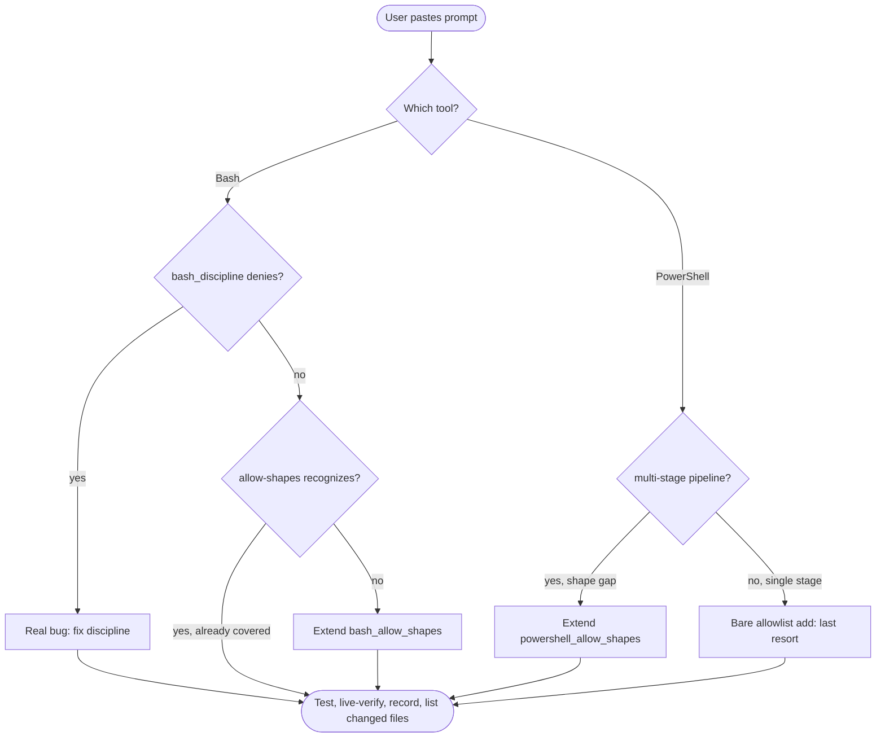

# agent-permissions

## Overview

When a user pastes a permission-prompt block, they want the prompt eliminated for that **shape** of command going forward — not re-approved once. The fix is almost never just editing `settings.json`. The fix is almost always extending the hook stack so the shape is recognized, then leaving the allowlist as a thin source of truth.

**Core principle:** Diagnose where the prompt comes from before changing anything. Allowlist edits are last resort, not first.

## When to Use

- User pastes any block matching `<command>\n<description>\n\nContains <reason>`.
- User says "auto-accept X", "stop prompting me for X", "add to permissions".
- User mentions `Bash(...)` / `PowerShell(...)` patterns or settings.json `permissions.allow`.

**Don't use for:** the literal `/permissions` slash-command UI, or for asking which tool to use.

## Tool Stack Asymmetry (Read First)

The harness plugin ships the hooks and wires them in its own `hooks/hooks.json` (each runs through
`sh "${CLAUDE_PLUGIN_ROOT}/scripts/hpy" "${CLAUDE_PLUGIN_ROOT}/hooks/<hook>.py"`).

| Tool | Discipline hook | Allow-shapes hook | Settings matcher |
|---|---|---|---|
| Bash | `bash_discipline.py` (denies `;`/`&&` chains, with construct and heredoc exemptions; off when the plugin option `bash_discipline` is false) | `bash_allow_shapes.py` (auto-allows recognized shapes); `approve_python_c.py` (`python -c` one-liners, only when the project's `.claude/harness.json` sets `auto_approve_python_c: true`) | `Bash` |
| PowerShell | none | `powershell_allow_shapes.py` (pipelines only, single-stage defers) | `PowerShell` |
| Write, Edit | `guard_commit_txt.py` (denies Write and Edit tool calls on `.txt` files under `artifacts.commit_messages`, except `PR<NNN>_merge.txt`; those files are `build` output; shell writes are covered only by the standing rule) | none | `Write\|Edit` |

The `hooks.json` matchers route each hook to its tool; `approve_python_c.py` and `powershell_allow_shapes.py`
also check `tool_name` as a second guard, while `bash_discipline.py`, `bash_allow_shapes.py` and
`guard_commit_txt.py` rely on the matcher alone. Allow-shapes hooks never block;
they either emit `allow` or stay silent. A deny from `bash_discipline.py` wins over any allow.

## Process (Mandatory)

### Step-by-step

1. **Diagnose.** Feed the failing command to the relevant hook(s) as a synthesized PreToolUse payload (see the pipe test below). Do not use `python -c "..."` for scratch probes — it trips `simple_expansion` on the way in; use a temp `.py` file. Identify: is `bash_discipline` denying a legitimate shape (real bug), or is an allow-shapes hook deferring because the shape is unrecognized (missing shape)?
2. **Edit the hook**, not the allowlist, where possible. Hooks are plugin code: change them in a checkout of the harness plugin's source repository, never in the installed plugin cache (it is replaced on every update).
   - Bash discipline edits use placeholder tokens `_O_/_C_/_X_`; preserve real chain visibility.
   - Allow-shapes edits extend `extract_subcommands` / `_split_pipeline`; rely on `is_allowed` recursion + `SAFE_BUILTINS`/`SAFE_CMDLETS`.
3. **Allowlist** is the single source of truth — the project's `.claude/settings.json` (+ `settings.local.json`) and the user settings directory (`CLAUDE_CONFIG_DIR`, else the default). Allow-shapes hooks read the session project (`CLAUDE_PROJECT_DIR`), the same settings Claude Code enforces, so a linked-worktree `cwd` still sees the main checkout's `settings.local.json` and a `cwd` in another repo never adds rules; only without `CLAUDE_PROJECT_DIR` does the payload `cwd`'s git top level stand in (shared logic: `hooks/_allow_settings.py`). Don't duplicate rules inside hooks. Add a narrow `<Tool>(<verb> *)` rule only when shape recognition genuinely can't help (e.g. PowerShell single-stage `Get-ChildItem`).
4. **Test (unit)** in the plugin source repository: add the new shape AND a regression case for a shape that should still defer or deny to `tests/hooks/test_<hook>.py`. Build throwaway projects with `make_project` and point `CLAUDE_CONFIG_DIR` at an empty directory so the tests never read live settings.
5. **Test (pipe)**: feed a synthesized payload on stdin:
   `sh "${CLAUDE_PLUGIN_ROOT}/scripts/hpy" "${CLAUDE_PLUGIN_ROOT}/hooks/<hook>.py" <<< '{"tool_name":"PowerShell","cwd":"<project>","tool_input":{"command":"..."}}'`.
   Confirm `permissionDecision: "allow"` JSON for the new shape; silent `rc=0` for deferred shapes; `permissionDecision: "deny"` for discipline violations.
6. **Live-verify** with one subagent on the cheapest model. Dispatch with: the new shape, a regression that should still prompt, and one control. **Subagents must cancel (not approve) any prompt and report PROMPT.** Absence of PROMPT for the new shape = success.
7. **Record the shape** wherever the project keeps its permissions notes (memory index or docs): append it to the handled-shapes list for its tool. Update on every meaningful shape addition, even allowlist-only ones.
8. **Don't commit.** The developer commits and pushes; finish with the list of changed files.

## Quick Reference

| Symptom | Right move |
|---|---|
| `Bash` prompt with `Contains command_substitution` / `simple_expansion` / `shell operators` | Extend `bash_allow_shapes.py` `extract_subcommands` |
| `Bash` prompt for compound `cd X; cmd` | NOT a permissions issue — discipline correctly denies. Tell the user to use `git -C` or split calls. |
| `Bash` prompt for `python -c` with a newline followed by `#` | Project opt-in: `"auto_approve_python_c": true` in `.claude/harness.json` |
| `PowerShell` prompt for multi-stage pipeline with safe tail | Extend `powershell_allow_shapes.py` `SAFE_CMDLETS` (only if the cmdlet can never accept an executable script-block payload) |
| `PowerShell` prompt for single-stage cmdlet | Bare `PowerShell(<verb> *)` allowlist add |
| Error mentions "command line is too long" / `pwsh exited with code 1` | OS-level (Windows ~8191 char `CreateProcess` cap), separate from permissions. Tell the user. Still propose the shape generalization — the OS error today doesn't preclude a permission rule for tomorrow. |

## Common Mistakes

- **Editing `settings.json` first.** Read the hooks first. Allowlist last.
- **Adding broad rules** like `Bash(rm *)`, `PowerShell(Remove-Item *)`. Use shape exemptions in the hook stack instead.
- **Skipping the regression case** in the unit test. The failure mode for `bash_discipline.py` is over-stripping — a fast path that swallows real chains. Always include "this should STILL deny" cases.
- **Skipping live-verify.** A passing pipe test doesn't prove the harness picked up the settings change. A subagent test or `/hooks` reload is the only way to know.
- **Editing the installed plugin cache.** The next plugin update erases it. Change the plugin source.
- **Treating PowerShell pipelines as single units.** Each stage needs its own allowlist match (or `SAFE_CMDLETS` membership). `Get-ChildItem | Foo` requires both `PowerShell(Get-ChildItem *)` and either `PowerShell(Foo *)` or `Foo` in `SAFE_CMDLETS`.
- **Running `git commit` / `git push`.** Never outside a dedicated worktree; the developer commits.

## Red Flags — STOP and Re-read This Skill

- Thought: "Just adding to settings.json fixes this."
- Thought: "Get-ChildItem is read-only so the wildcard tail is fine without checking each stage."
- Thought: "Recording the shape isn't needed for an allowlist-only change."
- Thought: "Skipping the live-verify; the pipe test is enough."
- Thought: "The pwsh `command line is too long` will go away once permission is granted."

All of these mean: stop, re-read this skill, follow the process.

## Files

- Hooks: `${CLAUDE_PLUGIN_ROOT}/hooks/{bash_discipline,bash_allow_shapes,powershell_allow_shapes,approve_python_c,guard_commit_txt}.py`
- Hook wiring: `${CLAUDE_PLUGIN_ROOT}/hooks/hooks.json`
- Allowlist (single source of truth): `<project>/.claude/settings.json` (+ `settings.local.json`) and the user settings directory
- Project opt-ins: `<project>/.claude/harness.json` (`auto_approve_python_c`); plugin options `bash_discipline`, `inject_rules`
- Tests: `tests/hooks/test_<hook>.py` in the plugin source repository
