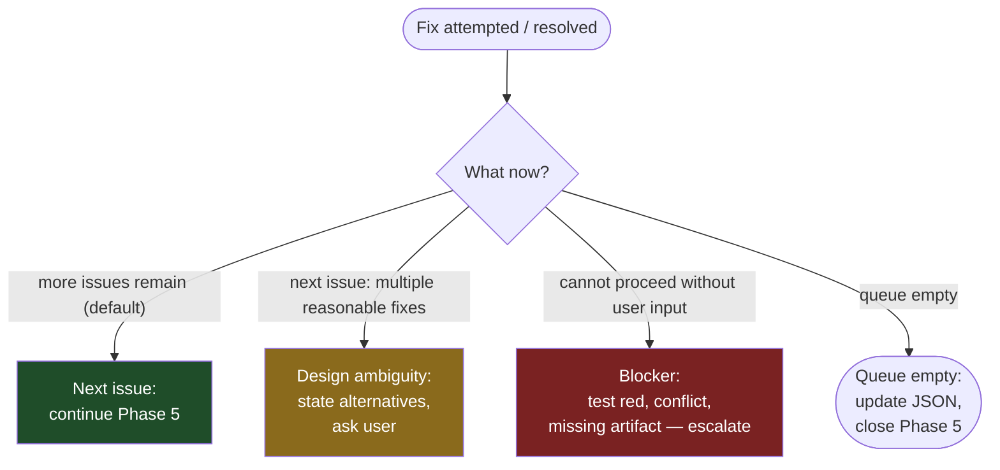

# PR Review

## Overview

Agent-driven code review end-to-end: capture and guards (Phase 1), reviewer fan-out (Phase 2), consolidated verdict
JSON (Phase 3), branch safety before any code change (Phase 4), fix waves and closeout (Phase 5).

The plugin's `scripts/pr_review.py` owns the mechanics; this skill states the procedure and the rules the script
enforces. The main session runs the subcommands, dispatches the rows they print, and makes the judgment calls the
script cannot: severity regrades, merge candidates, the bubble audit, and the conversation with the developer.
Reviewers and fixers never write JSON; each records once through the typed API in its brief.

```bash
sh "${CLAUDE_PLUGIN_ROOT}/scripts/hpy" "${CLAUDE_PLUGIN_ROOT}/scripts/pr_review.py" <subcommand> --pr <N> [options]
```

Run every subcommand with the Bash tool from the project checkout (or pass `--repo <abs project root>`). The
project's `.claude/harness.json` supplies every project value the script reads: the run scratch directory
(`artifacts.scratch`), the review directory (`artifacts.reviews`), the exclusions file (`exclusions`), the test
roots and registry (`tests.*`), the structural guard suites and brief pointers (`review.*`), the project lens file
(`review.lenses`), `state_dir` and the base branch. Below, `<scratch>` and `<reviews>` stand for the first two.

| Subcommand | Phase | Does |
|---|---|---|
| `capture [--roast yes\|no\|roll] [--no-fetch] [--allow-closed]` | 1 | PR metadata, structural guards, review buckets, lens triggers, slot plan, reviewer briefs and diffs under `<scratch>/<NNNN>/<RUN_ID>/`; prints one `agent=harness:pr-reviewer model=<m>` dispatch row per slot |
| `block --agent ID` | 2, 5 | Reprints an agent's return block from its recorded report |
| `fold --source ID --kind external\|tests\|developer\|adhoc (--from-gh-review URL \| --findings FILE\|-) [--severity S]` | 3, 5 | Records an outside review as `findings/<ID>.json` (same Finding model reviewers use) and registers it in `plan.json` `folded`; a GitHub review maps one `judgment` finding per inline comment (default `minor`). Before `build` it is `merge` input. After `build` it appends the source's issues to the review with fresh ids (per severity, after the highest existing; nothing renumbered or auto-merged, merge candidates printed as a note), recomputes the verdict, keeps the phase inside an open Phase 5 pass (`fix-plan` / `fix`, else sets `consolidate`) and prints the added rows; re-folding a source already in the built review is refused, and so is any fold into a review whose Phase 4 first run failed (`pre_fix_time` pending) |
| `merge [--force]` | 3 | Merges the slot reports, then the folded sources, into `draft.json`, assigns ids, prints the issue table and merge candidates; an unregistered `findings/*.json` is a problem |
| `amend [--regrade I3=minor ...] [--merge I3+I7 ...]` | 3 | Applies severity regrades and merges to the draft, logs them, reprints the table |
| `build [--replace] [--waive-head-ancestry]` | 3 | Runs the Phase 4 first run, writes `<reviews>/<NNNN>_<slug>.json` with `pre_fix_time` inserted, records `build_head`. `--waive-head-ancestry` accepts a first run whose only STOP is a head-ancestry desync (Phase 4 waiver) |
| `bubble ID --classification C --reason R` | 5 | Adds a bubble, recomputes the verdict |
| `bubbles` | 5 | Prints fixer bubbles not yet in the review (read-only) |
| `waves [--ids I3,M2]` | 5 | Plans fix waves, writes fixer briefs, prints `agent=harness:pr-fixer model=<m>` rows per wave |
| `closeout [--closed M17="rationale" ...] [--deferred I4="decision; tracker" ...]` | 5 | Validates fixer reports against the working tree, writes resolutions and verdict, prints the Phase 5 line, then any `hint:` lines, then any slow tests held out of the fix waves that the changes since `build_head` reach (the `deferred tests:` block, unrelated to `--deferred`). `--deferred` records a developer-confirmed defer of an issue |
| `closeout --resolved I5="what changed"` | 5 | Resolves a fix in the tree that no accepted fixer entry records (developer-directed work, or a fixer edit closeout rejected); one of the issue's files must have changed since `build_head` |

Each successful subcommand writes the run's position to `plan.json` `phase`: `review` (capture, fold before
build), `consolidate` (merge, amend, build, fold after build outside an open Phase 5 pass), `fix-plan` (bubble),
`fix` (waves; closeout with problems or undispositioned ids), `done` (closeout with every issue id dispositioned).
A fold after build inside an open pass keeps `fix-plan` / `fix`, so only `bubble` and `waves` open a pass.

Every failure exits 1 with one `problem: ...` line per defect on stderr. An exit 1 is a STOP unless the step below
names the recovery. Every write to the review JSON goes through one writer that validates against
`PR_REVIEW.schema.json` (the project's pinned copy under its `schemas_dir`, else the plugin's), the Layer 2 pending
rule and the issue-count check, then runs the plugin's PostToolUse schema hook so the Phase 5 sentinel clears; a hand `Edit` of the review JSON is never part of the procedure.

**Core principle:** Code changes must be implemented on the correct, clean branch. This is verified immediately before
fix application (Phase 4) — not before the review dispatch — because the review itself does not touch code and the
branch state may change between dispatch and the moment fixes begin. This skill exists to make implementing fixes on the
wrong branch impossible.

**REQUIRED:** read `${CLAUDE_SKILL_DIR}/operating_rules.md` before Phase 3. It holds the standing review-JSON
field semantics, grading rules and the Phase 5 dispatch order.

## When to Use

- You are about to request an agent-driven code review on a GitHub PR
- A review JSON exists and its findings still need fixing on the correct branch
- You want mandatory branch safety verification before ANY fix implementation

**When NOT to use:**

- You are requesting review from HUMAN GitHub reviewers via `gh pr edit --add-reviewer`. That is a different workflow
  and does not belong here. Run `gh pr edit <N> --add-reviewer @user` directly — no skill needed.
- You are reviewing code as a reviewer. See `superpowers:receiving-code-review`.

## The Rule

**Every check in Phase 1 and Phase 4 runs every time, in order, without exception.** Phase 2 only starts if every Phase
1 check passes. Phase 5 only starts if every Phase 4 check passes. There is no fast path, no "I already know I'm on the
right branch" shortcut, no "working tree is close enough" exception.

**Violating the letter of these checks is violating the spirit of this skill.** If the user reassures you that something
is fine, that is EXACTLY the pressure this skill exists to resist. Run the check anyway and report the result.

**Session-start state is not a check.** Claude Code's system prompt injects a `gitStatus` snapshot at session start
showing current branch, recent commits, and a status summary. **Do NOT substitute that snapshot for running Phase 4
branch safety checks fresh.** The snapshot ages the moment it is captured — the user may have switched branches,
committed, stashed, fetched, or run a rebase since session start. Every Phase 4 check is a fresh command whose `stdout`
is captured into the `pre_fix_time` section of the `verification_log` when Phase 4 updates the JSON written in Phase 3.
Session-prompt state is a hint, not evidence.

### Gate taxonomy and terminal-step convention

**Mandatory gates** must be evaluated; legitimate skip paths are part of the contract (Phase 1 Check 2's
`applies: false`
when neither filter matches).
**No-exception gates** (Phase 3's atomic close: `merge`, `amend` when needed and `build` in one turn with no
user-facing text before `build` returns; Phase 4's two-run sequence; Phase 5's automatic entry and
continue-until-done) must execute every time, in order — no `applies: false` path, no user-reassurance skip ("the
verdict is obvious", "I already verified the branch", "the dirty files are unrelated").

**Terminal step.** Every phase's numbered sequence has exactly one terminal step — the step the phase's "done
criteria" require on disk or in the JSON, AND the step whose output is the phase's user-visible artifact.
Earlier steps that emit user-visible text (status lines, announcements, heartbeats) are intermediate
transmissions, not terminals; visibility is not a yield permit. The summary is a *report* of work already done,
not a *promise* of work to do.

**Terminal does NOT mean "yield."** A "terminal" designation tells you only *where* the phase's user-visible
output lands. It does NOT, on its own, grant a yield permit.
> *Yielding to the user is governed by the next phase's entry condition, not by the current phase's 'terminal' label.*

When the next phase has automatic entry (e.g. Phase 5 fires automatically once Phase 3's atomic close lands),
control flows from the current phase's terminal step directly into the next phase's first action with no turn boundary
between them. Yielding after a phase's terminal in that case inserts a fake terminal between the two phases and is the
canonical Phase 3 → Phase 5 deferral failure.

**The pr-review skill has ONE true terminal: Phase 5 Step 8.** All other "terminal step" labels in this skill
(notably Phase 3 Step 5) name a user-visible artifact, not a yield point. The Phase 5 Step 5 bubble pause
(user answers bubbled issues) is a sanctioned mid-phase input stop, not a terminal.

---

## Phase 1: Review Dispatch Prep (mandatory, in order)

Phase 1 collects the PR metadata needed to dispatch reviewers and runs CICD structural guards when relevant. **Branch
safety verification (whether you are on the correct, clean branch) happens in Phase 4, immediately before implementing
any fixes.** The review itself does not touch code, so branch state at dispatch time does not affect reviewer output.
One exception: the structural guard suite (Check 2) runs in the working tree, so when it applies `capture` requires the
PR head checked out (see Check 2).

Run, with `--roast roll` for a normal review (the 50/50 dice; `yes` / `no` force it):

```bash
sh "${CLAUDE_PLUGIN_ROOT}/scripts/hpy" "${CLAUDE_PLUGIN_ROOT}/scripts/pr_review.py" capture --pr <N> --roast roll
```

`capture` starts a fresh run directory (`<scratch>/<NNNN>/<RUN_ID>/`, which the project keeps git-ignored; `current`
names the active run) and makes both checks below. **Exit 1 is a STOP:** do not dispatch reviewers; follow Stop Recovery.

### Check 1 — PR metadata

One `gh pr view` call (number, title, headRefName, baseRefName, state, url, head and merge-commit oids, commit count,
first and last sha). The raw stdout is saved as `phase1_meta.txt` and becomes
`verification_log.dispatch_time.pr_metadata_check`. **A PR whose `state != "OPEN"` is a problem** — closed or merged
PRs have nothing to review. `--allow-closed` exists for replaying a past review's plan only; `build` refuses it.

### Check 2 — CICD/test-infra structural guards (conditional)

The script decides whether the guard suite applies, runs it with the project interpreter before any brief is written,
and records the invocation, pass count and output tail for `verification_log.dispatch_time.structural_guards_check`
(`applies: false` with a `SKIPPED` result when no trigger fires). The decision reads the PR head, but the suite runs in
the working tree: when it applies and HEAD is not the PR head (or a reviewable PR path has local edits), `capture`
exits 1 without running it. Check out the PR head and rerun `capture`.

Every guard input is project configuration; a project that configures no guard files never runs the check.

**Step 1 — path filter.** Any PR path starting with one of `review.structural_guard_prefixes`.

**Step 2 — content pins.** A touched test file (under `tests.roots` or matching `tests.file_pattern`, read at the PR
head) whose text matches `review.content_pin_pattern`. The path filter is necessary but not sufficient: such a pin
can live anywhere in the test tree.

**Step 2b — local test files (additive).** Any PR file matching `test_*_local.py` adds `review.local_guards` to the
suite (tests that only run against a locally installed dependency).

**Registry guards (additive).** A touched registry file (the `tests.registry` file or one of `tests.registry_names`)
adds `review.registry_guards`.

**Step 3 — the suite.** `review.guard_suite`, plus the additive files above, each named as a file. Schema-vs-data
consistency is mechanically verifiable; no reviewer should have to spot it by reading code.

**If a guard fails:** `capture` exits 1. STOP. Do NOT dispatch reviewers. Report the failure to the user — the PR is
not in review-ready state, and reviewers writing READY TO MERGE while a structural guard is red is a wasted dispatch.

---

## Phase 2: Reviewer Dispatch

Only runs if `capture` exited 0. If it exited 1, STOP and report — do not proceed to Phase 2 under any circumstance.

**Dispatch every row `capture` printed, in ONE message**, one `Agent` call per row:

```
Agent(subagent_type="harness:pr-reviewer", model=<model from the row>, prompt=<the row's prompt, verbatim>)
```

No sub-skill loads: the rows already satisfy `parallel2` (read-only reviewers, fixed tool set) and the scoping that
`dispatching-parallel-agents` would do is the slot plan below. Do not add, drop, merge or re-scope slots by hand, and
do not edit a brief; a slot plan that looks wrong is a problem to report, not to patch.

### Model floor (reviewer dispatch)

The script picks each slot's model: `opus` by default, `sonnet` when a path-bucket slot holds exactly one file. Always
pass the row's `model` explicitly, never inherit the main session's. `haiku` never reviews — it under-calls Critical
findings; it is reserved for mechanical Phase 5 fixers. Effort is inherited from the main session.

### Slot plan — what `capture` applies

**Exclusions.** Paths matching the project's exclusions file (`exclusions` in `.claude/harness.json`; the same list
and `fnmatch` rule Phase 4 Check 3 uses), plus artifact-bucketed paths, are never review subjects. Reviewers MAY read
them as context, but no slot is scoped to them. To add or remove an exclusion, edit that JSON, not this prose.

**Review buckets** (one per path, first match wins). Each non-empty bucket gets one slot.

| Bucket | Rule |
|---|---|
| cicd | the commit-bucket `Cicd` rule of the project's `commit_buckets` (default: `.github/workflows/**`) |
| config-or-registry | the `tests.registry` file and `tests.registry_names`, `*.schema.json`, `pyproject.toml`, `requirements*.txt`, `.claude/settings*.json`, `<schemas_dir>/**/*.json` |
| tests | paths under `tests.roots` or matching `tests.file_pattern` (default: `tests/**`, `**/test_*.py`, `**/conftest.py`, `**/*.test.ts`, `**/*.test.tsx`, `**/*.test.js`) |
| runtime | suffix `.py`, `.ts`, `.tsx`, `.js`, `.sh`, `.ps1` |
| docs | suffix `.md`, `.txt`, `.rst`, or under `docs/` |
| unbucketed | everything else; reviewed by OVERALL only |

A config-or-registry bucket holding only registry files (the `tests.registry` file and `tests.registry_names`)
merges into tests; the rationale is recorded in `plan.json`.

**OVERALL** always gets a slot covering every reviewable path. **Roast** is the 50/50 dice (`--roast roll`); its slot
dispatches `harness:pr-reviewer` with the roast voice in the brief.

**Default sub-lens (mandatory):** per-file linear code-read pass.

Every reviewer, in every slot, runs a linear docstring-vs-code pass over each in-scope file before any bucket-specific
or cross-cutting reasoning: one top-to-bottom read with no sampling or skip path, checking every module, class and
function docstring or adjacent prose contract against the code, and recording each contradiction as `file:line` with
the claim and the conflicting behavior. Targeted, claim-driven re-reads follow. The brief embeds the catalog's
`default_sub_lenses[*].scope_template`; the pass is a sub-lens, not a slot.

**Cross-cutting lenses** cover concept-shaped concerns that path buckets miss. Triggers are mechanical, evaluated in
Python at the PR head; each triggered lens adds a slot on top of the bucket slots.

| Lens | Trigger |
|---|---|
| per-skill-package | the PR touches `<skills_dir>/<name>/` AND `<name>` appears as a whole word (hyphens included) in a non-excluded file under `.claude`, `docs`, `.github` or the skills root outside that skill's folder; one slot covers every triggered skill |
| coordinated-multi-artifact | >= 2 NEW files (status `A`) matching `*.schema.json` or under `<schemas_dir>/` |
| overall-system-shape | >= 3 non-empty path buckets (OVERALL and roast never count) |
| project lenses | each lens of the project's lens file (`review.lenses`) whose `trigger.path_globs` match at least `min_files` reviewable paths; one slot per triggered lens over the matching paths |

Scope templates come from the plugin's `schemas/catalogs/CrossCuttingLensCatalog.json`, merged with the project's
lens file (`policy.project_lenses`: a same-name lens replaces only its template), and are embedded in the briefs
once. Do not invent lenses or reword templates ad hoc; edit the project's lens file.

**Small-PR lens cut.** Below 20 reviewable files (after exclusions):

- overall-system-shape gets no slot of its own; its scope template is appended to OVERALL's brief.
- When the roast roll fires, the roast slot replaces the OVERALL slot. The roast brief carries OVERALL's full scope
  plus system shape, in the roast voice, so coverage is kept and only the duplicate slot is dropped.

At or above 20 reviewable files, OVERALL, overall-system-shape and roast are separate slots. This is the one exception
to the catalog's `policy.additivity` (`policy.small_pr`); pr-team keeps strict additivity.

### Prompt and brief contract

Each dispatch prompt is exactly the four run-header lines at column 1, then the brief path, nothing else:

```
AGENT_ID: <slot id, unique within the run>
AGENT_ROLE: reviewer
RUN_ID: pr<N>_<UTC yyyymmddTHHMMSSZ, one value for the whole run>
PR: <N>
Brief: <abs path to briefs/<agent_id>.md>
```

The brief (written by `capture`) carries: role and lens; scope paths; how to read the tree at the PR head (Read when
HEAD is the PR head and the paths are clean, else `git -C <repo> show <head_sha>:<path>`); the budgeted diff file; new
files listed as `new file, N lines - read it` and left out of the diff; every summarized or omitted path with its exact
`git diff` command; the catalog scope templates; the default sub-lens; the clauses below; each
`review.domain_pointers` text whose prefix starts an in-scope path; the roast voice for the roast slot; and the exact
`record` heredoc (run through the plugin's `hpy` launcher).

**Artifact ownership clause** (every brief, verbatim):

> Record findings only through `record`; never write under `<reviews>/`; reply with the printed block only.

(`<reviews>` is spelled out as the project's configured directory in the brief.)

`record` validates every finding (severity, name, summary, one or more `fix` options, repo-relative `file`, optional
`lines` and `also`, `fix_kind` mechanical or judgment) before writing, replaces the reviewer's report on a retry, and
prints the return block. Reviewers never choose issue ids; ids are assigned at merge.

**Test-design clause** (every brief whose scope includes test files, verbatim):

> Test-design principle: every test in scope must be either CLEARLY BEHAVIORAL (exercises real logic with real
> or fake collaborators that do not stub the function under test) OR an integration test against the real
> dependency. Mock-chain wiring tests — tests that stub the helpers and then assert the stubs were called — are
> NEITHER. Flag each one as Critical, recommending removal or conversion to a behavioral or integration test.

**Return block.** The reviewer's reply is the block `record` printed (the reviewer form of the pr-team skill's
`return_contract.md`, with the strict `COUNTS: findings=<N> critical=<C> important=<I>
minor=<M>` line). The `pr-review-watch` mod attributes engine-measured usage by the header and takes the counts from
the block, so the Phase 3 Step 4 matrix rows carry real `tokens` / `tool_uses` / `duration_s`; both are inert when the
mod is not loaded. A reply without the block is recovered with `block --pr <N> --agent <ID>`; a slot with no report
at all is re-dispatched with its original row.

### Envelope vs contents (scope boundary)

**This skill's scope covers two verification gates:** Phase 1 verifies the PR is open and review-ready (CICD guards).
Phase 4 verifies branch safety before applying fixes (branch match, SHA ancestry, clean tree). Content review happens in
Phase 2 via reviewer subagents.

Do not expand Phase 1's scope to "read the diff first and sanity-check." Content review happens in Phase 2 via the
reviewer subagents. If you catch yourself wanting to peek at the diff before dispatching, that is scope creep — let the
reviewers do their job.

---

## Phase 3: After Reviewers Return

Once the last reviewer returns, this skill records the reviewer outcome and the verified envelope in the consolidated
verdict file.

**Temporal gate (mandatory):** Phase 3 begins **IMMEDIATELY** when the last reviewer returns. The atomic close is
`merge`, `amend` (only when needed) and `build`, in one turn, with **no user-facing text before `build` returns**.
The review JSON is the source of truth, written only by `build`; the chat summary is a view onto it.

- **No heartbeats.** A "reviewers returned, building the verdict now" line is a protocol violation, not a courtesy.
  One line of pre-`build` text is the same failure as a full summary, just shorter.
- **No drafts.** A summary drafted in a scratch note, a thinking block or any parallel artifact is deferral in
  disguise. Compose the summary from the file `build` wrote.
- **No "ceremony" excuse.** "The verdict is obviously READY TO MERGE, the JSON is just ceremony" is the most common
  rationalization for deferring Phase 3. The ceremony **IS** the evidence. There is no verdict without the recorded
  file.

**Order enforcement.** The mandatory sequence is:

0. **Fold outside reviews (only when there are any).** A review from outside the slot plan joins the run as a
   findings source before `merge`: an external reviewer (a GitHub PR review URL), test results, the developer, or
   ad-hoc feedback. A developer's free text, pasted test output, a review URL or a tool report goes through
   `harness:fold-in-review`, which verifies each claim, runs this fold itself and continues the sequence; the main
   session does not run this fold again for it. Otherwise run `sh "${CLAUDE_PLUGIN_ROOT}/scripts/hpy" "${CLAUDE_PLUGIN_ROOT}/scripts/pr_review.py" fold --pr <N> --source <snake_id>
   --kind external|tests|developer|adhoc` with `--from-gh-review <URL>` or `--findings <FILE>` (`-` reads stdin; a JSON list
   of findings, or `{"findings": [...], "strengths": [...]}`). Findings go through the same Finding model reviewers
   use, so `merge` treats a folded source like a slot and `build` credits it as `<id> (<kind>)`. A GitHub review
   maps one `judgment` finding per inline comment at `--severity` (default `minor`) and is skipped when DISMISSED
   or blank without comments; before `build`, regrade its findings with `amend` after `merge`. Fetch a URL the
   moment it arrives; fold it once the in-flight reviewers return. A fold after `merge` needs `merge` rerun
   (`--force` when the draft was amended); `build` refuses a draft missing a folded source. `fold` also works
   after a successful `build`, at any point of Phase 5 (a review whose Phase 4 first run failed refuses it until
   `build --replace` lands). **Grade before a post-build fold:** `amend` does not run after `build`, so the
   severity the fold records is final. When the review's comments differ in blast radius, convert them to a
   `--findings` file with a per-finding `severity`; otherwise pass the matching `--severity` (never the default
   for a comment that reports a critical or important defect). The fold appends the source's issues to the
   review with fresh ids (per severity, after the highest existing; existing ids never renumber, nothing
   auto-merges, so merge candidates print as a note), credits the source, recomputes the verdict, keeps the
   phase inside an open Phase 5 pass (else sets `consolidate`) and prints the added rows
   plus `next: Phase 4 second run, then waves (new ids only)`, or, inside an open Phase 5 pass, `next: waves (new
   ids only), then closeout (Phase 5 pass open: no second run)`. Re-folding a source already in the built review is
   refused with its ids; fold new findings under a new `--source` id.
1. **`merge`.** `sh "${CLAUDE_PLUGIN_ROOT}/scripts/hpy" "${CLAUDE_PLUGIN_ROOT}/scripts/pr_review.py" merge --pr <N>` merges the reports of the run's slots
   into `draft.json` and prints one line per issue (`I3 important path:lines [slots] name`), then the
   `merge candidates:` pairs, then the strengths count. Findings sharing a primary file whose line ranges lie within 3
   lines of each other merge automatically, every pair in a merged group, never by chaining (highest severity wins, `judgment` beats `mechanical`, every slot is
   credited); findings without lines never auto-merge. Ids are numbered per severity by file, first line, name. A
   missing report is a problem naming the slot: re-dispatch that slot's row, then rerun `merge`.
2. **`amend` (only when the table needs it).** Two judgment calls, made from the printed table:
   - **Regrade by blast radius** (operating rules, "Grading and verifying findings"): `--regrade I3=minor`.
   - **Merge candidates that are the same defect:** `--merge I3+I7` (the first id is kept).

   `amend` logs each operation in the draft and reprints the table; `merge` refuses to overwrite an amended draft
   without `--force`. Once `build` has written the review, `merge` and `amend` both refuse (a draft change would
   never reach it). No changes needed: skip straight to `build`.
3. **`build`.** `sh "${CLAUDE_PLUGIN_ROOT}/scripts/hpy" "${CLAUDE_PLUGIN_ROOT}/scripts/pr_review.py" build --pr <N>` assembles
   `<reviews>/<NNNN>_<slug>.json` (4-digit zero-padded PR number, title slug). It checks for stragglers, runs the
   Phase 4 first run (`phase4_branch_safety.py <N>`, no `--second-run`), inserts its JSON as
   `verification_log.pre_fix_time` in memory, then validates and writes the review once and records `build_head`.
   It prints the path, verdict and counts.
   - **Straggler problem:** any other `<reviews>/<NNNN>_*.json` or `<NNN>_*.json` is reported before writing. A
     reviewer-written file broke the ownership clause: confirm its findings are in the draft (re-dispatch the slot if
     not), delete it, rerun `build`. A same-named file is overwritten only with `--replace`; any other existing review
     of this PR is the developer's call — STOP and ask.
   - **Phase 4 first-run failure** (rc 1 = a check failed, rc 2 = argv error, empty or non-JSON stdout = metadata
     failure): the review is kept with `pre_fix_time` still the pending literal and its verdict overridden to
     `NOT READY TO MERGE - Phase 4 first run failed: <reason>` (a READY verdict is never kept), `build` exits 1 — STOP. Do not emit
     Step 5, do not enter Phase 5. `phase4_first_run.json` in the run directory holds stdout, stderr and rc.
4. **Matrix rows (the manual JSONL append).** When the reviewer `Agent` results carried the
   `[pr-review-watch] Matrix rows for this run are recorded by the pr-review-watch mod` note, skip this step: the mod
   appends one validated row per reviewer once the review JSON has its verdict, with engine-measured usage. Without
   that note, append one row per reviewer (`dispatch_shape: "parallel"`, `phase4_script: null`) to
   the project's `matrix_path` (`.claude/harness.json`):
   - Fields per `pr_review_invocation_test_matrix.schema.json` (the project's `schemas_dir` copy when pinned, else
     `${CLAUDE_PLUGIN_ROOT}/schemas/`) (`cell`, `pr`, `model_family`,
     `effort`, `dev_commit`, `dispatch_shape`, `tokens`, `tool_uses`, `duration_s`, `findings_count`, `C_count`,
     `I_count`, `M_count`, `other_count`, `verdict_prefix`, `notes`).
   - `model_family` is the enum token found anywhere in the model id
     (`next(t for t in ("haiku", "sonnet", "opus") if t in raw_id)`), never a left split on `-`.
   - `dev_commit` is `git merge-base HEAD <configured base branch>` (`base_branch`, else the branch `origin/HEAD`
     points at, else `main`) plus a ` -- <branch-label> (<tag>)` suffix, captured once per run.
   - Validate each row with `jsonschema.validate(row, schema)` BEFORE appending; never append an invalid row.

   **The attempt is mandatory; the failure is forgivable.** A disk or lock error is logged and tolerated; omitting
   the attempt is a Phase 3 failure.
5. **Emit the user-facing summary**, referencing the path `build` printed. **The summary MUST lead with a one-line
   protocol-state announcement**, before any verdict or finding text:

   ```
   Phase 3 [done] | Phase 4 first-run [done] | Phase 5 entry: automatic | next: Phase 4 second-run + fix dispatch
   ```

   By the time Step 5 fires, the Phase 4 first run has either landed (`build` exit 0) or aborted with a STOP (Step 5
   does not fire at all). Invisible state is the same failure mode as un-executed state: the user reads the protocol
   position from the chat without opening the JSON.

**Step 5 is the user-visible summary step — NOT a yield point.** Steps 1–4 produce no output to the user; Step 5 is
the single visible artifact and describes work already on disk. Per the Terminal-step convention near the top of
this skill, "terminal" names *where* the phase's output lands; it does NOT grant a yield permit. **Control DOES NOT
yield after Step 5.** The next action is the Phase 4 second run (Phase 5's first action), with no turn boundary
between them. Neither the matrix append nor the summary is a hand-back point.

The Phase 4 first run is folded into Phase 3's atomic close inside `build`: Phase 3 → Phase 4-first-run is not a
transition between phases, and there is no user gate between them.

**What `build` guarantees** (the schema, `PR_REVIEW.schema.json`, is the authority on shape):
`pr_title` verbatim from the PR; `base_branch` copied from `baseRefName`, never assumed `main`; both
`dispatch_time` sub-objects present with raw `stdout` paste captures (`structural_guards_check` is `applies: false`
with a `SKIPPED` result when no guard trigger fired); `pre_fix_time` either the full Phase 4 struct or the literal
`"pending - to be populated in Phase 4"`; `bubbles` and `bubble_up` initialized as `[]`; every `issue.fix` an array
of one or more self-contained alternative remediations; the verdict derived per the rule below. A `build` problem is
fixed at its source (a report, the draft, the branch), never by hand-editing the written JSON.

**Done criteria (concrete).** Phase 3 is complete when ALL of the following hold:

- **(a)** `build` exited 0 and the review exists at `<reviews>/<NNNN>_<slug>.json`.
- **(b)** The file passed `build`'s writer gate: schema, Layer 2 pending rule, issue-count check, hook run.
- **(c)** Every Phase 2 slot has a report in the run directory and is credited in `reviewers`.
- **(d)** The `verdict` matches `^(READY TO MERGE|NOT READY TO MERGE)(.*)$` and is the derived value, naming the
  blocking ids when NOT READY.
- **(e)** `verification_log.dispatch_time.pr_metadata_check.stdout` is the raw `gh pr view` output from
  `phase1_meta.txt`.
- **(f)** **Exactly ONE** `<reviews>/<NNNN>_*.json` exists for this PR and no `<NNN>_*.json` straggler.
- **(g)** **The Phase 4 first run completed** and `verification_log.pre_fix_time` holds the full branch safety struct,
  not the pending literal.
- **(h)** **Reviewer statistics rows were appended (or the attempt was made and failed)** per Step 4: the
  `pr-review-watch` ownership note on the reviewer results (the mod makes the attempt and records its failures),
  else the manual append. Skipping the attempt is a Phase 3 failure.

If ANY of (a)-(h) is not satisfied, Phase 3 is NOT done. Do not emit the user summary (Step 5). Do not claim
completion. Fix the missing piece first.

### Verdict re-evaluation rule

The `verdict` is derived from the current `issues`, `post_review_resolutions`, `bubbles` and `bubble_up`, never a
frozen snapshot. One function computes it for `build`, `bubble` and `closeout`, and each recomputes it in the same
write that changed the state. The rule matches the hook's issue-count check, which rejects READY while any id is
undispositioned:

1. **Orphan check.** A resolution or disposition id that names no issue is a writer error: the command fails and
   writes nothing.
2. **Unresolved** = no resolution, or a resolution whose status is not `RESOLVED` / `CLOSED_NO_ACTION`.
   `DOWNGRADED_TO_*` is unresolved: the issue still needs action, at a lower severity.
3. The verdict, first match wins:
   - any unresolved **critical** → `NOT READY TO MERGE - critical: C1, C2`
   - else any unresolved **important** → `NOT READY TO MERGE - important: I1, I4`
   - else any id not dispositioned (no resolution, not in `bubbles`, not in `bubble_up`) →
     `NOT READY TO MERGE - minor findings pending Phase 5: M1, M3`
   - else `READY TO MERGE - <R> of <T> findings resolved, <B> bubbled`
4. **Phase 4 override (outside steps 1-3).** When `build` runs the Phase 4 first run and it fails, a READY verdict
   becomes `NOT READY TO MERGE - Phase 4 first run failed: <reason>`. The derived forms above do not cover this case,
   and `build` applies it. A pending `pre_fix_time` allows no READY verdict (done criterion (g) above).

A bubbled Critical or Important keeps the verdict NOT READY: the agent has no authority to close what it cannot
resolve, and the developer's decision is the legitimate next step. A bubbled Minor is dispositioned. Bubbling is not a
missing closeout; it is "agent did its part, developer decides the rest."

**The user is a reviewer of the JSON, not its editor.** If issues are all RESOLVED but the verdict still says NOT READY
TO MERGE, the JSON is internally inconsistent and the user has to ask for the fix — that is a skill failure. The verdict
and the issue/resolution state must always be coherent at write time.

**Why this is mechanical, not judgment.** "Are all criticals resolved?" is a set-membership question; "is the verdict
correct?" is its conclusion. Treating verdict as judgment-only invites stale-snapshot drift — exactly the failure mode
this rule prevents.

---

## Phase 4: Branch Safety Verification (mandatory, in order)

### Mechanical invocation (canonical execution path)

Phase 4's five checks are encapsulated in a single script:

```bash
sh "${CLAUDE_PLUGIN_ROOT}/scripts/hpy" "${CLAUDE_PLUGIN_ROOT}/skills/pr-review/commands/phase4_branch_safety.py" <PR_NUMBER>
```

Run it with the Bash tool from the project checkout; the project is the git top level of the working directory.

The script runs all five checks in order, captures every command's raw stdout, and emits a JSON object on stdout that
matches the `verification_log.pre_fix_time` schema sub-block exactly. Exit 0 = PASS; exit 1 = STOP (failed check's
result field carries the diagnostic; stderr names which check failed).

**This is the canonical Phase 4 invocation.** The five-check description below is preserved as documentation of WHAT
the script does and WHY -- it is NOT a separate manual execution path. Agents MUST invoke the script; partial
execution is impossible because the script either runs to completion or doesn't run. The first run is invoked by
`pr_review.py build`, which inserts the script's JSON as `pre_fix_time`; the second run is invoked directly.

The Layer 2 PostToolUse hook on `<reviews>/*.json` blocks any final-shaped review JSON whose
`verification_log.pre_fix_time` is still the literal `"pending"` string -- producing a complete review without
running the script is mechanically impossible.

### Two-context execution

**Phase 4 runs in two contexts:**

1. **Inside `build`, Phase 3 Step 3** (automatic, no user gate) — first-run verification that populates
   `verification_log.pre_fix_time` at review-completion time. This establishes the baseline branch state. Even
   though it is sectioned under Phase 4 here for documentation reasons, it executes inside Phase 3's atomic close
   with no turn boundary.

2. **As Phase 5's first action** (automatic, no user gate) — temporal re-verification that ensures branch safety is
   still valid. Phase 5 begins automatically once Phase 3's atomic close lands (the user-trigger gate is repealed; the
   Phase 5 intro and its Order enforcement preamble codify automatic firing). The second run is the first thing Phase 5 does, before any
   fix-dispatch. Branch state can change between Phase 3 closeout and Phase 5 entry (user switched branches, stashed
   work, fetched updates while the orchestrator was assembling the JSON). The re-verification is mandatory before ANY
   code change is made.

**Why twice:** The review itself does not modify code. Being on the "wrong" branch at review time does not change what
reviewers see (they read GitHub's committed history). What matters is being on the correct, clean branch **at the moment
you begin committing fixes**. The first run captures baseline; the second run enforces temporal validity.

**Both runs execute all five checks below, in order, without exception.** Phase 5 only starts if every Phase 4 check
passes on the temporal re-verification. There is no fast path, no "I already verified after Phase 3" shortcut, no "
working tree is close enough" exception.

**Second-run flag and the Stop-hook sentinel.** The second-run invocation MUST pass `--second-run`:

```bash
sh "${CLAUDE_PLUGIN_ROOT}/scripts/hpy" "${CLAUDE_PLUGIN_ROOT}/skills/pr-review/commands/phase4_branch_safety.py" --second-run <PR_NUMBER>
```

A `--exclusions-fixture <path>` flag exists for callers needing to override the default JSON; the default (the
project's configured `exclusions` file) matches all standard pr-review workflows. The pr-team skill
threads this flag explicitly via its dispatch_plan.exclusions_fixture_path field.

On all-checks-pass, the script writes `<main checkout>/<state_dir>/pr-review/.phase5_pending_<PR>` (a linked
worktree arms its main checkout, so the gate holds whichever worktree the session sits in) — a sentinel file
consumed by the plugin's `Stop` hook (`check_phase5_sentinel.py`). Line 3 records the arming session
(`CLAUDE_CODE_SESSION_ID`, exported to subagents too). While the sentinel exists, the harness blocks that session
from ending; other sessions stop with a notice to leave the file alone. A sentinel without line 3 blocks every
session, and a Stop input without a session id is blocked by every hot sentinel (fail closed). Known limitation: a
session-id change after arming (`/clear`, or a resume that forks a new id) makes the continuing conversation a
different owner, so the block no longer holds for it (fails open); re-run `phase4_branch_safety.py --second-run
<PR_NUMBER>` from the continuing session to re-arm the sentinel under its id. With the `pr-review-watch` mod
installed, a per-prompt `PHASE5_PENDING=<ids>` context line lists every hot sentinel, whichever session armed it; a listed PR is not proof this
session owns it. The sentinel is deleted **mechanically** by the PostToolUse hook (Layer 3 of
the plugin's `validate_pr_json_schema.py`) when the matching PR_REVIEW JSON shows EITHER of two closeout shapes:
(a) **resolution closeout** — `post_review_resolutions[]` populated, `verdict` no longer starts with
`NOT READY TO MERGE`, and at least one resolution carries SHA-shaped evidence; OR
(b) **bubble-accounted closeout** — every issue id is dispositioned across `post_review_resolutions[]`, the
transient `bubbles` array, and the `bubble_up` ledger (any resolutions present still need SHA evidence; bubbled
items need none). Shape (b) clears the sentinel even when `verdict` stays `NOT READY TO MERGE` because Important
items are bubbled for the developer — the agent has done its part. Both shapes share one id-set predicate
(`harness_lib.validation.id_handling.all_issues_dispositioned` / `disposition_ids`), so the gate and the issue-count check never
drift. **No agent action is required to clear the sentinel** — every review write by `pr_review.py` (`build`,
`bubble`, `closeout`) runs that hook after the write, so Rule 5's `closeout` triggers cleanup. Stale sentinels
(older than 24 hours) are auto-ignored by the Stop hook with a warning; manual cleanup deletes only the single
stale file that warning names (`rm <state_dir>/pr-review/.phase5_pending_<PR>`). Never glob: other sessions'
hot sentinels share the folder.

The first-run invocation (inside `build`) does NOT pass `--second-run` and does NOT write the sentinel — only the
Phase 5 entry point arms the dispatch-completion gate.

### Check 1 — Current branch

```bash
CURRENT_BRANCH=$(git -C "$REPO" rev-parse --abbrev-ref HEAD)
echo "Currently on: $CURRENT_BRANCH"
```

Record the value. Do not proceed without running this, even if you believe you know the branch. Local state can drift (
detached HEAD after a checkout, new worktree, forgotten rebase). The command takes 50ms; the cost of being wrong is a
fix committed to the wrong branch.

### Check 2 — Branch match (field-by-field assertion)

```bash
test "$CURRENT_BRANCH" = "$(jq -r .headRefName <<<"$PR_METADATA")" \
  && echo "OK: branch matches PR headRefName" \
  || { echo "STOP: branch mismatch"; exit 1; }
```

`PR_METADATA` is the object captured in Phase 1 Check 1. This is a **named comparison**, not a visual glance at output.
If they differ, STOP and report to the user with the specific mismatch and a suggested recovery command (
`git checkout <headRefName>` or `git fetch origin && git checkout -t origin/<headRefName>`).

### Check 3 — Clean working tree

```bash
EXCLUSIONS="<exclusions>"   # empty when the project configures none
if [ -n "$EXCLUSIONS" ]; then
  DIRTY=$(git -C "$REPO" status --porcelain \
    | sh "${CLAUDE_PLUGIN_ROOT}/scripts/hpy" "${CLAUDE_PLUGIN_ROOT}/lib/harness_lib/git_status_filter_excluded.py" "$EXCLUSIONS")
else
  DIRTY=$(git -C "$REPO" status --porcelain)
fi
if [ -z "$DIRTY" ]; then
  echo "OK: working tree clean (after exclusions)"
else
  echo "STOP: working tree has non-exempt changes:"
  echo "$DIRTY"
  exit 1
fi
```

The script applies the same filter in process: it loads the exclusions JSON, treats every entry's `pattern` as an
fnmatch glob, and keeps only the lines whose paths match no pattern. `<exclusions>` is the project's configured
`exclusions` file (`--exclusions-fixture <other.json>` overrides it); with none configured, the shell form skips the
filter (never call the helper without a file argument) and every change counts.

**Exclusions** (the project's exclusions file): generated artifacts such as CI freshness reports, PR summaries and
review JSONs are produced outside PR scope and would otherwise force a false STOP. Treat the JSON as the authority —
do not hard-code patterns here.

**This check is mandatory and a dirty tree is a hard STOP.** Fixes must land on a clean surface — non-exempt uncommitted
edits interleave with fix commits and produce incoherent history. Two failure modes:

1. **Load-bearing local edits.** You wrote a fix, forgot to commit it, and now it will be lost or mixed with review-fix
   commits. Production breaks.
2. **Unverified user claim.** The user says "those dirty files are just debug logging." That may be true, OR it may be
   an earlier fix they forgot they wrote. Verifying costs 30 seconds (`git diff <files>`); being wrong costs a bad
   commit history. Always verify, never trust the reassurance.

**If the tree is dirty:**

- Inspect each dirty file (`git diff <file>`).
- If the edit belongs to the PR: ask the user to commit and push before proceeding. STOP.
- If the edit is genuinely unrelated: ask the user to stash (`git stash`) before proceeding. STOP.

**No filename exception.** A file named `debug_trace.py`, `scratch.py`, `tmp_notes.md`, `wip_helper.py`, or anything
else "sympathetic" gets the SAME inspection as any other dirty file. **Filenames are social signals, not permissions.**

**Reading budget.** Plan 2-3 minutes per dirty file in a production directory. A 200-line diff in a runtime package
is a 2-3 minute read, not a skim.

### Check 4 — SHA ancestry

```bash
BASE_SHA=<first_sha from Phase 1 Check 1>
HEAD_SHA=<last_sha from Phase 1 Check 1>

git -C "$REPO" merge-base --is-ancestor "$BASE_SHA" HEAD \
  && echo "OK: BASE_SHA ancestor of HEAD" \
  || { echo "STOP: BASE_SHA not on current branch"; exit 1; }

git -C "$REPO" merge-base --is-ancestor "$HEAD_SHA" HEAD \
  && echo "OK: HEAD_SHA ancestor of HEAD" \
  || { echo "STOP: HEAD_SHA not on current branch"; exit 1; }
```

Do NOT skip this as "tautological." Force-pushes, local resets, divergent fetches, and worktree cross-contamination all
produce cases where the PR's SHAs are not ancestors of your HEAD. The check is cheap. Run it.

### Check 5 — Record base branch (NOT always `main`)

Capture `baseRefName` from Phase 1 Check 1 verbatim. **Never assume `main`.** Projects commonly target a development
branch, feature-parent branches, or integration branches; the script records whether `baseRefName` is the configured
base branch (`base_branch` in `.claude/harness.json`, else the branch `origin/HEAD` points at, else `main`).

If the base branch is anything other than the configured base branch or one of the configured
`integration_branches`, pause and confirm with the user that this is intentional — unusual base branches sometimes
indicate the PR was opened against the wrong target.

### Phase 4 closeout — the JSON (first run only)

After all five checks pass on the **first run**, `build` replaces the `verification_log.pre_fix_time` placeholder
with the script's sub-object in the same write path as the rest of the review. This IS part of Phase 3 Step 3 — not a
separate Phase 4 closeout fired after the user summary. The user summary (Phase 3 Step 5) fires after it, not before.

**Sub-object shape:** see the canonical schema `PR_REVIEW.schema.json` (project-pinned copy first, else the
plugin's) —
`verification_log.pre_fix_time` populated form constrains all five sub-checks (`current_branch_check`,
`branch_match_check`, `clean_tree_check`, `sha_ancestry_check`, `base_branch_recorded`) with required keys, types,
and content rules. The `phase4_branch_safety.py` script emits exactly this shape.

**Paste-capture contract.** `stdout` fields MUST be raw command output, not summaries. A `clean_tree_check.stdout`
of `""` is an affirmative "clean" claim; a `stdout` of `"OK"` is a **lie** because `git status --porcelain` never
outputs the literal string "OK". The schema's `description` fields encode this contract; the runtime script obeys it.

**Phase 4 done criteria (first run):** All five checks passed AND `verification_log.pre_fix_time` in the JSON is the
full struct (per the schema). The first-run result is reported in the Phase 3 Step 5 summary. Control does not yield
there and flows straight into the Phase 4 second run.

**If any check fails on the first run, STOP and report — do not advance to Phase 3 Step 5 (the user summary), do
not transition into Phase 5.** `build` keeps the review with `pre_fix_time` still the pending literal (the Layer 2
rule keeps flagging it) and saves the script's stdout, stderr and rc in `phase4_first_run.json` as the audit trail.
The user must resolve the branch state (checkout correct branch, commit/stash dirty files, fetch missing SHAs); then
rerun `build --replace`, which re-executes the first run from Check 1. The review-fix loop does not begin until the
first run lands cleanly. The driver enforces this: `waves` (and `bubbles`) refuse while `pre_fix_time` is still pending, so
no fixer brief or dispatch row exists after a failed first run. The one waived failure (operating rules, "Phase 4 branch checks"): when the only failed check
is `sha_ancestry_check` with `head_ancestor_exit != 0` and `base_ancestor_exit == 0` (the remote PR head lags local
HEAD), rerun `build --replace --waive-head-ancestry`; `build` inserts `pre_fix_time` and records the waiver in
`plan.json`.

**Phase 4 second run (Phase 5's first action, automatic):** The user-trigger gate ("when the user says 'fix the
issues'") is repealed — Phase 5 begins automatically once Phase 3's atomic close lands. The second run is its first
action. Re-run all five checks fresh (do NOT trust the first-run values — branch state may have changed between Phase 3
closeout and Phase 5 entry). If any check fails on the second run, STOP and report — do not proceed to dispatch any fix.
If all checks pass, proceed immediately to Phase 5 fix dispatch. **The second run does NOT write to the JSON** — the
`pre_fix_time` section already exists from the first run, and overwriting it would corrupt the audit trail of the
first-run state. The second run only verifies temporal validity and (when invoked with `--second-run`) arms the Phase 5
sentinel.

---

## Phase 5: Post-Review Fix-Application Protocol

Phase 5 entry is automatic once Phase 3's atomic close lands; its first action is the Phase 4 second run. Phase 5
governs the fix work that follows. The agent does not wait for user input to begin fixing issues.

### Stop-condition triage (per wave)

After each fix wave returns, classify the next action against the diamond below. The four-exit shape is
intentional: the deferral exit ("let me summarize the plan first") has no node by design — it is
not a legitimate stop. Continue is the structural default.



The Rules below give the rationale and per-tier mechanics. The diamond is the navigation skeleton;
the prose is the guardrail against rationalizing into a fifth exit that does not exist.

**Rule 0 — Severity does NOT gate Phase 5 execution.** Phase 5 runs whenever there are any issues identified, and
yet-unresolved, regardless of which severities are in `issues.*`.

> **Severity gates the verdict, not the fix loop.**

A `READY TO MERGE` verdict means the merge signal is green; it does NOT mean Phase 5 is skipped. Phase 5's job
is to clear the queued findings — and the absence of Criticals/Importants is a *stronger* reason to run Phase 5,
not weaker, because the fix load is small and the cleanup is cheap.

The skip path is **per-issue**, not per-phase: an issue that survives the Rule 4.5 audit (out of the PR's scope, or
genuinely ambiguous with no obvious winner) is bubbled with `bubble` and held out of the waves. Do NOT pick
arbitrarily between genuinely ambiguous fixes. Anything else — Critical, Important, Minor, cosmetic, "trivial" — runs
through Phase 5. Rule 3's ordering governs *which order*, never *whether*.

The failure mode this rule blocks: agent sees `verdict: READY TO MERGE` and 0 Criticals / 0 Importants in the
JSON, concludes "nothing to fix," and emits a closing summary without dispatching anything. That mistakes the
*verdict* (merge signal) for the *Phase 5 work queue* (fix signal). The two are independent: the verdict tells
the developer "merge is unblocked"; Phase 5 tells the agent "now clean up the rest."

**Rule 1 — No pause for confirmation between issues.** Do not stop after each finding to ask "should I proceed to
the next?" The user already greenlit the work. Pause only when (a) you need genuine input — a design choice with
reasonable alternatives the user has not stated a preference on, or (b) you encounter a blocker that warrants
escalation. Routine mechanical fixes do not qualify.

**Rule 1.5 — No "let me show you the plan" pause.** After Phase 4 clears, the dispatch plan is internal staging,
not a deliverable. Reading source files for exact-edit context is correct; pausing *after* that read to summarize
the plan to the user is Phase 3's deferral pattern shifted to the fix step. **If you have context to write the
dispatch rows, you have context to dispatch.** The user reviews the *result*, not the *intent*.

**Rule 2 — Fixes run in `harness:pr-fixer` subagents planned by `waves`.** Fixes are NOT main-session work, and fixer prompts
are never hand-written. `waves` plans the undispositioned, non-held, not-yet-fixed issues as units:

- **Parts and whole issues.** A mechanical multi-file issue splits into one single-file part per file, owned by that
  file's fixer, so one id can appear in several fixers of a wave (the brief shows `Your part` / `Other parts`). A
  judgment multi-file issue stays whole over primary + `also`, with one owner, and is placed first.
- **At most 6 units (whole issues or parts) per fixer;** the remaining units group by file, and a file with more
  splits into chunks of at most 6.
- **File-disjoint within a wave** over the files each fixer owns, so a wave's fixers run in parallel; a later wave
  runs only after the earlier one returns.
- **Widened file set.** Each fixer also owns the registered tests (entries of the project's `tests.registry` whose
  `test_target_paths` include one of its issues' files) and the existing repo paths its issues' `fix` options name
  (`a/b/c.ext` tokens), so a fix can carry the test and doc edits it needs. Widened files count in the wave's
  disjointness check and closeout's file-set validation; parts and the split rule are unchanged.
- **Deferred tests.** A registered test whose summed seconds in the project's `tests.timings` report exceed
  `tests.fixer_test_seconds`, or whose registry entry is `true` at one of the `tests.defer_flags` paths, is listed
  in the brief as `deferred, do not run` with its reason. It is editable when the file set lists it, but no fixer runs it;
  one slow suite would otherwise gate the whole wave and every later one.
- **Model per fixer:** `haiku` when every issue is `fix_kind: mechanical`, else `opus`.
- Dispatch each row as `Agent(subagent_type="harness:pr-fixer", model=<row model>, prompt=<row prompt>)`. The fixer reads
  before it edits, stays inside its brief's file set (new files allowed), runs the brief's test commands for each
  edited file (never a deferred test), and records once with `record_fixes`.

**Rule 3 — Work up the severity chain inside each fixer.** A fixer brief orders its issues **M → I → C**, so I/C work
lands on a quality-checked surface. Waves are sized by issue count and file overlap, not by severity tier; do not
re-split a plan by tier by hand.

**Rule 4 — Continue until input genuinely needed.** After each wave returns, dispatch the next, then closeout. Stop
only at:

- **Design ambiguity** with no clear winner (state alternatives, ask).
- **Blocker** (test red, conflict, missing file).
- **Completion** (all issues resolved, verdict recomputed).

**Rule 4.5 — Pre-surface bubble audit.** During fix planning — BEFORE the fix dispatch, BEFORE any candidate
bubble surfaces to the user, and BEFORE the atomic closeout (Rule 5) writes `post_review_resolutions[]` and
`bubble_up[]` — re-audit every item you are about to
bubble. For each candidate bubble, answer three explicit questions:

1. **Are there ≥ 2 reasonable resolutions, AND does picking either one require domain knowledge the agent
   demonstrably does not have?** If yes to both: bubble as `architectural_ambiguity`.
2. **Is the fix outside the PR's actual scope** (different module, different feature, etc.)? If yes: bubble as
   `out_of_scope`.
3. **Does the fix require user judgment on an aesthetic or convention call where the codebase has no clear
   precedent?** If yes: bubble as `architectural_ambiguity`.

If all three answers are NO, bubble only if the work is genuinely net-new and exceeds Phase 5 mechanical scope
(`needs_follow_up`). Otherwise: pick the safest, most mechanical option and resolve.

Survivors are recorded with `bubble <ID> --classification <C> --reason "<R>"` (an unknown id is a problem and leaves
the file unchanged). Items that are NOT bubbled join the waves — through a `waves --ids` follow-up wave when a
late-discovered candidate fails the audit after the plan was made. Two misclassification patterns this audit blocks:

- **Multiple `fix` options ≠ "developer must choose."** A reviewer's `fix` array with > 1 option means "any of
  these would resolve," not "the user must pick." The default is: the agent picks the safest, most mechanical
  option and resolves. Tag `architectural_ambiguity` only when question 1 above is a genuine double-yes.
- **`needs_follow_up` is not a synonym for "bubble."** It is a load-bearing classification reserved for net-new
  work that genuinely exceeds in-session scope. Small docstring fixes, one-line generator changes, and similar
  shippable edits run through the fix dispatch, not the bubble list.

**Rule 5 — Atomic JSON closeout through `closeout`.** After the last wave, run
`sh "${CLAUDE_PLUGIN_ROOT}/scripts/hpy" "${CLAUDE_PLUGIN_ROOT}/scripts/pr_review.py" closeout --pr <N> [--closed M17="rationale" ...]
[--deferred I4="decision; tracker" ...] [--resolved I5="what changed" ...]`. It re-reads the
review and validates every fixer report against the paths changed since `build_head` (commits and working tree, plus
untracked files): a fixed entry counts only when every file it lists changed and lies in its fixer's file set or was
newly created (an entry for a split part may list the fixer's whole set except the same issue's parts other fixers
own); anything else is a problem and gets no resolution. A fixer resolves only the ids its planned parts
assign it, and a split issue resolves only when its fixers' entries together cover every planned part (else a
`<id> partially fixed: missing <files>` problem). A part the fix needs no edit in (a file the finding cites only as
context) is covered when its owner records it under the entry's `no_change` list, with the reason in `what`
(`{"id": "M3", "what": "<why>", "no_change": ["<path>"]}`); an issue whose entries edited none of its own files
(primary + `also`) still gets a `<id>: no fixed entry edited a file (only no_change files)` problem, unless one of
its own files listed under `no_change` changed since `build_head` and no other issue's accepted entry of the same
closeout lists that file under `files`: the fix is already present (an earlier wave or the developer made it), and
the evidence ends `(already present: <files> changed since build)`. When the fix predates `build_head` (no listed
file changed), close the id with `closeout --closed <id>="already in place at build"`. Validated fixes become `RESOLVED` with evidence
`<HEAD short sha> (working-tree snapshot; developer commits) - <what>`; `--closed` ids become `CLOSED_NO_ACTION`;
`--resolved I5="what changed"` (a fix in the tree that no accepted fixer entry records: developer-directed work, or
a fixer edit closeout rejected) becomes `RESOLVED` with `... - <what> (outside fixer waves)` once one of the issue's
files changed since `build_head`, so the fix is recorded without inventing a fixer report;
fixer bubbles join `bubbles` and `bubble_up`; resolved ids leave `bubbles`; the verdict is recomputed; one validated
write; the hook run clears the sentinel. Existing resolutions are never duplicated, so a rerun is safe. A planned
fixer with no fix report (`<fixer>: no fix report; re-dispatch its row`) and an undispositioned id a reporting
fixer was assigned but never recorded (`<id>: planned for <fixer> but not recorded; rerun waves`) are problems too,
so the done line requires every planned id dispositioned; a pending `pre_fix_time` refuses `closeout`. Exit 1 lists
the problems on stderr, and the printed line is `Phase 5 [blocked] | <N> problems | verdict: <v> | next: settle problems,
rerun closeout`, never the done line; a `deferred tests:` block (Step 8) can follow the `[blocked]` line too. Settle each problem, then rerun `closeout`; Step 8 opens only after a clean exit 0. Routes, first match wins:
(1) an id a `hint: <id>: <files> changed since build ...` line names (printed after the `[blocked]` line) has
files that already changed: verify the fix is in place, then rerun `closeout --resolved <id>="what changed"`, not
another wave, which would find nothing to edit; (2) an id whose fix predates `build_head` (no file changed, no
hint) is closed with `closeout --closed <id>="already in place at build"`; (3) any other `partially fixed` or
rejected-entry problem goes to a bare `waves` rerun: after a closeout it counts only the entries closeout accepted,
re-plans a split issue for its missing parts only and a rejected issue whole. A rejected-entry or partially-fixed
problem of an id stops once that id ends a closeout `RESOLVED` or `CLOSED_NO_ACTION` by any path, the same
closeout included; a rejected bubble, `--closed`, `--deferred` or `--resolved` problem stays until its cause is
gone (re-dispatch the fixer, or drop the flag). `waves --ids` (which re-plans the named ids whole) is for bubble
answers.

### Order enforcement (Phase 5 atomic close)

Mandatory sequence; entry is automatic once Phase 3's atomic close lands:

0. **No issues, no Phase 5.** A review with zero issues has an empty work queue: skip Steps 1-7 (the second run
   would arm a sentinel nothing can clear) and go to Step 8 with 0 issues resolved. Step 8 prints the terminal line
   `Phase 5 [done] | 0 issues resolved | verdict: <v> | next: stop`; no `closeout` runs.
1. **Phase 4 second run:** `sh "${CLAUDE_PLUGIN_ROOT}/scripts/hpy" "${CLAUDE_PLUGIN_ROOT}/skills/pr-review/commands/phase4_branch_safety.py" --second-run <N>`.
   Any failed check is a STOP (Stop Recovery), except the head-ancestry desync the operating rules waive (only
   `sha_ancestry_check` failed, `base_ancestor_exit == 0`): proceed, noting that the sentinel was not armed.
2. **Bubble audit (Rule 4.5)** over every undispositioned issue; `bubble` each survivor. Non-survivors stay in the
   fix queue.
3. **`waves`** plans the fix waves, writes the fixer briefs and prints the dispatch rows per wave plus the held ids.
4. **Dispatch the waves.** Wave 1 immediately, all its rows in one message; each later wave in one message after the
   previous wave returns. No user-facing text between Steps 1 and 4 — the rows ARE the plan. After the last wave,
   `sh "${CLAUDE_PLUGIN_ROOT}/scripts/hpy" "${CLAUDE_PLUGIN_ROOT}/scripts/pr_review.py" bubbles --pr <N>` lists the bubbles fixers recorded; run each through
   the Rule 4.5 audit: failures go to a `waves --ids` follow-up wave, survivors are surfaced in Step 5 (`closeout`
   records them).
5. **Surface bubbles.** If `bubbles` or the surviving fixer bubbles are non-empty, list each id with its
   classification, reason and fix options — the one sanctioned Phase 5 pause (Rule 4's "design ambiguity" stop). No
   bubbles: no pause, go to Step 7.
6. **Fold in the answers.** Fix-as-directed ids: `waves --ids <ids>` and dispatch that follow-up wave. Closed ids:
   carried to Step 7 as `--closed ID="rationale"`. Developer-confirmed defers: `--deferred ID="decision; tracker"`
   (recorded `RESOLVED` with the decision and tracker as evidence, plus a `bubble_up` entry).
7. **`closeout`** (Rule 5).
8. **Terminal step.** User-facing summary, opening with the line `closeout` printed:
   `Phase 5 [done] | <N> issues resolved | verdict: <v> | next: stop`. `closeout` prints it only on exit 0, with
   every planned fixer reported and every planned id recorded; a `[blocked]` line sends the run back through Rule 5's problem recovery.
   When the changes since `build_head` (commits, working tree and untracked files: fixer, `--resolved` and developer
   edits alike) reach deferred tests, `closeout` follows the line, done or blocked, with a `deferred tests:` block
   (each file, its reason, one command running them all). Carry the block into the summary verbatim: those tests have not run, and
   they run once, serially, before commit, by the developer or by the main session when the developer asks.

**After a post-build `fold`:** re-entry at Step 1 applies only when the fold follows a completed closeout (after
Step 8): run Step 1 (the second run re-arms the sentinel), then `waves` for the new ids (it plans only
undispositioned, not-yet-fixed ids), then `closeout`. Mid-pass (a fold during Steps 2-7) the sentinel is still
armed and the tree holds that pass's uncommitted fixes, so the second run's clean-tree check would fail by design:
skip Step 1, plan `waves` for the new ids and continue to `closeout`. The `next:` line `fold` prints names the
matching path.

**Steps 1–4, 6 and 7 emit no user-facing text before the terminal line; Step 5 is the only sanctioned mid-phase pause (skipped when no
bubbles survive the audit).** Step 0 routes a zero-issue review straight to Step 8, so Step 8 is its only terminal line. Step 8 is the **only true terminal** of the pr-review skill — the one step after which
control yields to the user. Phase 3 Step 5's "terminal step" designation names a user-visible artifact, not a yield
point (see Terminal-step convention near the top of this skill). A "ready to dispatch" heartbeat before Step 4 is the
canonical Phase 5 deferral failure. Default to autonomy; pause only on Rule 4 forks.

---

## Rationalization Table

Full table is in `${CLAUDE_PLUGIN_ROOT}/schemas/fixtures/pr-review/rationalization_table.json` (`rationalizations[]`).
Sample of high-frequency entries:

| Rationalization                                                                     | Reality                                                                                        |
|-------------------------------------------------------------------------------------|------------------------------------------------------------------------------------------------|
| User says they're on the right branch, no need to verify                            | Run Phase 4 Check 1 anyway. 50ms; reassurance is exactly the pressure to resist.               |
| The session-start `gitStatus` block tells me the branch, I can skip Phase 4 Check 1 | Session state is a snapshot, not current truth. Run Phase 4 Check 1 fresh, capture the stdout. |
| The verdict is obviously READY TO MERGE, the JSON is just ceremony                  | The ceremony IS the evidence. There is no verdict without the recorded file.                   |

To enumerate or extend, read the JSON. Do NOT add new prose rows here -- add to the JSON fixture instead. Eviction
policy lives in `_meta.eviction_policy`. Categories: `branch_safety`, `phase3_atomic_close`, `cicd_guards`,
`multi_domain_review`, `straggler_handling`, `phase4_two_run`, `phase5_fix_application`, `general_skill_discipline`.

## Red Flags — STOP and Re-read the Skill

Full list is in `${CLAUDE_PLUGIN_ROOT}/schemas/fixtures/pr-review/red_flags.json` (`flags[]`).
If a thought matches any entry, STOP and re-read Phase 1 / Phase 3 / Phase 4. Sample of high-frequency flags:

- "The session prompt already shows the branch / status, so I don't need to run the command"
- "I'll write the Phase 3 JSON after I summarize the findings for the user"
- "I already verified the branch after Phase 3, I can skip the Phase 4 re-run before fixes"

To enumerate or extend, read the JSON. Do NOT add new bullet items here -- add to the JSON fixture instead.
Eviction policy lives in `_meta.eviction_policy`. Categories mirror the rationalization table.

**All of these mean: stop, re-read Phase 1 and Phase 4, run every check.**

## Stop Recovery

If `capture` exits 1 (a Phase 1 check failed), do this:

1. Do NOT proceed to Phase 2. Do NOT silently retry.
2. Report to the user with the `problem:` lines and the specific recovery command.
3. Wait for the user to fix the underlying issue.
4. Re-run `capture` (a fresh run directory).

If any Phase 4 check fails, do this:

1. Do NOT proceed to Phase 5. Do NOT silently retry.
2. Report to the user with the specific failure and the specific recovery command.
3. Wait for the user to fix the underlying issue (checkout correct branch, commit or stash dirty files, etc.).
4. Re-run Phase 4 from Check 1: `build --replace` for a first-run failure, the `--second-run` invocation for a
   second-run failure.

Example report format:

> STOP — Phase 4 Check 2 failed. Current branch is `main`, but PR #596 headRefName is `feature-branch`. Recovery:
> run `git checkout feature-branch`, then re-run Phase 4 checks for PR #596 before applying any fixes.

## Integration with Other Skills

**Upstream (these skills lead into this one):**

- `superpowers:executing-plans` — invoke this skill when a plan phase completes
- `superpowers:subagent-driven-development` — dispatch tasks, then invoke this skill on completion
- `superpowers:finishing-a-development-branch` — safety gate before merging

**Downstream (this skill dispatches these):**

- `harness:pr-reviewer` agent (`${CLAUDE_PLUGIN_ROOT}/agents/pr-reviewer.md`) — every Phase 2 slot, roast included
- `harness:pr-fixer` agent (`${CLAUDE_PLUGIN_ROOT}/agents/pr-fixer.md`) — every Phase 5 fixer row

**Alternative:** `harness:pr-team` — for large multi-bucket PRs where main-session context must be bounded; it wraps this
skill's phase logic in a shimmed parallel dispatch and keeps strict lens additivity.

## Troubleshooting

Full Q&A list is in `${CLAUDE_PLUGIN_ROOT}/schemas/fixtures/pr-review/troubleshooting.json` (`items[]`).
Sample of high-frequency entries:

**Q: I'm on branch X but the PR says branch Y**

- Run `git checkout <Y>`. Verify with `git log --oneline -5`. Re-run Phase 4 from Check 1.

**Q: BASE_SHA or HEAD_SHA is not on my current branch**

- Your local is stale or you are on the wrong branch. `git fetch origin && git checkout -t origin/<headRefName>`.
  Re-run Phase 4.

**Q: Working tree is dirty**

- Inspect each dirty file. Commit+push if it belongs to the PR; stash if it does not. Re-run Phase 4.

To enumerate or extend, read the JSON. Do NOT add new Q&A entries here -- add to the JSON fixture instead.
